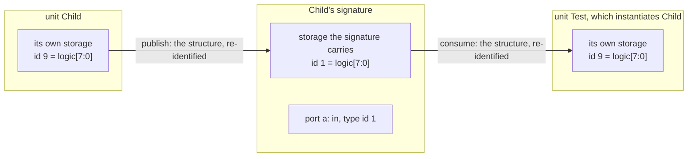

# Compilation Unit Model

## Purpose

Define what a compilation unit is, what it owns, and the rules that make it self-contained: the
signature it publishes across the boundary, and how another unit takes what it holds from that
signature and from nothing else.

## Owns

- The identity of the compilation unit as the primary semantic boundary of the compiler.
- The enumeration of compilation-unit kinds: module, interface, program, package, the scope of a
  compilation-unit input (`$unit`), a specialization of a package's or a `$unit` scope's generic
  class that no instance replicates, the design's root, and a text of Lyra's own it reads in beside
  the design (its definitions of the built-in package `std`'s classes, and the coverage library).
- The rule that a compilation unit compiles independently, given only its own contents and what the
  units it references publish: their signatures, and the parameter values of each lowering it
  reaches.
- The signature a unit publishes across the compilation boundary: the declarations other units may
  name, produced by the unit from its own contents and consumed by other units by name. What a
  signature contains follows the unit's kind, and its content is fixed by what its consumers read,
  not by an enumerated list.
- The rule that a reference into another unit resolves against what that unit published, where the
  referrer compiles, and that a name it did not publish is refused there.
- What a signature may carry: names, types, positions, coordinates and folded values, never an
  expression.
- The division between what a unit takes of another from the front end -- identity -- and what it
  takes from that unit's published statement -- content.
- The shape of instance records: minimal, structural, and free of semantic content that belongs
  inside the unit.

## Does Not Own

- The internal IR shape of any single layer (see [`hir.md`](hir.md), [`mir.md`](mir.md)).
- The hierarchy and generate ownership model (see
  [`hierarchy_and_generate.md`](hierarchy_and_generate.md)).
- Identity rules for declarations and references (see
  [`identity_and_ownership.md`](identity_and_ownership.md)).
- Which lowerings of one definition are one unit and how a unit is named (see
  [`specialization_model.md`](specialization_model.md)).

## Core Invariants

1. A compilation unit is the primary unit of compilation. Kinds include module, interface, program,
   package, the scope of a compilation-unit input, a specialization of a package's or a `$unit`
   scope's generic class that no instance replicates, whose parameters are written wherever it is
   named and which the scope declaring the generic therefore cannot hold, and the design's root,
   which no source declares and which builds each top-level instance
   ([`runtime_model.md`](runtime_model.md)). A unit holds exactly the declarations its own source
   fixes: a specialization is held by the scope that replicates it -- the innermost instance scope
   among the one enclosing it and those replicating each of its type arguments (LRM 6.22, 8.25) --
   and is a unit of its own where no instance replicates it.
2. A compilation unit's compile-time artifacts are class-level. They do not depend on any specific
   instance.
3. All semantic information needed to compile a unit is owned by the unit itself. Compilation never
   reaches outside the unit for semantic data.
4. Cross-unit access is only through explicit import or external reference mechanisms. Implicit
   cross-unit access is not allowed.
5. Parameters on a compilation unit are constructor or config inputs. They do not introduce
   per-instance compile-time identity.
6. Instance records carry only per-instance data: wiring, hierarchical position, parameter values,
   and runtime object identity.
7. The fully elaborated instance graph is not the compile-time model. The frontend may produce a
   full elaboration, but what is compiled is a unit and its bodies, and a lowering exists only for a
   body the frontend did not share. Instance expansion does not drive what is compiled, and
   compile-time identity does not depend on instance enumeration.
8. A unit's only cross-boundary surface is what it publishes: its signature, the set of declarations
   it publishes, whose content follows the unit's kind -- a package and a `$unit` scope publish
   their declarations, and a module or an interface publishes every declaration a hierarchical name
   may reach (LRM 23.6): its data objects and ports, its child instances, the statics of its named
   blocks and subroutines and its named blocks' disable targets, each stated with the named blocks
   and subroutines it sits in, the classes and covergroups it declares, whole, for an interface its
   views and the names each defines, its clocking blocks, its subroutines' signatures, and per
   generate construct the class each block was published as. Each generate block it elaborates
   publishes a class of its own the same way. A class a unit publishes is published with its
   declaration whole -- the type of each property it keeps to itself included and unnamed, every
   method with its prototype, its constructor's prototype, and the interface classes its declaration
   names -- and nothing an ancestor declares, so a class of another unit extending it is laid out at
   compile time and a call to one of its methods reads the callee there. An enumeration, an unpacked
   structure or an unpacked union it declares is published as what it declares, under the
   declaration a type naming it names. Beside the signature, each lowering publishes the value of
   every value parameter it declares, since lowerings one signature covers may hold different
   values. The unit produces its signature from its own contents, so nothing it publishes can
   contradict what it is. A unit that instantiates or references another depends only on that
   signature, identified by name, never on the other unit's body or internal ids. Units compile
   independently and in any order and are combined by matching names; they share no identifier space
   and exchange no internal state.
9. A signature names each class it publishes, and names which of them a referrer instantiates. A
   unit's name, the name of a class it declares, and where a backend places the emitted code are
   three separate facts; none substitutes for another, and a published class is never identified by
   name equality with its unit or by its position in a list. A signature names another unit's class
   by its declaring unit and published path, and an enumeration, structure or union another unit
   declares by its declaration alone, so deriving a signature reads no other unit; the definitions
   such a name reaches are taken from the declaring unit's signature once every signature exists.
10. A reference into another unit takes one form: a name on the target's signature resolves against
    that signature where the referrer compiles, and reaches the target's own access protocol. A name
    the target did not publish has nothing to compile against and is refused there; it is never
    resolved by name while the design elaborates or runs.
11. A unit's emission is a function of its own contents and what it consumes of what other units
    publish, and of nothing else. This is what makes a signature's content decidable: a fact absent
    from everything published cannot have reached a referrer, so it cannot invalidate one, and a
    signature is therefore exactly the set of facts a unit's lowering reads about another unit. A
    lowering that reaches a fact about another unit by any other path breaks that property, and the
    break is invisible until compiled units are reused, at which point it is a stale result rather
    than an error. **"Nothing else" includes the run that produced it.** Where the design's data
    landed in memory, and any order derived from that, are not among a unit's contents, so two runs
    over one unchanged design owe the same bytes. An emission that varies between them breaks the
    invariant exactly as a cross-unit leak does and is invisible for the same reason -- a simulated
    program cannot observe which of two orderings a set was written in, so nothing the design states
    can report it.
12. A signature carries the storage its own identities index. It is read where the publishing unit's
    storage is not, so an identity written on one addresses storage the signature itself holds,
    never the publishing unit's. A consumer takes the structure into its own storage and answers
    with its own identity for it, so what crosses the boundary is structure and nothing else. This
    is invariant 8's "never on the other unit's internal ids" applied to a fact too compound to be a
    name -- a type, whose value is a graph that ends at the declarations it names, whose definitions
    cross on their own.
13. Identity comes from the front end; content comes from the declarer. What the front end resolved
    the reader's own text to -- an instance, a declaration, a block, an index, the type it worked
    out for the reader's expression, a constant the language had it fold -- is the reader's and is
    taken as given. What that resolved to -- a declared type's definition, a member's type and
    storage, a parameter's value, a callable's prototype, a formal's default type, a clocking event
    -- is read from what the declaring unit published, through the one reader that records each read
    ([`incremental_build.md`](incremental_build.md) invariant 11).
14. A signature carries names, types, positions, coordinates and folded values, and never an
    expression, since an expression is a graph over the publishing unit's storage that no consumer
    can take into its own. So what a module port reaches is a projection: a published member and a
    closed path of selectors into it, the whole member being the empty path, or nothing where the
    port connects to nothing inside the unit (LRM 23.2.2.1). A port bundling several names is one
    part per name, each with its own direction and type. An input port's default (LRM 23.2.2.4) and
    a name a view offers only for reading (LRM 25.5.4) are expressions of the declaring unit, so
    each crosses as a published subroutine the declaring unit evaluates it in, beside the members it
    reads where a wait has to watch them.
15. A view (LRM 25.5) publishes only the names it defines for itself. An identifier it did not
    rename is the interface item, resolved against the published members as on an unrestricted port,
    so nothing about the view crosses for it. A name it renamed and admits a write to designates
    storage (LRM 25.5.4 through 23.3.3), so it is published as one projection per declaration the
    expression joins, most significant first, together with the name's own type. A name offered only
    for reading is the subroutine of invariant 14. The direction a view declares is on no signature,
    since no lowering reads it: it decides which of the two a name is.
16. Every name a scope declares is known before any body of that scope is walked, since a
    subroutine, a variable initializer or a class body of the scope may name any declaration of it
    in any direction (LRM 13.7, 8.27); and a class appears in a signature by its declaring unit and
    path, which exist before its declaration is settled.
17. An interface a type names is a unit whether or not any instance of it exists: code reaching
    through a virtual interface compiles against that interface's signature, and a declaration of a
    parameterization no instance has is legal (LRM 25.9).
18. A published member states which storage it is -- a variable's observable cell, a net's resolved
    cell, a reference bound to another's storage, or a borrowed reference to another unit's object,
    which an interface port and an instance the scope declares both are -- and one function of that
    statement gives the cell the member holds, computed alike by the declaring unit and every
    referrer. The statement comes from the declaring unit's own declaration, the one source a
    referrer could not read without reaching past the signature, and a function both sides compute
    makes a disagreement unspellable where a value carried between them would only hide one. A
    member that holds another unit's object names the class of the kind bound there in every unit
    that holds it, so the declaring unit and each unit filling or reading it spell one member alike.

## Boundary to Adjacent Layers

- The compiler defines the compilation unit model. The frontend provides source material and
  elaboration; it does not define what a compilation unit is or which compilation units exist.
- The runtime constructor consumes compile-time artifacts and per-instance records to build the
  object graph.
- [`reference_resolution.md`](reference_resolution.md) defines how the cross-unit access named here
  is resolved: checked where the referrer compiles, and executed as typed steps.
- [`specialization_model.md`](specialization_model.md) owns which lowerings are one unit and how a
  unit is named; this doc owns what a unit is and what it publishes.
- [`incremental_build.md`](incremental_build.md) owns when a signature is derived relative to the
  bodies that consume it, and the parallelism that ordering permits. This doc owns what a signature
  contains and who may name it; that doc owns the order the units' work runs in.

## Forbidden Shapes

Each shape below fails a requirement of [`north_star.md`](north_star.md) or an invariant above.

- Per-instance semantic tables consulted at compile time (variable lists, resolver maps keyed on
  instance identity). It fails invariant 2.
- A compilation unit reaching through a global or design-level lookup to answer a question about its
  own declarations. It fails invariant 3.
- Instance records that carry a copy of the unit's semantic state. It fails invariant 6.
- Maps keyed by `(instance_id, local_symbol)` used to resolve a reference inside the unit. It fails
  invariant 2: what the unit compiles would then follow its instances.
- Implicit cross-unit access that bypasses explicit import or external reference. It fails
  [`north_star.md`](north_star.md) invariant 5.
- A design-wide index, ordinal, or numbering that two units both depend on to refer to each other,
  including one naming a `$unit` scope by its position among the inputs. It fails
  [`north_star.md`](north_star.md) invariant 5: every unit would depend on the numbering, and adding
  one unit would rename another.
- Compiling one unit against another unit's body or internal ids instead of against its signature.
  It fails invariant 11: a body edit would reach every referrer.
- A signature defined as one fixed set of declaration kinds for every unit kind, or authored beside
  a unit rather than derived from it. It fails invariant 8: what a referrer may name is read off the
  language per kind, and an authored signature can contradict the unit.
- A field admitted to a signature because a reader thought of it rather than because a lowering
  reads it about another unit, and a lowering that reads such a fact through any path other than the
  signature. It fails invariant 11, from opposite ends: the first carries a fact nothing depends on,
  the second a dependency nothing records.
- A hierarchical name resolved by its text while the design elaborates or runs, for any name at all.
  It fails invariant 10: resolving at run time discards the check the signature exists to give,
  surfaces a type that differs between instances (LRM 23.8) at run time or not at all, and pays for
  an independence the declared dependency has already spent.
- A signature that publishes only what an instantiator needs. It fails invariant 8: what a referrer
  may name is LRM 23.6's set, so a narrower signature leaves a legal name nothing to compile
  against.
- A unit that knows or enumerates the units that reference it: a consumer list, a back-edge from a
  member to the references that read it, or code that resolves a reference on a referrer's behalf by
  pushing its own member outward. It fails [`north_star.md`](north_star.md) invariant 5: who depends
  on a signature is not part of the unit, and resolution is pulled by the referrer.
- An expression carried on a signature for the referrer to lower, or a referrer reading the
  declaring unit's source through the front end to learn what a port or a view's name means. It
  fails invariant 14 and invariant 11: an edit to that expression would change the referrer's output
  while changing no signature.
- A field holding a view's direction on a signature, or an entry published for a name the view did
  not rename. It fails invariant 11: no lowering reads either.
- Importing another unit's type definition while signatures are still being derived. It fails
  [`incremental_build.md`](incremental_build.md) invariant 8: the signature stage would gain an
  order.
- Treating "the design" as a compilation unit. It fails [`north_star.md`](north_star.md)
  invariant 5.
- Treating the frontend as the authority for compilation-unit identity, membership, or boundary. It
  fails [`north_star.md`](north_star.md)'s Forbidden Shapes: which elaborations the frontend found
  alike is read as given; which of them are one unit is this compiler's own comparison.
- Treating the elaborated instance graph as the compilation model, or allowing instance count to
  drive the number of compilation artifacts. It fails [`north_star.md`](north_star.md) invariant 2.
- A specialization of a package's or a `$unit` scope's generic held by the scope declaring the
  generic where its arguments come from another unit. It fails invariant 1: that scope's content
  would follow how other units use it, and two units would depend on each other where the program
  has one depending on the other.

## Notes / Examples

If resolving a name inside a compilation unit requires information not reachable from the unit
itself, the compilation-unit boundary has been violated. The fix is to move ownership inward, not to
add another lookup path outward.

### What crossing the boundary looks like

A compound fact -- a type, a class -- is not a name a consumer can simply read. It is a graph, held
in storage the publishing unit owns, addressed by identities that mean nothing anywhere else. So
three separate holdings exist for one such fact, and no two of them share an identity:



One type, three identities, and each is only meaningful in the holding that minted it. `Test` cannot
carry `Child`'s number and cannot carry the signature's; it takes the structure and answers with its
own. What travels is never an identity.

Two properties are what pay for this, and they are the two the north star asks for. One holding for
the whole design would remove the transfer, and with it both: a single holding has a single writer,
so no two units are lowered at once; and its numbering would depend on every unit in the design, so
a change anywhere would invalidate every unit compiled against it.

The transfer must also land on what the consumer already has. `Test` declaring its own `logic [7:0]`
and receiving `Child`'s must reach one identity, not two -- so the consumer's storage decides
identity by structure. Without that, which identity a construct carries would depend on the route it
arrived by, which is a difference between two things that are the same type. A declared type is the
exception by the language's own rule (LRM 6.22.1): it is its declaration, so it crosses as the
declaration's key and the reader holds its definition once.

**A module header is not the shape of a module's signature.** LRM 23.2.1 says a module header
defines the module's name, its port list, each port's direction and size, the type of data passed
through each port, the module's parameter constants, its package import list, and the default
lifetime of subroutines defined within it. That is what an instantiator needs. A hierarchical name
may reach far more (LRM 23.6): any variable, net, event, static of a named block or subroutine,
task, function, named block, generate block or instance, to read, write, trigger, call or disable.
The signature is that set, derived from the module's own declarations before any body lowers.

### A view's names

```systemverilog
interface Bus;
  logic [7:0] r, s;
  modport M (input r, output .Low(r[3:0]), input .Sum(r + s));
endinterface
```

`r` is not renamed, so `M` publishes nothing for it and a referrer reaches `r` as the published
member. `Low` is renamed and writable, so it is published as the projection `r[3:0]` with type
`logic [3:0]`, and every assignment form -- blocking, nonblocking, compound, continuous, a force --
reaches it as storage. `Sum` is offered only for reading, so it is published as a subroutine of
`Bus` evaluating `r + s`, with `r` and `s` beside it as what a wait on `Sum` watches.

### Naming a `$unit` scope

The scope of a compilation-unit input holds the declarations that lie outside any design element
(LRM 3.12.1). It has no name in the source and no parameters, so it is named by the one property the
standard defines it by, its input: a digest of the path of the source text its declarations lie in.
That name is stable across edits to the scope's body, differs between inputs, and is computed alike
by the unit and by every referrer, with no table between them.

The term "compilation unit" here is the compiler's own: a module, interface, program, package,
`$unit` scope, free-standing specialization, the design's root, or a text of Lyra's own. It is not
the LRM's "compilation unit" (LRM 3.12.1), which names the set of files whose `$unit` scope one such
unit holds; the two meet only there.
