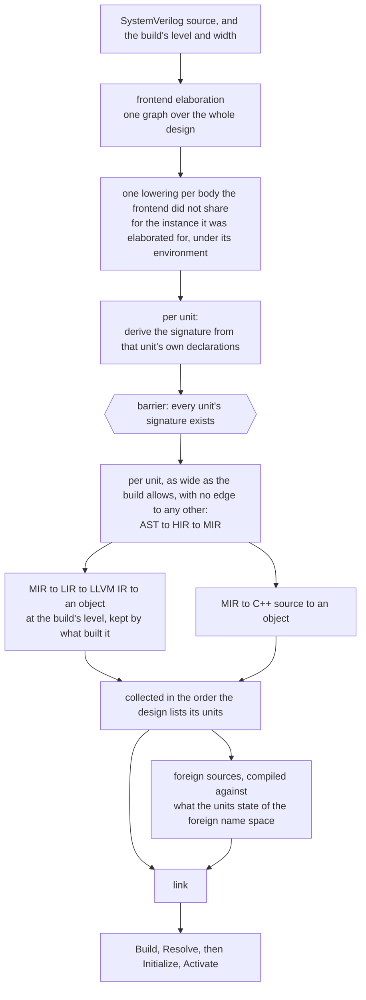

# Compiler Overview

The compiler holds to this contract except in three places. Units do not reach HIR side by side:
declaring a unit and lowering its bodies to HIR take turns, one unit at a time in the order the
design lists them, and only what follows a unit's HIR runs beside the other units
([`compiling_a_design.md`](compiling_a_design.md)). The lowerings of one unit are sorted into bodies
by a digest of their HIR dump's text, and a generate block's bodies are grouped by a digest of its
scope's dump the same way, so a lowering step reads a dumper's output, which invariant 8 forbids; in
both, the comparison that decides two are one body is still made on the HIR itself. And a failure
the compiler does not throw -- a fault in memory, an abort, a fatal error inside the code generator
-- unwinds nothing, so it collects nothing and names no place.

## Purpose

Define the compiler's worldview: the pipeline, what each stage produces, and the boundary between
compile-time and runtime.

## Owns

- The identity of the pipeline layers: HIR, MIR, LIR, LLVM IR.
- The definition of a compilation unit as the primary semantic boundary of the compiler.
- The chosen semantic model: object-oriented. Hierarchy is an object graph; construction is
  constructor-like logic; navigation is object-graph traversal. The model is not C++; C++ is one of
  the backend targets but does not define MIR's semantics.
- The contract that separates semantic modeling (HIR, MIR) from execution modeling (LIR, LLVM IR).
- The contract that separates compile-time artifacts (class-level) from runtime artifacts
  (object-level).
- The positioning of the two backends. The primary product is the execution backend, HIR -> MIR ->
  LIR -> LLVM IR, compiled ahead of time. The C++ backend is a secondary realization of the same
  MIR, and it stays. Its output serves two roles, as an executable artifact that builds anywhere a
  C++ compiler does, and the human-readable surface against which MIR's shape is validated from
  SystemVerilog source through MIR's semantic model. Being secondary does **not** loosen the
  mechanical-translation discipline: the C++ backend's render must remain mechanical at the LLVM-IR
  level (no decision logic in render, every entry a fixed function of one MIR node), so the one MIR
  feeds both backends without either deciding what it means.
  [`backend_contract.md`](backend_contract.md) owns this discipline; this doc owns its position in
  the pipeline. Debug inspection of HIR and MIR is separate: a dumper produces a textual traversal
  for a reader, while a backend is a real emitter. A dumper's wording is free to change and no test
  asserts on it ([`testing_strategy.md`](testing_strategy.md)). Dumpers and backends are both pure
  over their input IR and must not introduce or reinterpret semantics.
- What a run produces and reports: which failures stop it where, what it says about its own failure,
  and what it records of its own cost.

## Does Not Own

- The internal contract of any single IR layer (see [`hir.md`](hir.md), [`mir.md`](mir.md),
  [`lir.md`](lir.md)).
- The details of LLVM lowering and codegen.
- Runtime scheduling and simulation-engine design.

## The whole run, end to end

The four IR layers are the middle of a longer sequence. Each stage below has a doc that owns it;
this section owns only their order and where each one's boundary lies, so a reader arrives at those
docs knowing what stands on either side.

| Stage                          | Owned by                                                 |
| ------------------------------ | -------------------------------------------------------- |
| what a specialization is       | [`specialization_model.md`](specialization_model.md)     |
| what a unit publishes          | [`compilation_unit_model.md`](compilation_unit_model.md) |
| the barrier and what it buys   | [`incremental_build.md`](incremental_build.md)           |
| what each lowering may do      | [`lowering_boundaries.md`](lowering_boundaries.md)       |
| how a reference crosses a unit | [`reference_resolution.md`](reference_resolution.md)     |
| the four phases after link     | [`elaboration_lifecycle.md`](elaboration_lifecycle.md)   |

Two properties of the shape carry the north star's constraints, and both are read off the diagram
rather than argued: **exactly one stage before the barrier looks at the whole design, and exactly
one after it does** -- the frontend's elaboration, and the link. Everything between is per unit with
no edge to any other, which is what makes units compilable in isolation, in parallel, and in any
order. A stage that needs to see another unit belongs before the barrier or it does not belong.

Two things after the barrier wait on more than their own unit without reading any unit's work, and
neither is a third look at the design. What the units produce is collected in the order the design
lists them, whichever finished first, so the program and every name it is kept under are the same
however many ran at once. And a foreign source includes the header composed from what every unit
stated of the foreign name space, so it compiles once the last unit has been collected -- a
collection of statements, as the link is a collection of objects.

One thing on either side of the barrier is read by every unit, and it is not a look at the design
either: the frontend's elaborated AST, which elaborates what a reader first touches. How the units
read it at once is [`compiling_a_design.md`](compiling_a_design.md)'s.

### What a run produces when something fails

The first objective is the whole edit-compile-run-inspect loop ([`north_star.md`](north_star.md)),
and a compiler that reports one gap per run makes the loop's length the number of gaps. So a run
reports every gap it can reach, and a run that met any produces nothing, since what is short of the
design is not the design.

**Collect within a stage; stop between stages.** Every unit's declarations are attempted, then every
unit's bodies, each unit taken on below HIR as soon as its own are lowered, then the one
whole-design step; a failure inside a stage is reported and the stage goes on, and a stage that
reported anything is the last that runs. What makes a failure's neighbours still reachable is the
staging itself ([`lowering_organization.md`](lowering_organization.md)): nothing needs another
entity's body to be built, so a body that will not lower is reported and its siblings lower anyway,
while a declaration that will not settle ends its stage, because every later stage reads
declarations and would only report the want of one. A lowering abandons a body at its first refusal,
since the statements after it have no defined relation to one that was never built. The C++ backend
goes on through the body instead, because it is a rendering fold
([`lowering_organization.md`](lowering_organization.md)) and no node's text reads another's, so what
it writes after a refusal stands on its own; a unit that reported anything writes no file. A unit
whose own lowering broke one of the compiler's invariants is that unit's report: its pipeline reads
nothing another unit's writes, so the other units are still attempted, and a broken invariant ends
the unit rather than the body because it says the lowering's own state may be wrong. The checks that
hold a unit to what its consumers require do not run on a run that reported anything, which would
answer a stated gap with a bug report. None of this is a mode: no flag asks for the whole account,
because the run fails either way and the work of going on is work the next run would repeat.

**A request names the products it is answered with.** Asking the compiler for something is calling
the entry for what is wanted -- the elaborated source, the design's HIR, every unit modelled
semantically, every unit in the form something runs -- and no depth value, parameter or slot says
how far a run went. So a caller never asks whether a product it requested is there; the only absence
left means the run failed, and the account of why is in the diagnostic sink. Where a kind of thing
genuinely has no such product, the party that knows which kind it is says so in the answer's type.
clang's driver fixes its phase list before any work runs and rustc hands each stage's product to its
caller; here a command is the last stage, so what a run produced crosses back as a type of this
program, and being a type it is the request's to name.

### What a run says about itself

**The compiler's own failure says what it was working on.** On a design of a thousand units a broken
invariant that names only itself cannot be located without reducing the design by hand. The place
that fails does not know where it is, and the place that walks does, so each walk names the work it
is on ([`lowering_organization.md`](lowering_organization.md)) and a failure collects what was said
above it, as clang's pretty stack trace does. The report is one line, standing at the innermost
place in the source being lowered and carrying the unit and, below HIR, the function, which the
source cannot show; it renders through the same renderer as every report about the source, as a
diagnostic kind of its own, and a run that reported one exits with the status that says the compiler
failed.

**Asked, a run records where its cost went, and prints no summary.** `--time-trace <file>` writes a
trace through LLVM's profiler, the one clang's `-ftime-trace` uses: a lane per thread, a span per
stage, per unit within each stage, per scope a unit lowers and per function lowered or emitted, with
LLVM's own spans in the same lanes. `--stats-file <file>` writes what a span cannot: how many units
ran at once, each stage that runs alone with its peak resident memory, each body with every file it
left behind and whether this run made it or took it from the store, each body's count of each kind
of thing in each form it passed through, how many times each kind of work ran over the whole run,
and each tool the build ran with its wall and processor time. A count of work is taken where the
work is done, as LLVM's `STATISTIC` is, because a span says how long, which moves with the machine.
A reading of the two files -- a table, a slowest unit, a comparison of two runs -- is a tool's,
never the compiler's, as clang's trace is read by Perfetto; the project keeps
`tools/trace/report.py`, which compares counts exactly, sizes and peaks past a margin, and no time.
Stages of different units run at once on one heap, so they are measured together and a unit's size
is what it left behind; a tool the build runs is timed and its peak memory is not recorded, because
the only figure the system offers starts at the parent's high-water mark; and where the platform
offers no reading, the number is absent. Nothing is recorded unless asked.

## Which layer of another compiler each layer corresponds to

Lyra's layer names collide with other compilers' and do not line up with them. **Lyra's MIR is not
Rust's MIR; Lyra's LIR is.** A design question about a layer is surveyed against the layer that
plays the same role elsewhere, never against the one that shares its name.

| Lyra        | What it is                                                                                                     | rustc                                                                                                                                                  | clang                                                                                      | Swift                |
| ----------- | -------------------------------------------------------------------------------------------------------------- | ------------------------------------------------------------------------------------------------------------------------------------------------------ | ------------------------------------------------------------------------------------------ | -------------------- |
| HIR         | the source language as written, typed, with compiler identity                                                  | HIR and THIR (`rustc_hir`, `rustc_middle/src/thir.rs`)                                                                                                 | the AST Sema builds                                                                        | the type-checked AST |
| HIR-to-MIR  | the source language restated as a generic programming language                                                 | no counterpart: Rust needs no translation into a programming language                                                                                  | no counterpart, for the same reason                                                        | no counterpart       |
| MIR         | a generic high-level programming language: expression trees, structured control flow, classes, closures, calls | THIR's level (`rustc_middle/src/thir.rs`): typed expression trees with structured control flow, before any control-flow graph                          | the AST (`clang/include/clang/AST/Expr.h`, `Stmt.h`)                                       | the type-checked AST |
| MIR-to-LIR  | expression trees and structured control flow into a control-flow graph over places                             | MIR building (`rustc_mir_build/src/builder`), THIR to MIR                                                                                              | CodeGen's statement and expression emission (`clang/lib/CodeGen/CGStmt.cpp`, `CGExpr.cpp`) | SILGen               |
| LIR         | a control-flow graph over typed places and values, with no physical layout                                     | MIR (`rustc_middle/src/mir/syntax.rs`), with its shims and monomorphization (`rustc_mir_transform/src/shim.rs`, `rustc_monomorphize/src/collector.rs`) | no counterpart: clang goes from its AST to LLVM IR directly                                | SIL                  |
| LIR-to-LLVM | translation, answering every size, alignment and offset                                                        | codegen (`rustc_codegen_ssa/src/mir`)                                                                                                                  | the rest of CodeGen                                                                        | IRGen                |
| LLVM IR     | LLVM IR                                                                                                        | LLVM IR                                                                                                                                                | LLVM IR                                                                                    | LLVM IR              |

So a question about what a MIR node should be is asked of clang's AST and rustc's THIR. A question
about what LIR should hold, or where a body built for one type belongs on the execution backend, is
asked of rustc's MIR. A question about how an expression becomes a control-flow graph is asked of
rustc's MIR building and clang's CodeGen.

## Core Invariants

1. The compiler pipeline is HIR -> MIR -> LIR -> LLVM IR. No stage skips a layer.
2. Each IR layer has a distinct role. Semantic modeling lives in HIR and MIR. Execution modeling
   lives in LIR and below.
3. A compilation unit is the top-level semantic boundary. Kinds of compilation unit include module,
   package, and interface.
4. Compile-time produces class-level artifacts: shape, code, and metadata. Runtime constructs
   objects and installs relations.
5. MIR remains human-readable through its dumper; LIR does not reintroduce high-level semantics lost
   from MIR.
6. Lowering is one-way. A later stage does not write information back into an earlier stage.
7. The semantic model is object-oriented. Hierarchy is represented and navigated as an object graph;
   construction is constructor-like logic. The model is not C++ semantics; C++ is one backend target
   among possibly several.
8. HIR and MIR dumpers are debug-facing textual serialization. They are not compilation paths and
   are not consumed by any lowering step. They must remain semantically faithful to their input IR.
   _Requirement: a dump's wording is free to change for its reader, which holds only while nothing
   the compiler produces, or how much of it, depends on that wording; a digest a step needs is taken
   of the IR itself, as rustc fingerprints its IR rather than its pretty-printed text._
9. Backend emitters consume MIR -- the C++ backend directly, the execution backend through LIR --
   and produce executable artifacts. A backend is a first-class compilation stage, not a debug view.
   Every backend render entry is a fixed function of one MIR node; decision logic in render is a MIR
   design failure (see [`backend_contract.md`](backend_contract.md)). The C++ backend's role as the
   observation surface for MIR sharpens this discipline rather than relaxing it: a place where the
   C++ render would need decision logic is a place where the LLVM IR backend would too.
10. A run that reported anything produces nothing, and reports everything it reached: failures are
    collected within a stage and the run stops between stages. _Requirement: the edit-compile-run
    loop's length is not the number of gaps, and nothing short of the design is handed on as the
    design._

## Boundary to Adjacent Layers

- Upstream: the slang frontend produces elaborated-unit shape from SystemVerilog source. The
  compiler consumes slang's output and begins at HIR; a compilation the front end refused is not
  lowered.
- Downstream: LLVM IR is compiled to objects and linked with the runtime into a program. The runtime
  owns object construction and scheduling once the program starts.

## Forbidden Shapes

- **A pipeline stage that consumes and produces the same IR layer** fails invariant 2: a stage
  exists to retire one class of knowledge, and one that ends where it began retires none. The
  rewrites inside MIR's own phases ([`mir.md`](mir.md)) are not stages of the pipeline; they keep
  the layer and change only what its phase records.
- **Skipping an IR layer** (HIR to LIR directly) fails invariant 1.
- **Runtime execution logic in HIR** fails invariant 2.
- **High-level semantics reconstructed in LIR** fails invariant 5.
- **The elaborated design treated as a compilation unit** fails invariant 3 and the north star's
  incremental and parallel build: a unit that is the whole design rebuilds whole on every edit.
- **A compile-time stage that depends on per-instance identity** fails invariant 4.
- **The semantic model framed as "C++ semantics" rather than "object-oriented semantics emitted by
  one or more backends"** fails invariant 7: a second backend would then translate C++, not the
  program.
- **A dumper that diverges semantically from its input IR or introduces meaning not present in the
  IR** fails invariant 8.
- **A dumper's text treated as a backend artifact, or a backend's output treated as a debug view**,
  fails invariants 8 and 9: a test asserting on a dump pins text that is free to change, and a
  backend output nobody holds to the contract decides what MIR means.
- **The C++ backend's emitted readability traded for its compile time** fails the C++ backend's
  second role: its emitted text is how MIR's semantic correctness is validated, so compile-time wins
  come from the runtime library, build infrastructure (precompiled headers, parallel compilation),
  or backend-internal organization that does not change the emitted form.
- **The C++ backend's render treated as a place to decide what MIR means** fails invariant 9: the
  MIR it consumes is the same MIR the LLVM IR backend consumes, and a render entry that would need
  extra logic in LLVM IR is already wrong -- the MIR is the suspect, not the render.
- **A depth, a stage count or a set of optional slots describing what a run produced** fails the
  rule that a request names its products: every reader then has to know what its caller asked for,
  and an empty slot a reader trusted becomes a bug report at run time.
- **A flag asking for every gap, or a run that stops at its first one** fails invariant 10: two
  shapes for one question, and the cheap one costs the next run what this one already did.
- **A summary printed by the compiler** fails the rule that the compiler records and a tool reads: a
  table is a second statement of the trace, computed in a second place, and which reading is wanted
  depends on who reads.
- **A source location passed to every site that can fail**, or captured in the error type's
  constructor, fails the rule that the place that walks says where: the failing site does not know,
  a site that omits it fails silently, and the error type is shared with the runtime, where no
  design is being compiled.

## Notes / Examples

A compilation unit is a class. Compile-time produces the class definition -- its members, its
parameter signature, its constructor logic, and its callable bodies. Runtime executes the
constructor to instantiate objects and runs the callables under scheduler control to drive behavior.
The constructor expands generate `if` / `for` / `case` to build the object graph; processes
(`initial`, `always*`) are the class's runtime callables.

Concretely, `module Foo #(parameter N = 4) (...);` defines a class with an `N` constructor
parameter. `for (genvar i = 0; i < N; ...) ...` is a `for` loop in that class's constructor.
`if (N > 0) ...` is an `if` in that constructor. `initial begin ... end` is a class method
dispatched by the scheduler at simulation time zero. See [`runtime_model.md`](runtime_model.md) for
the contract that keeps the constructor context and the simulation context distinct.

Parameters on a compilation unit are constructor or config inputs. Per-instance data (wiring,
hierarchical position, parameter values) flows in at runtime construction. The compile-time model
remains class-level.

The compiler runs on Linux, and a stage's peak memory is read through what Linux offers.
