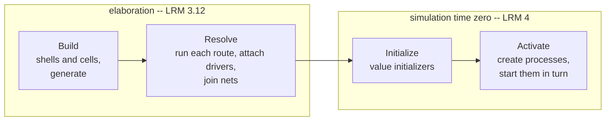

# Elaboration Lifecycle

## Purpose

Define the staged protocol that turns compiled, per-unit classes into a live, observable object
graph. A SystemVerilog instance does not become a semantically observable elaborated instance the
moment its C++ object is constructed; it becomes one only after a defined sequence of phases
completes. This doc owns that sequence and the rule that separates **allocation** (a C++
constructor's only job) from **SystemVerilog elaboration semantics** (structure building, topology
resolution, initialization, activation), which are distinct phases.

The driving principle:

> A generated C++ constructor is an allocation mechanism, not a SystemVerilog semantic executor.
> SystemVerilog elaboration is a staged graph-building and topology-resolution protocol, not
> recursive C++ constructor execution.

This is grounded in the language itself: elaboration -- expanding instantiations, computing
parameter values, resolving hierarchical names, and establishing connectivity -- occurs after
parsing and **before** simulation (LRM 3.12), whereas variable initialization and process execution
are simulation-time-zero activity (LRM 4). And it is forced by compiling per unit (`north_star.md`
invariant 2): a child's class is compiled without its parent, so a child built to completion by its
own constructor would run before anything bound it. Every cross-instance ordering hazard of a
recursive constructor -- a child read before its `ref` port is bound, pass-through `ref`, an
initializer that reads an upward reference, input and output initial-value visibility -- is that one
conflation.

## Owns

- The rule that elaboration is a staged protocol with four semantic phases: **Build -> Resolve ->
  Initialize -> Activate**, which may never be reordered, nor one phase observe a later phase's
  results. Build is the constructor; every scope class has one entry for each phase after it, and a
  phase with no work in a class is an entry with no statements rather than an absent one, so the
  runtime calls every entry and no consumer carries a case for a missing one. Whether an empty entry
  is worth emitting is the question of whatever removes dead code, asked there once.
- The rule that a generated constructor allocates the instance shell only -- each storage cell with
  its declared representation and its language default, firing nothing; port endpoint placeholders;
  the child table -- and runs no SystemVerilog semantic logic.
- The rule that a cross-instance connection is a statement of a resolve entry, compiled with the
  unit whose source writes it and run during Resolve against the final storage it names; Build
  records nothing of it.
- The rule that Resolve ends at a design-wide barrier: every reference bound, every driver attached
  and every connection joined before any initializer runs.
- The rule that variable initialization runs in Initialize, after that barrier, so an initializer
  observes only bound references and joined nets.
- The phase each port-connection realization belongs to, by port semantics.
- The order processes start in at time zero, which is bring-up's and not the engine's.

## Does Not Own

- The shape of the object tree and the faithfulness of generate expansion (see
  `hierarchy_and_generate.md`). Build constructs that tree; this doc owns only the phase ordering.
- What a cross-unit reference resolves into and the typed steps it takes (see
  `reference_resolution.md`). Resolve is _when_; that doc is _into what_ and _how_.
- What a net shows, and what joining two nets means (see `net_resolution.md`). This doc owns only
  that drivers attach and nets join in Resolve.
- Parameter and specialization strategy (see `specialization_model.md`). Baking versus flowing in is
  orthogonal to the lifecycle; this doc only requires structural parameters to be available by
  Build.
- IR shapes (see `hir.md`, `mir.md`).
- Event scheduling within simulation after Activate (see `scheduling.md`).

## The four phases



The end of Resolve is the barrier between the two halves: nothing to its right observes a reference
that is not bound, and nothing to its left executes a SystemVerilog body.

### Build

Construct the instance shell and the structural object graph. This phase runs the unit's
**structural** elaboration: it applies the parameter environment, evaluates generate (`if` / `for` /
`case`) to decide which children exist, and creates child shells (recursively). It records no
connection: a port connection, a hierarchical reference, an alias binding and a driver are each a
statement of the resolve entry of the class whose source writes it, compiled with that class's unit,
so each exists before any instance does and Build has nothing of them to make. Each cell takes its
declared representation and its default as the object is built, so a reference bound to it in
Resolve names storage that exists, and a later store is held to that representation rather than
fixing it by running first. A net fixes what its declaration gives it -- its type, its fold and the
contribution its net type makes (`net_resolution.md`). Build does **not** execute any value-level
SystemVerilog body: no variable initializer, no process body, no port read, no reference
dereference.

Generate is Build-phase logic: its conditions are constant expressions (LRM 27.5), available from
the parameter environment, so generate never depends on Resolve. A nested scope's parameter
environment includes every constant of the scopes enclosing it in the same instance -- a loop
block's index and what the block settles from it (LRM 27.4) -- and each of those is settled while
its own scope is built, before any scope inside it is. A reference whose route is only parent edges
within the instance passes nothing that can be missing, so it has nothing to resolve: it is walked
where it is used, by a generate construct during Build exactly as by a process later. The language
confines a constant expression to constants (LRM 11.2.1), which only such references reach, so
nothing one reads waits on Resolve; every reference descending into a scope, or crossing into
another instance, does.

### Resolve

With the full shell graph in existence, execute each reference's route, once. Each route is typed
navigation through the classes the referrer compiled against -- its own, and those other scopes
published -- with one runtime query only where an upward name finds its anchor; nothing is looked up
by name. The front end has proved that every route reaches a constructed object -- a name into an
unselected generate arm, or past the end of an instance array, is its error -- so a route that finds
nothing is a compiler defect, never a value substituted at run time.

A route ends at the final storage it names. A `ref` port, or any reference, bound from another
reference binds what that one names, so a forwarding chain of any length ends at a direct final cell
and costs one bind per link: a pass-through `Top.z -> Mid.r -> Leaf.r` leaves both `Mid.r` and
`Leaf.r` denoting `Top.z`'s cell. Resolve walks the tree from the root, each scope's routes before
its children's, so a reference a child's route reads through has been bound by the parent that
connects it; a route that would read a reference bound later in the walk is a dependency the walk
must be extended to order before it is admitted.

Resolve also attaches every driver, local or cross-unit -- they differ only in whether a route is
traversed first -- and joins the nets each bidirectional connection and `alias` places in one
resolution (`net_resolution.md`). Joining is commutative and associative and nothing observes a net
before Initialize, so a connection joins its nets the moment its route resolves, in whatever order
the walk reaches it. A module defining an interface's `extern` subroutine binds its callback on the
interface in its own resolve, so every definition is in place before any initializer or process
could call one ([`callable.md`](callable.md) invariant 13).

Nothing runs between Resolve and Initialize, because nothing is left to check there: whether a route
reaches a constructed object is the front end's, so is how many drivers a net may have
(`net_resolution.md` invariant 6), chains end at their final cell as they are bound, and joins are
final when the walk ends. A phase there is owed by the first construct that cannot be applied as its
route resolves.

### Initialize

Execute SystemVerilog variable initializers (LRM 6.8 / 10.5). This runs after Resolve, so an
initializer reads only bound references: a port read returns its bound source's value, an upward
reference reads its target cell, a `ref` read denotes the final aliased storage. This is simulation
time-zero activity, not construction, and a run-time error raised here is one of the simulation's
(`scheduling.md`).

Within a scope, every member's declared default is in place before any initializer runs, and the
initializers run in the order the source declares them, since one may read another declaration of
the scope -- a handle assigned an object whose constructor names a static property. A member the
source gives no initializer keeps its default (LRM Table 6-7), with no case of its own. An owned
child, a reference slot and a net take no initializer: a child is built by its own construction, a
reference is bound by its route, and a net's value comes from its drivers. The walk is parent-first,
and the design root runs every package's and compilation unit's initializers before the top
instances', each such unit's entry running those of the units it reads first, so an initializer that
reads another unit's cell reaches it initialized (LRM 26.2).

### Activate

Create every process and begin simulation: install continuous-assignment, port and `always`
processes, seed `initial`, arm event controls and sampled places, and enter the scheduler. Every
reference is bound before this phase. Arming a sampled place belongs here rather than earlier
because its default sampled value is the value its declaration assigns (LRM 16.5.1), which
Initialize has just stored.

A continuous driver has produced nothing before this phase: a net holds what an undriven one does
and a variable its declared initial value. At time zero the processes start in turn, each turn once
the one before it has run to its first waits:

1. every `always` and `always_ff` procedure, the clocked processes the compiler makes for a sampled
   value function and a concurrent assertion, and each clocking block's sampling (LRM 14.13), so
   each is waiting;
2. every continuous assignment and port connection, so the first value a driver produces is a change
   a waiting procedure sees (LRM 4.9.1, 4.9.6);
3. every `initial` procedure, so it reads what a constant drives;
4. every `always_comb` and `always_latch`, triggered after all initial and always procedures have
   been started (LRM 9.2.2.2, 9.2.2.3).

The standard leaves the rest of the order open (LRM 4.7, 9.2). A register whose only reset is an
asynchronous one tied to a constant is reset by nothing but that constant's first value, which is
why drivers follow the `always` procedures; an `initial` reading an input port tied to a parameter
is why they precede it. A program's processes take the same turns in the reactive region set, once
the design's have settled (LRM 24.3.1). Each process is registered as the kind it is, and nothing in
a unit's code states a position: a turn is released into the Active region of its set and the next
is placed where Inactive begins, so the engine's loop is unchanged (`scheduling.md`).

## Core Invariants

1. **Elaboration is staged; the constructor only allocates.** The four phases run in order. A
   generated constructor produces an inert shell; it executes no variable initializer, no process
   body, and no port or reference read. Serves LRM 3.12 and 4, and compiling per unit: a child's
   constructor cannot see what its parent will bind.
2. **Build before Resolve, system-wide.** Every shell exists before any cross-instance reference is
   resolved, because a route may reach any instance of the design.
3. **Connections are code that runs only in Resolve.** A port connection or cross-unit reference is
   a statement of the resolve entry of the class whose source writes it, compiled with that class's
   unit, so stating a connection never requires the other endpoint to exist, and nothing runs it
   before Resolve.
4. **Resolve respects dependency order.** A reference whose route reads another reference is bound
   after that reference. The top-down walk realizes this for every route admitted so far; a route
   the walk does not order is admitted only with a mechanism that does.
5. **Resolve ends at a design-wide barrier.** No reference observable at or after Initialize is
   unbound or a reference to another reference, and every join and driver is in place. Serves LRM 4:
   an initializer is simulation and must read the connected design.
6. **Initialize after Resolve.** A variable initializer observes only bound references and joined
   nets, never an unbound reference or an unconnected port.
7. **Parent-edge ownership.** A connection whose behavior evaluates a parent-side actual expression
   or depends on parent-side sensitivity is realized as a **parent-owned reactive process**,
   registered in Activate. The child is compiled without the parent and cannot know the parent's
   expression, read-set, or scheduling (`north_star.md` invariant 2).
8. **No body runs before Initialize, and no process before Activate.** SystemVerilog-visible
   time-zero ordering is a property of these phases, never an accident of when a C++ constructor
   returns.
9. **The hot path resolves nothing.** Simulation-time reads, writes, and observations through a
   route that descends or crosses an instance reach bound endpoints; one that only climbs to an
   enclosing scope of the same instance follows a fixed number of parent edges, which is neither
   traversal nor lookup. Whatever mechanism orders Resolve exists only at elaboration. Serves the
   iteration-time target (`north_star.md` invariant 1), which simulation time is part of.
10. **The time-zero order is bring-up's.** Which turn a process starts in follows from the kind of
    process it is and is placed by bring-up through the engine's existing placements; neither the
    engine nor a unit's code states it.

## Boundary to Adjacent Layers

- **The language (LRM 3.12, LRM 4).** Elaboration -- expanding instantiations, computing parameters,
  resolving hierarchical names, establishing connectivity -- happens after parsing and before
  simulation; this is **Build + Resolve**. Variable initialization and process execution are
  simulation-time-zero; this is **Initialize + Activate**. The phase split mirrors the elaboration /
  simulation boundary the language already draws, and so does what an error raised in each is: one
  raised in Build or Resolve precedes the simulation, one raised in Initialize or Activate is the
  design's run-time error (`scheduling.md`, How a run ends).
- **`runtime_model.md`** defines the constructor / simulation execution-context split. This doc
  refines that split into the four phases.
- **`reference_resolution.md`** owns _what_ a route's steps are and what its endpoint becomes. This
  doc owns _when_: every cross-instance reference resolves in Resolve and is read on the hot path
  after Activate; a reference that only climbs to an enclosing scope of the same instance resolves
  in no phase, being walked where it is used.
- **`net_resolution.md`** owns what a driver contributes and what a join forms; drivers attach and
  nets join in Resolve, and a driver's first value is a process of Activate's second turn.
- **`hierarchy_and_generate.md`** owns the object tree this lifecycle builds; generate is
  Build-phase constructor-time logic.
- **`specialization_model.md`** owns parameter strategy, orthogonal to the lifecycle.
- **`mir.md`** states each phase's work as statements of that phase's body; a member declaration
  carries its type and no initializer, so every backend renders construction-time work from one
  statement list.

## Forbidden Shapes

- A generated constructor that executes SystemVerilog semantic logic -- a variable initializer, a
  process body, a port read, a reference dereference. It fails LRM 4, which makes each of them
  simulation, and invariant 1: the constructor runs before anything bound the instance.
- Resolving a cross-instance reference inside the constructor that builds the subtree. It fails
  invariant 2: a child must then be fully constructed before its parent can bind it, which is the
  pass-through `ref` hazard and the construction-time-read hazard.
- Running a variable initializer before Resolve completes. It fails invariant 6: it can observe an
  unbound reference or an unconnected port.
- A reference that remains a chain (a reference pointing at another reference) or unbound after
  Resolve. It fails invariant 5, and costs every access a walk the bind could have made once.
- Resolution dispatched on the front end's lexical-form classification or on source order. Every
  route is the same typed steps whatever form named the target; an upward name resolved later than a
  downward one orders by spelling rather than by dependency, failing invariant 4.
- A scope registering its declarations or children under their names during any phase, so that
  Resolve can find a target by its text. A hierarchical name's target is fixed where the referrer
  compiles; registering names costs every instance a record per declaration, which fails the
  iteration-time target, and turns a compile-time check into an elaboration-time failure.
- Realizing a port connection that evaluates a parent-side expression as anything other than a
  parent-owned reactive process, or relocating that process into the child. It fails invariant 7. A
  connection that is a whole variable of the port's type evaluates nothing and runs no process: its
  sink names its source's storage ([`reference_resolution.md`](reference_resolution.md) invariant
  6).
- Realizing a `ref` port as a persistent cross-unit slot or a value-cell access path. A `ref` port
  is a reference bound in Resolve to the final cell; it owns no child-side cell and needs no
  simulation-time reach from the parent, so anything more fails invariant 9.
- Letting "when the C++ constructor returns" determine any SystemVerilog-observable ordering. It
  fails invariant 8.
- Reading a route's endpoint on the simulation hot path via descent or a crossing into another
  instance. It fails invariant 9.
- Two MIR mechanisms for code that runs at construction or at bring-up -- an initializer field on a
  member declaration beside the phase's statements. Every backend then reads construction-time work
  from two places, which fails `backend_contract.md`'s single statement of each operation.
- A time-zero order carried by the engine -- a turn number on each activation that the slot loop
  reads. It fails the engine's invariant that it branches only on queue and region
  (`scheduling.md`).

## Notes / Examples

**The three port semantics land in different phases.** Each is stated in the parent's code and none
is made in Build; their realization differs.

| Port               | Realization                                                                                                                                                                                                                                                                  | Phase              |
| ------------------ | ---------------------------------------------------------------------------------------------------------------------------------------------------------------------------------------------------------------------------------------------------------------------------- | ------------------ |
| `input` / `output` | as [`reference_resolution.md`](reference_resolution.md) invariant 6 states: each side that is a reference is bound in Resolve, and wherever the connection is not a whole variable of the port's type the implied continuous assignment is started in Activate's second turn | Resolve + Activate |
| `ref`              | a reference; the child's reference member bound to the actual's final cell                                                                                                                                                                                                   | Resolve            |
| `inout`            | the two nets joined into one resolution over the contributions of both (`net_resolution.md`); no process, no driver, no sensitivity                                                                                                                                          | Resolve            |

**Pass-through `ref`.**

```
module Mid(ref int r);
  Leaf c(.r(r));
endmodule
```

Two binds are stated: one in the parent's resolve entry makes `Mid.r` an alias of the parent's
connected cell, and one in `Mid`'s makes `Mid.c.r` an alias of `Mid.r`. The parent binds `Mid.r` in
its part of the walk; `Mid` then binds `Mid.c.r` from `Mid.r`, which takes what `Mid.r` names, the
final cell. Binding is not a constructor step, so `Mid`'s constructor building `Leaf` before `Mid.r`
is bound observes nothing unbound.

**An initializer that reads a port.**

```
module Child(ref int r);
  int x = r;        // construction-looking, but a simulation-time-zero read
endmodule
```

`x = r` runs in Initialize, after `r` is bound in Resolve, so it reads the aliased cell's value. In
a recursive-constructor model this read would execute during `Child`'s construction, before the
parent bound `r`.

**A sibling-of-sibling hierarchical reference.**

```
module Top;
  if (1) begin : a int ax; always_comb from_b = b.bx; end
  if (1) begin : b int bx; always_comb from_a = a.ax; end
endmodule
```

Both `b.bx` and `a.ax` are routes stated in the code compiled for Top's unit. Build constructs `a`
and `b` in either order and walks neither route. Resolve walks each route through the typed parent
edge into Top and the typed member access into the sibling's class; neither route depends on the
other's resolution. `always_comb` bodies read bound endpoints; the source order of `a` and `b` does
not affect mechanism.

**Baked parameters are orthogonal.** When a parameter is baked into a specialization, "apply the
parameter environment" in Build is trivial (the value is a compile-time constant in that
specialization). When parameters instead flow in as constructor inputs, they are an incoming binding
that must be available by Build. Either way the phase ordering is identical; the lifecycle does not
depend on the parameter strategy.
