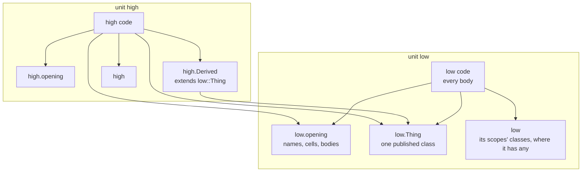

# Emission Model

## Purpose

Define how a backend turns per-unit MIR into runnable artifacts while preserving the independent,
parallel compilation that [`north_star.md`](north_star.md) requires. This doc owns the **emit-side
realization** of the compilation-unit boundary and of cross-unit reference resolution: what one
unit's emitted artifact may depend on, how cross-unit access is expressed without breaking unit
independence, and what role the runtime SDK plays as the link-time-resolution substrate. It is the
layer between the principle in [`reference_resolution.md`](reference_resolution.md) (a cross-unit
reference is checked against what the target published where the referrer compiles, and executes
once at construction) and the backend code that must obey it.

Both backends exist, and the rules here are stated for any backend. Each unit is emitted as the
declarations a referrer compiles against and a code artifact realizing each body of it; the program
is formed by compiling each artifact and linking the results, so no unit's bodies are read while
another is compiled, and each compile is an action kept under the digest of what it reads
([`incremental_build.md`](incremental_build.md)), so a build compiles again only what came out
different.

## Owns

- The rule that a backend emits, per compilation unit, a signature artifact and a code artifact per
  body, and that the program is assembled by linking those artifacts -- never by a single artifact
  that aggregates many units.
- The set of inputs one unit's emission may depend on: its own MIR, the signatures of the units it
  references, and the runtime SDK.
- The contract that a reference into another unit is a typed access against the class that unit
  published, resolved where the referrer compiles and executed once at construction, and that the
  referrer's emitted artifact never embeds what lies outside that published class -- what lowering
  adds to the unit's realization, or the object's size -- and never names a unit it does not
  reference.
- The rule that what a change recompiles follows the parts of signatures a referrer's artifact
  names, not the files it reads.
- The role of the runtime SDK as the substrate that stands in for link-time symbol resolution and
  (under LLVM) intrinsics.
- How a definition several artifacts state is kept once.

## Does Not Own

- Where the runtime library lives and how a binary locates it (see
  [`runtime_distribution.md`](runtime_distribution.md)).
- The foreign-language ABI surface an emitted project publishes to a user's own sources (see
  [`foreign_interface.md`](foreign_interface.md)). Each unit states its own part of that surface and
  the build assembles the union, so it is no exception to the per-unit rule below; what the name
  space is and who checks it lives there.
- The compilation-unit boundary itself and what a unit's signature is (see
  [`compilation_unit_model.md`](compilation_unit_model.md)).
- When and into what a cross-unit reference resolves, semantically (see
  [`reference_resolution.md`](reference_resolution.md)); this doc owns only how a backend _realizes_
  that resolution.
- The object-graph shape the resolution navigates (see
  [`hierarchy_and_generate.md`](hierarchy_and_generate.md)).
- IR-layer shapes (see [`mir.md`](mir.md), [`lir.md`](lir.md)), including which of a unit's
  definitions every body states alike.
- How many compiles a build runs at once (see [`compiling_a_design.md`](compiling_a_design.md)).

## Core Invariants

1. **A signature per unit and a code artifact per body it is compiled to; the program is linked, not
   aggregated.** A backend emits each unit as a signature and a code artifact for each body of it.
   The signature is derived from the unit's declarations alone, so it completes without lowering a
   single body; the code carries the bodies. No emitted artifact contains the bodies of more than
   one unit, and none enumerates "all units": the design root's construction tables name the body
   every instance is, which is the elaboration's answer for this design and changes only when its
   hierarchy does, never another unit's code. The program is formed by linking the per-unit
   artifacts. This is what keeps compilation parallel and incremental
   ([`north_star.md`](north_star.md) invariants 4, 5), and the split is what makes it pipelined: a
   unit's referrers compile against its signature while its own code is still being emitted.

   **A signature is one artifact and may be more than one file.** Where the target reads
   declarations in an order and reads each file once, the files have to be no coarser than what the
   order is actually over -- otherwise a design whose declarations can be ordered has files that
   cannot, and a correct program is refused for the shape of its artifacts, which
   [`north_star.md`](north_star.md) invariant 3 forbids. A declaration reaches another unit through
   a pointer, which needs the other class declared and nothing more, in every case but two: a class
   extending another unit's class (LRM 8.13, 8.26), and a structure holding another by value, each
   of which needs the definition complete. So each such declaration is a file of its own, and the
   graph of what reads what is the graph of what extends and holds what, which no program can make
   circular. Which file a declaration is written in is the backend's own business and no consumer of
   the signature reads it.

2. **A unit's emission depends only on itself, the signatures of the units it references, and the
   SDK.** The inputs to emitting unit U are: U's own MIR; the signature of each unit U references;
   and the runtime SDK. U references a unit it instantiates, one it holds a handle to an instance
   of, one it calls a receiver-less callable of (LRM 26.3), and one it reads or writes a static
   variable of by name (LRM 26.2). U's artifact never depends on a unit it does not reference, on
   another unit's code, or on a declaration that unit did not publish
   ([`compilation_unit_model.md`](compilation_unit_model.md) invariant 8). Because those are the
   only inputs, a fact absent from every signature cannot have reached U, so it cannot invalidate U
   ([`compilation_unit_model.md`](compilation_unit_model.md) invariant 11).
3. **The runtime SDK is the link-time-resolution substrate.** Cross-unit operations the referrer
   cannot resolve from its own inputs are expressed as SDK operations. In the C++ backend the SDK is
   the runtime library; under LLVM its operations become intrinsics the linker resolves. A backend
   never invents a second cross-unit mechanism outside the SDK.
4. **A route that descends or crosses an instance executes once in Resolve and binds its endpoint.**
   A route of parent edges within the instance has nothing to resolve and is walked where it is
   used. Either way the simulation-time read and change observation perform no per-access lookup
   ([`reference_resolution.md`](reference_resolution.md) invariants 3, 5).
5. **Every step of a route is a typed access.** A route is an anchor, steps and a leaf, and each is
   compiled against a declaration the referrer has: a class the emitting artifact owns, or a class
   another unit published. Realization is typed navigation -- through a stable MIR member identity
   when the artifact owns both classes, and through the member's name resolved against the published
   class at the referrer's compile time when it does not. The emitted code reaches the next pointer
   or member via a typed access expression, steps into a generate block through the construct's
   published entry viewed as the block's published class, and calls a published subroutine through
   the object. No step carries a string and none is an SDK lookup by name; the one SDK call a route
   may make is the anchor of an upward name, which asks for the nearest enclosing scope of a class
   and downcasts statically to it. The bound endpoint is one access point however many steps the
   route contained.

6. **A scope is two classes: the published part and the realization extending it.** The published
   part holds the published members first, in the order the publication states, and one virtual
   method per subroutine, which the realization overrides with its body; the realization adds what
   lowering adds -- a slot per route, process state, the homes of closures. A referrer compiles
   against the published part alone, reads a member at its offset there and calls a subroutine
   through the object, and never needs the object's size, because the declaring unit's own entry
   makes every object of it: the entry is published with the values an instance is handed, typed and
   in the order the unit declares them. That entry, a class's constructor, is linked under a symbol
   of its own category composed from the parts that name the class, in one place
   ([`identity_and_ownership.md`](identity_and_ownership.md) invariant 4). Which body a child
   instance is belongs to the construction, not to the parent's code
   ([`specialization_model.md`](specialization_model.md) invariant 6), so a parent makes a child
   through the entry its construction table names for that child, never by naming a body's entry
   itself, and the design root's tables are where every body's entry is named. No route reaches a
   scope by name: a scope keeps its hierarchy segment, and a scope class the records of the scopes
   it declares and its DPI-C export table, for the names `%m` prints and foreign code gives and
   takes (LRM 35.5.3, 38.21), and none of them is a lookup a route reaches.
7. **A change recompiles exactly the referrers whose artifact names a part that changed.** A change
   confined to a unit's bodies changes only its realization, so it changes no signature and
   recompiles no referrer. A change to a declaration changes what the unit publishes and recompiles
   every unit whose artifact names it, which is the dependency being real rather than the mechanism
   being coarse.

   **A referrer's artifact names a part of a signature, not the unit whole.** What a unit publishes
   is its namespace and each class it published, and a reference names one of those; naming only
   that one is what keeps a change to a class nobody named from reaching anybody's compile. A
   referrer that only holds a pointer to another unit's class names that class and depends on
   nothing in it; it depends on the class's definition only where it reaches a member. Which
   referrers are lowered again is a different question, answered by what each lowering read
   ([`incremental_build.md`](incremental_build.md) invariant 11), and a referrer lowered again where
   nothing its artifact names changed writes the same text, which nothing then compiles again.

8. **A published member is placed by the publication, and nothing lowering adds can move it.**
   Because the published part leads the object (invariant 6) and everything the realization adds
   sits after it, a referrer and the declaring unit compute one offset from the same declarations. A
   body edit therefore moves no published member, and a referrer's access to one costs what an
   access to its own member costs, with nothing dispatched.

   **A published class is named from declarations alone, and how many classes realize it is no
   referrer's concern.** A generate block is a definition nested in the scope holding it, and each
   block instance is an application of it; an application is one published class, named before any
   body lowers. Block instances of one application are that class realized once per distinct code
   they come out as, each realization extending it and found by comparing what the blocks state. A
   unit is the same one level out: instances whose code comes out differently are one unit compiled
   to more than one body, each a compilation of its own that states the classes the unit published
   and the classes it declares alike, so the link keeps one of each; what a declared class's
   operations do is the code of each body, reached through the instance an object belongs to. A
   definition every body states alike names nothing a body numbers among its own -- a closure, a
   class or a function only that body states -- since the copy the link keeps stands in for the
   others. A referrer names the published class and is unaffected by how many realizations stand
   beneath it, so a body edit that changes the count changes nothing a referrer read.

9. **The design's own link-level unit is a unit, and invariant 2 binds it.** A design needs one
   artifact nothing in the source declares -- the one whose construct elaborates the design by
   building the tops. It is synthesized rather than lowered from a source module, and that changes
   nothing about what it may read: the signatures of the units it references -- the class each top
   is, and which units are namespaces it must bring up -- and the construction the design was
   elaborated with, whose tables name the body every instance below a top is; it reads no unit's
   contents. Work that cannot be expressed that way is not this unit's, and the party it belongs to
   is whoever runs after compilation. Symbol uniqueness across units is the linker's, by the same
   mechanism any target uses for a definition several artifacts emit. Composing what each unit
   registers -- an initialization order, the union of a foreign name space -- is the runtime's or
   the build's. A compiler that does either itself has to read every unit, which is the one thing a
   unit boundary exists to forbid.

10. **A backend is a choice of linker, not a choice of pipeline.** What an artifact is varies -- an
    object file, a target-language source compiled separately, a module loaded into an execution
    session -- and so does the party that resolves names across artifacts. Nothing upstream of the
    artifact varies with that choice. An execution session is a linker: it resolves symbols across
    modules as it loads them, which is the same job a system linker does earlier. So a backend that
    needs a different pipeline shape from another backend has put something in the wrong place, and
    the thing in the wrong place is upstream of both.

11. **An artifact several units may write has a canonical identity, and its content is a function of
    that identity alone, never of which units ask for it.** A container type's header and the code
    file of what is needed wherever the type is named are identified by the type; an operation of
    the type that only some units call is identified by the type and the operation, and is a file of
    its own. Every unit asking for one writes the same text, a unit asking for it adds nothing to
    what another unit's artifacts hold, and the build keeps one copy for the link. A file whose
    content followed the set of units asking for it would depend on the whole program, so an edit to
    one unit would change what others share, which invariants 1 and 7 rule out. Which artifact a
    definition goes in is the backend's packaging; which definitions exist, and what each does, is
    decided above it.

12. **A symbol several units define takes a merge rule, never an owner.** A foreign name a scope
    exports (LRM 35.4) belongs to no compilation unit's name space, and LRM 35.4 lets several scopes
    declare one. So every unit declaring a scope that exports the name defines its symbol, from the
    name and the prototype alone, the definitions are one text, and the party resolving names across
    artifacts keeps one. The rule chosen keeps a definition nothing in the emitting language
    references, since such a symbol is reached only from outside it. An owner chosen among the
    declaring units would need every unit to know the others.

## Boundary to Adjacent Layers

- [`compilation_unit_model.md`](compilation_unit_model.md) defines the unit and its signature; this
  doc defines what a unit's _emitted artifact_ may depend on, which is exactly those signatures plus
  the SDK.
- [`reference_resolution.md`](reference_resolution.md) defines a route's steps and the binding
  contract; this doc defines how a backend realizes each step without breaking unit independence.
- [`backend_contract.md`](backend_contract.md) defines the per-node within-an-artifact realization
  rules: how a MIR node becomes target-language source. This doc draws the artifact boundary;
  [`backend_contract.md`](backend_contract.md) governs what happens inside.
- [`runtime_distribution.md`](runtime_distribution.md) owns where the SDK/runtime lives; this doc
  owns the SDK's role as the link-time-resolution substrate.
- [`runtime_model.md`](runtime_model.md) places route execution in the constructor context and the
  read in the simulation context.
- [`incremental_build.md`](incremental_build.md) owns how each compile and link is kept and found
  again.

## Forbidden Shapes

Each shape below fails a requirement of [`north_star.md`](north_star.md) or an invariant above.

- An emitted artifact that contains more than one unit's bodies, or that enumerates all units (a
  global "wiring" file). It fails invariant 1 and [`north_star.md`](north_star.md) invariant 4: it
  serializes otherwise-independent compilation and reintroduces an undeclared whole-design
  dependency.
- A synthesized link-level unit that reads the units' contents rather than their signatures. It
  fails invariant 9: being synthesized rather than lowered from source is not a licence, and a step
  that needs two units' contents at once is a link step or a runtime step.
- A referrer's artifact that names, includes, or casts to the type of a unit it does not reference,
  or names what a referenced unit's realization adds beyond its published class. It fails
  invariant 2. Naming a referenced unit's own published declaration is not this shape: that
  declaration is what the referrer compiles against.
- A referrer's artifact that depends on another unit's object size or on any offset past its
  published members. It fails invariant 7: those move with the unit's bodies, so a body edit would
  recompile every referrer.
- A run-time by-name lookup emitted for a hierarchical name the design writes: a scope registering
  its declarations under their names, a child searched for by name, a name table on a scope or a
  class, or a string carried by a route. It fails invariant 5: it replaces a compile-time check with
  an unchecked cast, surfaces a misspelt name or a type that differs between instances at run time,
  and makes every instance pay a registration per declaration.
- A referrer that has to know how many classes realize a published class, or which one an object is,
  to reach a published subroutine. It fails invariant 8: that count follows the bodies, so it would
  put a body edit in every referrer's header.
- A published class whose name, or whose existence, depends on a comparison of lowered bodies. It
  fails invariant 8: which class a name reaches would then move with a body edit, and every referrer
  with it.
- A signature artifact that also carries the unit's bodies, so that editing a body re-emits the
  unit's referrers. It fails invariant 1: the file boundary is not the dependency boundary.
- One file holding several classes a declaration of another unit may extend. It fails invariant 1:
  an order over the classes can exist with none over the files, and a correct program is refused.
- A unit's cells defined in the declarations a referrer includes. It fails invariant 2: each
  referrer's artifact would carry storage belonging to the unit it reached.
- A route mechanism dispatched on the frontend's lexical-form classification or on source order, or
  a reference shape that splits cross-unit and intra-unit references into separate IR species,
  install paths or vocabulary items. It fails invariant 5: every step is the same typed step
  whatever form named the target.
- A design-global signal or path table that mirrors the object graph. It fails invariant 9: a table
  of every unit is a whole-design read. Routes navigate the object graph locally -- the parent
  chain, an owned child, a generate entry -- through typed steps.
- A per-access cross-instance lookup on the simulation path, or a second cross-instance access
  mechanism that bypasses the route and its bound endpoint. It fails invariant 4.
- An IR vocabulary item modeling a particular SDK resolver shape (a named-method family carrying
  bind state, a wrapper-typed member kind). It fails invariant 3: the resolver is the SDK's, and the
  IR names only steps, route, and endpoint.
- A binding installed in the constructor block. It fails invariant 4: routes execute and bind in
  Resolve, and construction allocates the shell only.
- A file whose content depends on which units asked for it. It fails invariant 11.
- A definition that permits dropping a symbol nothing in the emitting language references, for a
  foreign entry point. It fails invariant 12: the symbol is dropped from every artifact and the
  program fails to link.

## Notes / Examples

### What a unit emits, and what reads what

Two packages, where `high` declares a class extending one of `low`'s and a subroutine calling one of
`low`'s. Every arrow is "reads first"; every box is one emitted file.

Three things the picture is for, none of which a sentence carries as well.

**No arrow crosses into a unit's code file.** That is invariant 1: a referrer reads declarations and
never bodies, so `low`'s bodies can still be changing while `high` compiles.

**The arrows between units land on a part, never on a unit.** `high.Derived` reads `low.Thing`
because that is the class it extends, and `high`'s code reads `low.opening` because that is where
the subroutine it calls is declared. Neither reads a file holding the rest of `low`, so a second
class of `low` that `high` never named is text `high` never sees.

**A code file names every part its unit read, including the ones its own declarations already
brought.** `high`'s code reads `low.Thing` although `high.Derived` did too. The repetition is the
point: what a unit's text needs is stated in one place a reader can open, rather than being whatever
the declarations happened to pull in behind them.

**The graph cannot close.** A declaration draws an arrow to another unit in one way that can chain:
a class draws one to the class it rests on (invariant 1's second paragraph), so those edges have the
shape of the class-extends graph -- which no program can make circular, since a class may not be its
own ancestor. A declaration that only names another design element's published class declares that
class itself and draws no arrow, and one naming a function or variable of another unit's namespace
reads that namespace's header, which reads nothing but the records it names, so it ends every path
it is on. Two units whose names reach each other -- one calling the other's task while the other
names the first upward -- therefore read each other's declarations without a cycle. The file holding
a unit's scope classes is read by code files alone, so it starts arrows and never receives one from
another unit's declarations.

_Current implementation, C++ backend:_ a file that names a class it only points at declares the
class itself, together with the definition the class's objects carry, which is declared beside the
class rather than in it so that naming it needs the class declared and no more -- a cast toward a
class reads only which class it is (LRM 8.16). So a file reads nothing of a unit whose classes it
only holds handles to or casts toward, and an edit adding a class or a function to that unit reaches
none of it. A class's header holds what its declaration states; what the class keeps for its own
bodies and the constants its definition is made of are a part of it defined with the class's code,
in the code file wherever one code file defines the class. A design element's scope classes are
nested classes written together in `<Unit>.hpp`, the class of a generate block declared inside the
class of the scope holding it; a class the source declared has a file of its own, since another
unit's class may extend it, and so does a structure, since another may hold it by value. A nested
class cannot be declared ahead of its definition, so text naming another unit's block class reads
that unit's `<Unit>.hpp`; only a code file does, because a scope's class holds what it reaches in
another unit as the class every scope extends. A file that constructs, extends or reaches a member
of another unit's class includes that class's header, so a change to what the class declares
recompiles it: the host compiler lays the object out and resolves its members, which the execution
backend instead reads off the published layout where the referrer is compiled. What every body of a
unit states alike is defined inline in the header every body writes alike on the C++ backend, and
linked weak on the execution backend; what only one body states is in the namespace with no name, or
under the body's name.

**Same-unit sibling reference.** `always_comb from_b = b.bx;` inside generate block `a` of `Top`.
The route has two steps: `a -> Top` (typed; the parent edge whose target class lives in Top's
artifact) and `Top -> b -> bx` (typed; sibling member access plus variable access, both in Top's
artifact). Top's emission produces a typed pointer chain; no SDK call. Resolve binds the variable's
cell.

**Cross-unit downward reference.** `always_comb r = c.p;` where `p` is one of `c`'s ports, and
`always_comb r = c.x;` where `x` is one of its internal variables. Both routes open with the same
step `parent -> c`, since the parent's artifact owns the `c` member's pointer type, and both end at
a member of `c`'s published class, so the parent emits a typed access at that member's offset in the
published part and a renamed `p` or `x` fails where the parent compiles. A call `c.tick()` is a call
through the object to the published part's virtual method for `tick`, which the class the object is
overrides with its body.

**What each backend borrows to realize a cross-unit step.** A referrer needs the published part's
layout and the position of each virtual method in its table. A backend emitting to a language with
its own name resolution borrows both from that language's compiler, which is why including a
declaration-only header is sufficient there. A backend emitting machine code computes the same
offsets and table positions from the same publication. Neither reaches past the published members,
which is what invariant 8 states.

**Cross-unit upward reference.** `always_comb x = Top.g;`. The referrer does not instantiate `Top`.
The front end's search lands on `Top`'s class; the route's anchor asks the runtime for the nearest
enclosing scope of that class and downcasts statically to it, and `g` is a member of `Top`'s
published class. The referrer's artifact carries no knowledge of Top's body; the route arrives as
ordinary MIR primitives in the emitted resolve code, not as type payload --
[`backend_contract.md`](backend_contract.md) keeps render mechanical.

**A route through generate blocks.** `top.gen[2].child.x` from outside `top`: `top -> gen[2]` reads
the loop construct's published entry for the block built at index 2 and views it as the block's
published class, `gen[2] -> child` is the published member holding the child, and `child -> x` is a
member of `child`'s published class. Every step is typed; the bound endpoint is one access point.

**Cross-unit package call.** `r = pkg::add_base(23);`, where `pkg` is a package the caller neither
instantiates nor owns. Unlike the references above, this reaches no object and no per-instance cell:
a package has no instance layout, only namespace-level declarations, so its callable is an ordinary
link-time symbol. The caller's artifact renders the direct qualified call and includes the package's
own emitted header; the linker binds the symbol. There is no route and no runtime object-graph
traversal, because a package has no instance identity to reach; a call to a module's published
subroutine differs only in that a route first reaches the object it runs on.

**Cross-unit package variable.** `x = pkg::cnt;` or `pkg::cnt = 7;` (LRM 26.2) is the storage
counterpart of the call. A package variable is one program-global cell, not a per-instance member,
so it too is an ordinary link-time symbol: the caller renders the direct qualified access and
includes the package's header, and the linker binds the one definition, which the package's code
artifact holds. Reading, writing, and waking on the cell's change all reach that same linked cell
directly -- there is no route, no per-instance endpoint to bind, and no SDK step, again because a
package has no instance identity. Its LRM 10.5 initialization is not a per-instance constructor
action but two receiver-less callables the design root invokes: its constructor, before it builds
the top modules, installs every package's cells (declared type and default) design-wide, and its
Initialize phase, before the top modules initialize, runs each package's value initializers -- so a
value initializer that reads another package's cell always reaches installed storage. The order of
packages' initializers, which the LRM leaves open (LRM 26.2, 6.8), is ruled in
[`language_conformance.md`](language_conformance.md); no party computes it: the root calls every
package in a stable order, each initializer takes its package's one bring-up before descending, and
a package whose own initializers read another calls that one first. The order is therefore those
calls executed, which makes a cyclic dependency terminate on a default rather than fail, leaves
nothing reading across units to decide it, and states each edge as a call in the artifact of the
unit that has it.

Any artifact that aggregates multiple units' bodies into one is forbidden, however a build step
packages the emitted sources: the per-unit artifact boundary and the typed-step rules above are the
contract every backend must satisfy.
