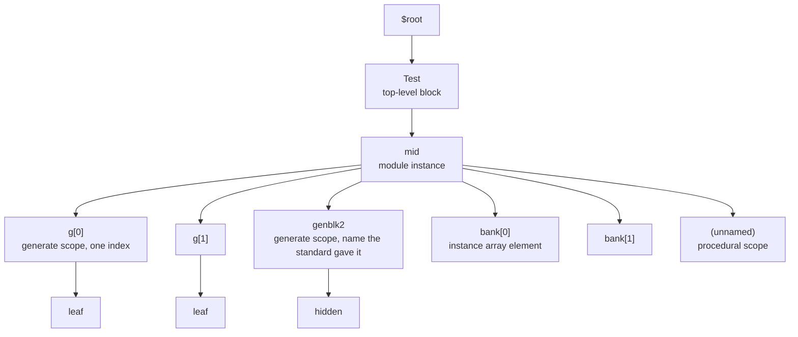

# Hierarchy and Generate

## Purpose

Define the canonical representation of hierarchy and the role of generate. Establish a single model
shared by all consumers: external references, child routing, and construction.

## Owns

- The rule that the canonical hierarchy is an object tree, built at construction time.
- The rule that the object tree is single-rooted at the implicit `$root` scope, which owns every
  top-level block as a child.
- The rule that generate constructs build the object tree at construction, from what elaboration
  decided for each instance. Generate is not a separate identity or topology system.
- The rule that a semantically visible generate scope (named, navigable) is represented as a
  first-class constructed object in the tree.
- The contract that every consumer of hierarchy navigates the same object tree.

## Does Not Own

- The IR-layer shape of declarations (see `hir.md`).
- Construction order at runtime. Ownership is static; order is a runtime concern.
- Storage layout for hierarchical state (see `lir.md`).

## Core Invariants

1. The canonical hierarchy is an object tree. Path identity derives from ownership on this tree, not
   from a parallel side table.
2. A generate block is a definition of its own, compiled like any other. Which blocks an instance
   builds -- the alternative a conditional selected, how many blocks a loop counted out, which body
   each block is -- the front end has already decided, and it reaches the construction as that
   instance's data; a body builds what its data lists and decides none of it again.
3. A named generate scope is a first-class constructed object. An unnamed generate scope is not
   addressable and is not materialized as an object.
4. External references, runtime child routing, and the runtime constructor all navigate the same
   object tree. Typed members on the derived class are the ownership locus; a single non-owning
   generic adjacency list on the base scope, populated by one attachment operation per child, serves
   deterministic traversal. No second list of child pointers is maintained in parallel, and the
   parent never restates a child's identity that the child already carries. A hierarchical name
   reaches a child through the typed member or the generate entry that holds it, never by searching
   the adjacency list for its name.
5. The same compilation unit compiled once serves every instance of that unit. Hierarchy does not
   fork the unit's compile-time artifacts.
6. A parameter value read only as a value is a constructor input: it changes which children are
   constructed, how many, and with which sub-parameter bindings, and does not fork the unit's
   compile-time artifacts or its identity. A value that decides what is compiled -- a type, a width
   the lowering settles -- does fork them, because a compiled artifact cannot hold two answers to
   one question; and so does anything written elsewhere that reaches an instance below the unit (a
   `defparam`, a `bind`, a configuration rule), since the unit then builds different children. What
   serves this is that artifacts scale with distinct specializations rather than instances
   (`north_star.md` invariant 2), with each instance correct whatever is shared (its invariant 3).
7. The constructed object tree is faithful to the frontend's elaboration. Every elaborated instance
   and named scope has a corresponding constructed object, and generate-produced objects preserve
   the elaborated index and identity. Reference resolution relies on this faithfulness (see
   `reference_resolution.md`).
8. The object tree has a single implicit root scope, `$root`, that owns every top-level block as a
   child. A design with multiple top-level modules (LRM 3.11) is still one tree rooted at `$root`;
   each elaborated, uninstantiated module is a child of `$root`, not a separate disconnected root.
   Path identity for a top-level block derives from this ownership, the same as for any other node.
   One top is the N = 1 case of the same model, not a special case. Which modules are top-level
   blocks is an elaboration property, distinct from the set of compiled units (see
   `compilation_unit_model.md`): the two coincide only when nothing is instantiated and must not be
   collapsed into one set.
9. Instance multiplicity and generate are orthogonal axes. An array of instances (`c[3]`) is a
   cardinality property of one member's type -- a vector of owned children (see `mir.md`) -- not a
   generate construct. A generate builds named child scopes; an array replicates one child member.
   Either may appear without the other, and a generate scope may itself contain instance arrays.
   Neither axis subsumes the other.
10. Scope identity is structural and complete at construction. A child's identity at one hierarchy
    edge is the pair `(parent, segment)`, where the segment is the source-level label plus any
    per-dimension elaborated indices. The child receives that segment from its constructor's caller,
    holds it for its lifetime, and remains the sole authoritative source of its own identity; no
    consumer reconstructs the bracketed name by reverse-searching a parent registry, and the parent
    never re-states an identity the child already carries. `%m`, hierarchical paths, and debug
    output all read from this single source; resolving a hierarchical name reads none of them.
11. A reference targeting a non-constructed runtime object is a sealing failure with a user
    diagnostic, never a runtime fallback. A conditional-generate arm not selected at Build has a
    class declaration but no runtime scope; a hierarchical reference whose route traverses such an
    arm cannot seal. The same rule covers an out-of-range instance-array element and any other
    object whose declaration exists at compile time but whose runtime object is absent in the
    elaborated design. The reference is rejected at the sealing barrier; route execution does not
    silently substitute a null, a default, or an alternate target.
12. A set of objects the source writes under one name -- an instance array, the instances an
    interface port carrying a range is bound to, the blocks a loop generate counts out -- is
    described object by object: each element's identity is computed from its own elaboration, and
    elements whose identities are one share an artifact. Every element takes what its instantiation
    wrote (LRM 23.3.2), but a `defparam`, a `bind` or a configuration rule may reach one of them
    (LRM 23.10.1, 23.11, 33.4), so nothing about the set can be read off one element. What this
    serves is that correctness does not depend on sharing (`north_star.md` invariant 3): a
    description of the set that starts from a representative has to predict that the rest agree.
    Which kind stands at each position is the holding instance's construction data, so artifacts
    follow the distinct kinds and never the element count (invariant 2 there).

## Boundary to Adjacent Layers

- HIR holds the generate tree inside each module compilation unit, one definition per block. MIR
  lowers a scope's construction to building the children its data lists.
- The runtime constructor builds the live object graph from each instance's data.
- `runtime_model.md` defines the constructor / simulation execution-context split that this doc
  builds on. Building a generate's blocks is constructor-context; processes are simulation-context.
- `reference_resolution.md` owns how a reference reaches state across the object tree and when it
  resolves. This doc owns the tree's shape and construction and its faithfulness to the frontend's
  elaboration; that doc relies on this faithfulness to make cross-unit resolution total.
- A node whose owned child is built from another compilation unit (an instantiation) crosses the
  unit boundary: the parent references the class the child's unit published, never its body or
  internal ids, and never which unit is made there. An object is handed its construction data, which
  says how each child it builds is made -- an instance at each instantiation, a block of each
  generate -- and makes each through the entry the data holds there, so the code compiled for a unit
  counts its instantiations and generates and the design root states, for every instance, what is
  made at each. A named generate scope crosses no unit boundary for the unit's own code; a referrer
  in another unit reaches it through the class it was published as. `compilation_unit_model.md` owns
  the signature and the name-based linkage; this doc owns only the resulting ownership edge in the
  object tree.

## Forbidden Shapes

- A coordinate or ordinal side system that numbers generate regions and is used as identity.
- A topology representation owned by the driver or a central map instead of by the object tree
  itself, which fails invariant 4: a consumer navigating such a map instead of the tree reaches
  something the tree may not hold. The data a constructor is handed -- what is made at each of the
  object's instantiations and generates, decided by elaborating the instance -- is not this: nothing
  navigates it and nothing reads it once construction is over.
- Separate hierarchy models for compile-time and runtime. Only one model exists.
- Two independently maintained runtime child views that can drift -- e.g., one list for traversal
  plus a separate registry of children, each written by a distinct opcode and at a distinct
  construction-time moment. One non-owning adjacency relation serves traversal, populated by one
  attachment operation per child.
- A runtime search of a scope's children, or of a scope's declarations, by name to resolve a
  hierarchical reference. A name's target is fixed by the class each step was published as and is
  checked where the referrer compiles; a search by text defers that check to run time and leaves an
  unchecked cast in its place.
- A child-routing or external-reference path that reconstructs hierarchy from flattened symbol
  names.
- Per-instance code for a generate. What differs between instances is their construction data; code
  that differs per instance makes artifacts follow instances (`north_star.md` invariant 2).
- A body that decides at construction which generate blocks to build, or that holds every block any
  of its instances built. It evaluates again what the front end decided, and its content then
  follows instances it is not named for, so adding one elsewhere changes it.
- Treating an instance array as a generate construct, or modeling generate replication as an array
  type. Multiplicity is a property of a member's type; a generate builds scopes. The two axes must
  not be conflated or made to subsume each other.
- A parameter read only as a value used as part of compile-time identity, which forks artifacts per
  value and fails `north_star.md` invariant 2 for no correctness gain.
- Describing a set of objects by one of its elements -- the first element's unit standing for an
  array's, one class standing for the instances a port is bound to -- which fails `north_star.md`
  invariant 3 wherever an override elsewhere made an element differ (invariant 12 above).
- Splitting a child's hierarchy identity between the child and a parent-side registry -- the child
  carrying only an un-indexed label while bracketed indices live in a parent table that consumers
  reverse-search to recover the full name. The child carries its complete `(base, indices)` segment;
  any per-dim decoration is the child's own property, never parent metadata about the child.
- A scope's base constructor side-effecting its own attachment into the parent. Attachment is one
  explicit operation the parent performs once the child is fully constructed and its typed owner has
  committed, so a partially-built child is never visible in the parent's adjacency relation.
- A runtime fallback for a reference whose route traverses a non-constructed object (a non-selected
  conditional-generate arm, an out-of-range instance-array element). Such references are rejected at
  the sealing barrier as user-diagnosable elaboration errors; substituting a null, a default value,
  or an alternate object hides a SystemVerilog semantic violation.

## Notes / Examples

### Every node kind, in one tree

```systemverilog
module Mid;
  for (genvar i = 0; i < 2; i++) begin : g
    Leaf leaf ();
  end
  if (1) begin            // unnamed in the source; LRM 27.6 gives it one
    Leaf hidden ();
  end
  Leaf bank[0:1] ();
  initial begin           // procedural, so it answers to no name at all
    ...
  end
endmodule

module Test;
  Mid mid ();
endmodule
```



Four things the picture is for.

**There is one tree and every kind of node is in it.** A generate scope is not a second topology
laid over the instances; it is a node beside them, with children of its own. Nothing anywhere holds
a generate-specific parent relation, which is what invariant 1 means by generate having no identity
system of its own.

**An index is part of a node's own identity, not a separate structure.** `g[0]` and `bank[0]` carry
theirs the same way, so an instance array and a generate loop differ in what declared them and in
nothing a consumer of the tree can see.

**A node with no name is in the tree and no hierarchical name reaches it.** The procedural scope is
a child like any other and contributes no segment to the paths beneath it, so a process declares its
own scope without lengthening any hierarchical name.

**Each scope a name can step into publishes a class.** `mid`'s class publishes its members, the
`bank` array, and one entry per generate construct, holding the blocks the object built. So
`mid.g[1].leaf` is a typed step into `g`'s entry at the block `g[1]`, viewed as the class that block
was published as, and then a published member. Which block a name reaches and its class are the
referrer's, read off its own elaboration, so the entry lists no classes and no count: `g[0]` and
`g[1]` are two applications of one block, objects of one class unless the index decides what the
block declares, and two objects of one class may hold different numbers of blocks, none included, as
their data says. `bank` is published the same way as a set: its range, and which kind of object
stands at each position, so `mid.bank[1]` reaches the kind its own elaboration made it even where a
`defparam` made it differ from `bank[0]`.

If resolving a hierarchical reference requires a lookup through a table that mirrors the object
tree, the table is redundant: the tree itself is the authority.
