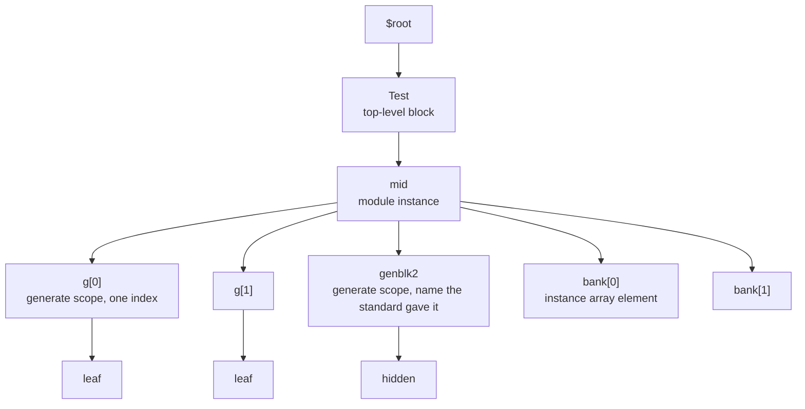

# Hierarchy and Generate

## Purpose

Define the canonical representation of hierarchy and the role of generate. Establish a single model
shared by all consumers: external references, child routing, construction, and every party that
names a scope of the running design.

## Owns

- The rule that the canonical hierarchy is an object tree, built at construction time.
- The rule that the object tree is single-rooted at the implicit `$root` scope, which owns every
  top-level block as a child.
- The rule that generate constructs are constructor-time mechanisms that build the object tree, and
  that a generate block is a definition nested in the scope holding it. Generate is not a separate
  identity or topology system.
- The rule that every generate scope a generate construct builds is represented as a first-class
  constructed object in the tree.
- The contract that every consumer of hierarchy navigates the same object tree.
- What a scope states of itself to the run -- the record of each scope its class declares -- and
  where a package and a compilation unit's scope stand beside the tree.

## Does Not Own

- The IR-layer shape of declarations (see [`hir.md`](hir.md)).
- Construction order at runtime. Ownership is static; order is a runtime concern
  ([`elaboration_lifecycle.md`](elaboration_lifecycle.md)).
- Storage layout for hierarchical state (see [`lir.md`](lir.md)).
- Which lowerings of a definition are one unit and one body (see
  [`specialization_model.md`](specialization_model.md)).

## Core Invariants

1. The canonical hierarchy is an object tree. Path identity derives from ownership on this tree, not
   from a parallel side table.
2. A compilation unit that has a generate structure contributes that structure as constructor-time
   construction logic. A generate block is a definition nested in the scope holding it, and each
   block an object builds is an application of it. The constructor runs the generate as the source
   wrote it: a loop's initial value, condition and step, the step being the expression the source
   wrote for its effect on the index (LRM 27.4); and the conditionals of a conditional generate as
   the source nested them, each condition or `case` selector stated once, with what stands on each
   side (LRM 27.5). Which generate blocks an instance built, how many a loop counts out and which
   alternative stands are no part of its unit, which publishes every block class any of its
   instances built ([`compiling_a_design.md`](compiling_a_design.md)). Which body each block it
   builds is, is stated in the construction table the object's constructor is handed -- one entry
   per alternative the source wrote, per block a loop counts out, and for a block standing alone --
   and each entry carries, beside the body, the table that block is constructed with in turn, as an
   instance's entry carries its child's. The constructor builds every block through the entry there,
   as it builds an instance, so the unit's code names no block's body and no table but its own, and
   is the same code wherever the object stands. A loop's block is handed the value its index stood
   at, the one value a block receives, and its implicit `localparam` is a declaration of the block
   filled from it.
3. A generate scope is a first-class constructed object whether or not the source named it. One the
   source gave no name is named as LRM 27.6 names it (`genblk<n>`, counted among the generate
   constructs of the scope declaring it), and its declaration says the name was given rather than
   written (LRM 37.85 `vpiImplicitDecl`).
4. External references, runtime child routing, and the runtime constructor all navigate the same
   object tree. The base scope keeps one list of the scopes attached under it, filled by one
   attachment operation per child once the child is built; that list owns them, and it is what the
   elaboration phases, a dump and a traversal descend. A scalar child -- an instance or a generate
   block -- is also held by its parent through a borrowed handle typed to the child's own class,
   filled from what the child's construction returns, so a class's layout states every object the
   runtime builds under it and a name reaching a child is a typed step checked where its referrer
   compiles ([`reference_resolution.md`](reference_resolution.md) invariant 2); an instance array's
   member holds one such handle per element. No second list of child pointers is maintained in
   parallel, and the parent never restates a child's identity that the child already carries. A
   hierarchical name the design writes reaches a child through the typed member or the generate
   entry that holds it, never by searching the child list for its name. Upward it is the same pair:
   a generate block keeps the scope that built it in a member of the class it published, viewed as
   the class that scope published and set from the value its builder hands it, and a name declared
   there is reached through that member and what that scope published, so a block's code is the same
   whichever body built it. The base scope's generic parent, written once from the same value,
   serves what the runtime answers by walking the tree -- a scope's name, the scope a name from
   outside the design names, and where an upward name searched by class starts (LRM 23.8) -- and no
   name within one unit.
5. The same compilation unit compiled once serves every instance of that unit. Hierarchy does not
   fork the unit's compile-time artifacts.
6. A parameter value read only as a value is a constructor input: it changes how many blocks a loop
   constructs, which alternative stands, and which values the children are handed, and forks neither
   the unit nor its code. A value that decides what is compiled -- a type, a width the lowering
   settles -- forks the unit where it changes what the unit publishes and the body where it changes
   the code, because a compiled artifact cannot hold two answers to one question; so does anything
   written elsewhere that reaches an instance below the unit (a `defparam`, a `bind`, a
   configuration rule), since the unit then builds different children. Which blocks an object built
   is no part of the unit, and a block's body is compiled from a lowering that built it, since an
   alternative not selected is not elaborated (LRM 27.5) and need not be valid for the values of an
   instance that did not select it. What serves this is that artifacts scale with distinct classes
   and bodies rather than instances ([`north_star.md`](north_star.md) invariant 2), with each
   instance correct whatever is shared (its invariant 3).
7. The constructed object tree is faithful to the frontend's elaboration. Every elaborated instance
   and generate scope has a corresponding constructed object, and generate-produced objects preserve
   the elaborated index and identity. The constructor evaluates the conditions and loop headers the
   front end evaluated, from the values the object was handed, so it builds what the front end
   elaborated. Reference resolution relies on this faithfulness (see
   [`reference_resolution.md`](reference_resolution.md)).
8. The object tree has a single implicit root scope, `$root`, that owns every top-level block as a
   child. A design with multiple top-level modules (LRM 3.11) is still one tree rooted at `$root`;
   each elaborated, uninstantiated module is a child of `$root`, not a separate disconnected root.
   Path identity for a top-level block derives from this ownership, the same as for any other node.
   One top is the N = 1 case of the same model, not a special case. `$root` is a synthetic unit made
   where the program is linked, whose constructor builds the tops
   ([`runtime_model.md`](runtime_model.md)); nothing instantiates a top, so it is built as an
   instance left to its parameters' defaults is, and a module declaring an interface port or a `ref`
   port, which no instantiation connects there (LRM 23.3.3.2, 23.3.3.4), is refused as a top where
   the tops are chosen. Which modules are top-level blocks is an elaboration property, distinct from
   the set of compiled units (see [`compilation_unit_model.md`](compilation_unit_model.md)): the two
   coincide only when nothing is instantiated and must not be collapsed into one set.
9. Instance multiplicity and generate are orthogonal axes. An array of instances (`c[3]`) is a
   cardinality property of one member's type -- a vector of borrowed handles to the children the
   tree owns (see [`mir.md`](mir.md)) -- not a generate construct, and the type carries no length,
   which the constructor decides. A generate builds child scopes as constructor-time logic; an array
   replicates one child member. Either may appear without the other, and a generate scope may itself
   contain instance arrays. Neither axis subsumes the other.
10. Scope identity is structural and complete at construction. A child's identity at one hierarchy
    edge is the pair `(parent, segment)`, where the segment is the record of the declaration of the
    parent's class the child fills, plus any per-dimension elaborated indices. The child receives
    that segment from its constructor's caller, holds it for its lifetime, and remains the sole
    authoritative source of its own identity; no consumer reconstructs the bracketed name by
    reverse-searching a parent registry, and the parent never re-states an identity the child
    already carries. `%m`, hierarchical paths, the names foreign code is handed, what a dump records
    and what VPI answers all read from this single source; resolving a hierarchical name the design
    writes reads none of them. `%m` names the innermost named block, task or function around the
    call, or else the scope the body belongs to (LRM 21.2.1.5): the name of the instance holding it,
    which only the run knows since one body serves every instance ([`north_star.md`](north_star.md)
    invariant 2), followed by the text the source fixes below that instance, to which a block the
    source did not name adds nothing. Where no instance holds the declaration -- a package, `$unit`,
    a class declared in either -- that text is the whole name and a constant. A display deferred to
    a later region reaches the instance as it reaches its other operands, so it names the scope it
    was called in, and every kind of body forms the name the one way.
11. A reference to a target no object stands for -- an alternative a conditional generate did not
    select, an out-of-range instance-array element -- is the front end's error, reported where it
    elaborates the design. Route execution never substitutes a null, a default, or an alternate
    target.
12. A set of objects the source writes under one name -- an instance array, the instances an
    interface port carrying a range is bound to, the blocks a loop generate counts out -- is
    described object by object: each element is read from its own elaboration, or from the one the
    frontend found it alike, and elements whose lowerings come out equal share an artifact. Every
    element takes what its instantiation wrote (LRM 23.3.2), but a `defparam`, a `bind` or a
    configuration rule may reach one of them (LRM 23.10.1, 23.11, 33.4), so nothing about the set
    can be read off one element. The set is still one declaration, stating the distinct ways its
    elements are built and which each position takes, and the construction builds equal neighbours
    as one run, so code follows the distinct kinds and the overrides written, never the element
    count ([`north_star.md`](north_star.md) invariant 2). What this serves is that correctness does
    not depend on sharing (its invariant 3): a description of the set that starts from a
    representative has to predict that the rest agree.
13. A write at construction is an ordinary write. What an assignment writes and what it puts there
    is decided by the assignment, wherever a process or a construction reaches it, so a loop
    generate's step in any of the forms LRM 27.4 admits is lowered as the write it is. What differs
    is only when the write takes place: a procedure may defer an update to a later region (LRM
    10.4), and a construction, which runs before there is a time slot, writes where it reaches the
    write.
14. Every class of the design hierarchy, and every package and compilation unit's scope, states one
    record per scope it declares -- an instance or an array of them, a generate block or the set a
    loop counts out, a class however many of its specializations the design uses, a clocking block,
    a subroutine it imports from C, and each procedural scope the front end made one (LRM 37.12) --
    holding the scope's name as a hierarchical name writes it, its kind, whether the name is the one
    LRM 27.6 gives, and the procedural scope it lies in; and one record of the definition its scopes
    come from (LRM 37.10). A constructed scope's segment is the record it fills. No record states
    where a scope was written, since a place stated as a constant of a unit would make text moved
    above it recompile it with nothing changed ([`north_star.md`](north_star.md) invariant 4). A
    procedural scope has no object of its own.
15. A package and a compilation unit's scope (LRM 3.12.1, named `$unit`) are each one object of the
    run beside the instance tree, not a node of it. The design root brings each up as it installs
    the namespace's storage, which is where it hands the run the namespace's definition and records.
    A name that reaches the run from outside the design -- from foreign code (LRM 35.5.3, 38.21) or
    the run's command line -- is read in one place, as an identifier with its selects and an
    optional package prefix, looked for among the scopes the run constructed and then among the
    declarations each class states; an escaped identifier and the simple one it spells are one name
    (LRM 5.6.1), and nothing within a compilation unit's scope is reached this way (LRM 37.10).

## Boundary to Adjacent Layers

- HIR holds the generate tree inside each module compilation unit. MIR lowers generate to
  constructor-time construction logic that builds the object tree.
- The runtime constructor executes this logic to produce the live object graph.
- [`runtime_model.md`](runtime_model.md) defines the constructor / simulation execution-context
  split that this doc builds on. Generate logic is constructor-context; processes are
  simulation-context.
- [`reference_resolution.md`](reference_resolution.md) owns how a reference reaches state across the
  object tree and when it resolves. This doc owns the tree's shape and construction and its
  faithfulness to the frontend's elaboration; that doc relies on this faithfulness to make
  cross-unit resolution total.
- A node whose owned child is built from another compilation unit (an instantiation) crosses the
  unit boundary: the parent references the class the child's unit published, never its body or
  internal ids, and the object is made through the child unit's own entry. An owned child that
  belongs to the same unit (a generate scope) is intra-unit and crosses no boundary for the unit's
  own code; a referrer in another unit reaches it through the class it was published as.
  [`compilation_unit_model.md`](compilation_unit_model.md) owns the signature and the name-based
  linkage; this doc owns only the resulting ownership edge in the object tree.

## Forbidden Shapes

The test each shape answers to: does it break the one tree of invariant 1, its faithfulness
(invariant 7), or the per-unit artifacts of [`north_star.md`](north_star.md) invariant 2?

- A coordinate or ordinal side system that numbers generate regions and is used as identity. It
  fails invariant 1: identity derives from ownership on the tree, and a numbering shifts when an
  unrelated region is added.
- A topology representation owned by the driver or a central map instead of by the object tree
  itself. It fails invariant 4: a consumer navigating such a map instead of the tree reaches
  something the tree may not hold.
- Separate hierarchy models for compile-time and runtime. It fails invariant 1: two models answer
  one question twice.
- Two independently maintained runtime child views that can drift -- e.g., one list for traversal
  plus a separate registry of children, each written by a distinct operation and at a distinct
  construction-time moment. It fails invariant 4: one owning child list serves traversal, filled by
  one attachment operation per child.
- A runtime search of a scope's children, or of a scope's declarations, by name to resolve a
  hierarchical reference the design writes. It fails
  [`reference_resolution.md`](reference_resolution.md) invariant 2: that name's target is fixed by
  the class each step was published as and is checked where the referrer compiles, and a search by
  text defers that check to run time and leaves an unchecked cast in its place. A name from outside
  the design has no compiled referrer whose check a search could defer, so it is read by the one
  search of invariant 15.
- A child-routing or external-reference path that reconstructs hierarchy from flattened symbol
  names. It fails invariant 1: the tree is the authority, and a flattened name is a rendering of it.
- Per-instance generate trees that duplicate the unit's construction logic. It fails invariant 5.
- A body holding a generate block an instance of another name built, or a parent's code naming which
  body a block or a child is. It fails [`north_star.md`](north_star.md) invariant 4: the body's
  content then follows instances it is not named for, so adding one elsewhere changes it.
- The constructor building a block from a stored answer -- which alternative stood, which indices a
  loop reached -- rather than from the conditions and loop the source wrote. It fails
  [`north_star.md`](north_star.md) invariant 2: a list of answers grows with what elaboration
  counted, where the question is the size of the source.
- Treating an instance array as a generate construct, or modeling generate replication as an array
  type. It fails invariant 9: multiplicity is a property of a member's type and generate is
  constructor-time scope construction, so either subsuming the other makes one axis's change move
  the other's artifacts.
- A parameter read only as a value used as part of a unit's name or a body's. It fails
  [`north_star.md`](north_star.md) invariant 2: it forks artifacts per value for no correctness
  gain.
- Describing a set of objects by one of its elements -- the first element's unit standing for an
  array's, one class standing for the instances a port is bound to. It fails
  [`north_star.md`](north_star.md) invariant 3 wherever an override elsewhere made an element differ
  (invariant 12).
- Splitting a child's hierarchy identity between the child and a parent-side registry -- the child
  carrying only an un-indexed label while bracketed indices live in a parent table that consumers
  reverse-search to recover the full name. It fails invariant 10: the child carries its complete
  `(declaration, indices)` segment.
- A scope's base constructor side-effecting its own attachment into the parent. It fails invariant
  4: attachment is one explicit operation performed once the child is fully constructed, so a
  construction that departs leaves nothing half-attached and a partially-built child is never
  visible in the parent's child list.
- A runtime fallback for a reference whose route reaches a target no object stands for. It fails
  invariant 11: substituting a null, a default value, or an alternate object hides a defect, since
  the front end has already refused every such reference.
- A record of where a scope was written held as a constant of a unit. It fails
  [`north_star.md`](north_star.md) invariant 4: text moved above the unit would recompile it with
  nothing it does changed.

## Notes / Examples

### Every node kind, in one tree

```systemverilog
module Mid;
  for (genvar i = 0; i < 2; i++) begin : g
    Leaf leaf ();
  end
  if (1) begin            // unnamed in the source; LRM 27.6 gives it one
    Leaf hidden ();
  end
  Leaf bank[0:1] ();
  initial begin : run     // procedural: a name for paths and `%m`, no node
    ...
  end
endmodule

module Test;
  Mid mid ();
endmodule
```



Four things the picture is for.

**There is one tree and every kind of node is in it.** A generate scope is not a second topology
laid over the instances; it is a node beside them, with children of its own. A block's link to the
scope that built it is that same edge of that same tree, kept typed, so nothing holds a parent
relation of generate's own, which is what invariant 1 means by generate having no identity system of
its own.

**An index is part of a node's own identity, not a separate structure.** `g[0]` and `bank[0]` carry
theirs the same way, so an instance array and a generate loop differ in what declared them and in
nothing a consumer of the tree can see. A loop whose step is not an addition of one counts out a
sparse set of indices, and each block carries the value its index held, which is also the coordinate
a name from outside spells.

**A procedure and its blocks are no node.** A procedure is no branch of the hierarchy (LRM 23.6),
and a named block such as `run` is one only as a declaration its class states: a path into it
(`mid.run.x`) is a member `mid` publishes, and `%m` inside it is `mid`'s path with `.run` fixed by
where the call is written. What a block keeps past an activation is a cell of `mid`.

**Each scope a name can step into publishes a class.** `mid`'s class publishes its members, the
`bank` array, and one entry per generate construct: `g`'s entry names the class its blocks are
objects of, and `genblk2`'s names its one block by where the source wrote it. So `mid.g[1].leaf` is
a typed step into the entry at the place `g[1]` has among the blocks `mid` counted out, viewed as
that block's class, and then a published member. `g[0]` and `g[1]` are two applications of one
block, and objects of one class unless what the block declares differs between them; a name reaching
a block takes the class from the block the front end resolved it to. How many blocks a loop counts
out is no part of the entry: each construction of the holding scope runs the loop, so two objects of
one class may hold different numbers of them, none included. `bank` is published the same way as a
set: its range, and which kind of object stands at each position, so `mid.bank[1]` reaches the kind
its own elaboration made it even where a `defparam` made it differ from `bank[0]`.

### A conditional inside a loop

```systemverilog
for (genvar i = 0; i < 64; i++) begin : s
  if (i == 0) begin : seed  assign q[i] = d;        end
  else        begin : step  assign q[i] = q[i-1];   end
end
```

The construct states the loop and, inside the block, the one `if` the source wrote, with `seed` and
`step` as its two alternatives. Each block's construction evaluates `i == 0` against the index it
was handed and builds the alternative that holds, so the blocks of `s` are one class and one body,
and the artifact is the size of the source at any iteration count. The object's construction table
holds, for each block, which body each of `seed` and `step` is; `step` is not elaborated at index 0,
where it names `q[-1]`, and is compiled from a block that did build it.

If resolving a hierarchical reference requires a lookup through a table that mirrors the object
tree, the table is redundant: the tree itself is the authority.
