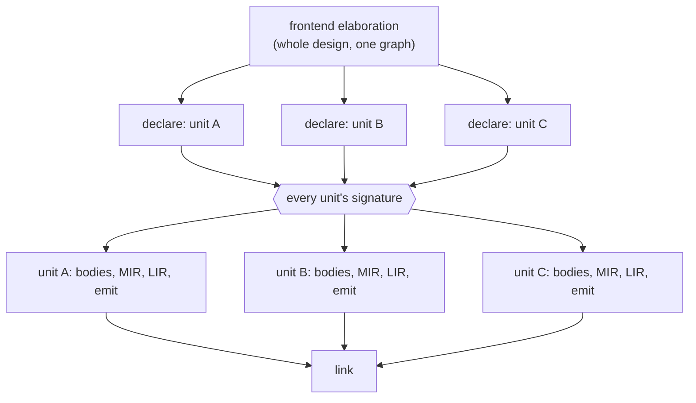

# Incremental Build

The compiler realizes this contract only below the lowering. Each step from a unit's emitted text
onwards -- compiling a unit's module or an emitted file to an object, linking the program -- is an
action kept under the digest of everything it reads, so a build after an edit compiles and links
only what came out different, and that digest is the only fingerprint there is: a name the emitted
text still spells changes it. The front end and every lowering run whole on every build, with no
query memoized and no key finer than a unit. The rules here constrain every layer regardless,
because they are what keeps a query-based implementation of the rest possible -- a design that
assumes whole-design lowering forecloses it.

## Purpose

Define how incremental compilation works at the architectural level: what is cached, how identity is
defined across sessions, how reuse is determined, what shape the work takes so that units compile in
parallel, and how a compiled result is kept so that a run whose inputs did not change pays for none
of the compile.

## Owns

- The query model: compilation expressed as a graph of memoized queries.
- The definition of stable keys that identify what each query computes.
- The definition of fingerprints that detect semantic change.
- The granularity at which incremental reuse is tracked.
- The rule that invalidation is bounded by ownership.
- The staging that makes units independent of each other: every unit's signature is derived before
  any unit's bodies are lowered, and a unit's later work consumes only what other units publish.
- The rule that the only cross-unit synchronization points are that staging barrier and the final
  link.
- The store every kept result lives in, what names an entry, and what may change one.

## Does Not Own

- Specific query implementations or on-disk storage formats.
- Build-tool integration (how the scheduler dispatches queries, what executable drives them) and how
  many run at once (see [`compiling_a_design.md`](compiling_a_design.md)).
- Runtime behavior or simulation outcomes.
- The shape of compilation units or IR layers (covered by other architecture docs).
- What a signature contains (see [`compilation_unit_model.md`](compilation_unit_model.md)).

## Core Invariants

1. **Incremental compilation is query-based.** Compilation is expressed as a directed acyclic graph
   of queries. Every query depends only on its explicitly declared inputs; implicit data flow is
   forbidden. Query results are memoized under their stable keys.
2. **Stable keys are ownership-based.** A query key is derived from ownership (compilation unit,
   callable, type, etc.). Keys do not depend on traversal order or insertion position.
3. **Fingerprints capture what a compiled program can tell, not syntax spelling.** A fingerprint
   excludes every name and every source position the program never reads: renaming a local variable,
   or moving text no report prints a position of, does not change it. A name or a place the program
   does read is part of what it means and is included -- in SystemVerilog `%m` prints scope names
   (LRM 21.2.1.3), `%p` prints member names, and a report prints its file and line (LRM 20.10) -- as
   is a name another unit links against.
4. **Identity has two roles: matching and semantic equivalence.** A key answers "what is being
   computed" and matches a current entity to its previous self. A fingerprint answers "has the
   meaning changed" and decides whether the cached result can be reused. The two are distinct values
   and must not collapse into one.
5. **Incremental reuse is bounded by ownership.** A change affects only the owning scope and its
   transitive dependents declared in the query graph. Unrelated callables and compilation units are
   not invalidated.
6. **No global identity coupling.** No design-global id space participates in incremental keys or
   fingerprints.
7. **Tracked granularity is coarse, not per-expression.** Reuse is tracked at, at minimum,
   compilation-unit, body, and callable or process level. Expression-level incrementality is not
   required.
8. **Deriving a unit's signature reads nothing outside that unit.** A signature is a function of its
   own unit's declarations. Nothing about another unit is required to produce one, so every unit's
   signature is computable at once, in any order, with no dependency graph among them and therefore
   no cycle to detect. _This is the property the rest of the staging rests on; if it ever fails, the
   whole design collapses back into ordered compilation._
9. **Signatures for the whole design are derived before any unit's bodies are lowered.** That
   ordering is the only cross-unit synchronization the pipeline has before the link. It exists
   because the design admits mutual reference between units, exactly as a compilation unit admits it
   between its own declarations: a body cannot reference what has not been declared, whatever scope
   "declared" is measured in.
10. **After that point a unit's remaining work names no other unit's work.** Each stage's inputs are
    the unit's own prior stage plus what the units it references publish -- their signatures and the
    values of the lowerings it reaches -- so the stages of different units interleave freely: one
    unit may be emitting while another is still lowering bodies. A stage that needs no signature
    receives an empty set, which is the same shape as receiving many.
11. **What a lowering reads of what another unit publishes is its dependency on it, recorded as it
    is read.** What the design's units publish is reached through one reader, which records each
    answer as an input of the lowering it serves, as rustc records an edge where a query reads, so
    the query graph's cross-unit edges are enumerable rather than discovered and no read can be left
    out of them. That is wider than what the lowering's output names: a read decides what a
    construct means, and the output may name nothing of the unit read -- a hook call that finds no
    class declaring the hook runs the library's (LRM 18.6.2). The reads belong to the lowering and
    not to the body it came out as, since two lowerings that come out as one body may have read
    different units. A fact reaching a unit by any other path is a dependency the graph does not
    have, and it is invisible until a cached result is reused, at which point it is a stale result
    rather than an error.
12. **Every kept result is an action's output, kept by content.** An action is a step and every
    input it reads; the store maps the digest of an action to the digest of its one output, and a
    digest to the bytes it is the digest of, as Bazel's remote execution API and LLVM's CAS do. A
    unit's object, an emitted file's object, a prepared header and a program are each one action's
    output, and an output that comes out the same however it was reached leaves every action reading
    it found again. An action is performed at most once in a build however many ask for it.
13. **An entry is named by what its step reads, never by the SystemVerilog sources.** A compile is
    named by the text it compiles, every file it includes, the compiler that runs and the level it
    runs at; a link by the bytes of what it links, the runtime library, the foreign code and the
    driver it runs under. That name is complete by construction, where one built from the sources
    and the options would have to list every file the front end opened and every define in effect,
    and the first one missed is a stale program that runs without a word. How many compiles ran at
    once is in no name, since the objects are the same however many there were.
14. **An entry never changes, and the store is shared.** One store per user serves every checkout
    and every configuration of every design, so two that agree share an entry and two that differ
    get different ones, and nothing one does can change what another reads. An entry is written
    under a temporary name and renamed into place, an entry that vanishes between being found and
    being read is a miss, and a command hands back a private copy of a program rather than a link
    into the store -- so clearing or trimming the store fails no build and breaks no program already
    handed out.

## Boundary to Adjacent Layers

- [`identity_and_ownership.md`](identity_and_ownership.md) establishes that identity follows
  ownership, not traversal order. This doc builds on that rule as the foundation of stable keys; it
  does not restate it.
- [`compilation_unit_model.md`](compilation_unit_model.md) defines the compilation-unit ownership
  boundary and what a unit's signature contains. This doc uses that boundary as the coarsest
  granularity of incremental reuse, and the signature as the unit of cross-unit dependency; it does
  not define what is on one.
- [`specialization_model.md`](specialization_model.md) defines unit and body names. Those names feed
  the cache this doc describes; this doc does not redefine them.
- [`lowering_boundaries.md`](lowering_boundaries.md) owns what a single lowering may do. This doc
  owns the order the units' lowerings run in relative to each other, which is a separate axis.
- Each IR layer defines its own identity kinds. This doc uses those identities as key sources; it
  does not redefine them.
- [`emission_model.md`](emission_model.md) owns what each artifact an action compiles contains.

## Forbidden Shapes

Each shape below fails an invariant above, and through it [`north_star.md`](north_star.md)
invariant 4.

- Using raw pointer identity as part of a key. It fails invariant 2: an address is a fact of one
  run, so no later build matches it.
- Using global sequential ids as stable keys. It fails invariants 2 and 6: an insertion anywhere
  shifts every key after it.
- Fingerprints derived from raw source text rather than from semantic content. It fails invariant 3:
  a rename or a moved line would invalidate what it did not change.
- Dependencies between queries that are not captured in the query graph. It fails invariant 1, and
  surfaces only as a stale result once one is reused.
- Recomputing entire compilation units in response to a local edit inside one callable. It fails
  invariants 5 and 7.
- A key scheme that shifts when unrelated entities are inserted, removed, or reordered. It fails
  invariant 2.
- Collapsing the key and the fingerprint into a single value, such that semantic equivalence cannot
  be detected independently of structural identity. It fails invariant 4.
- Signature derivation that consults another unit. It fails invariant 8: it would put a dependency
  graph, an order, and a cycle diagnostic in front of the one stage that has none of those, and
  every later stage would inherit the ordering.
- A compilation order computed over the units. It fails invariant 10: after the signature stage
  there is nothing to order, and a scheduler that sequences units is serializing work that has no
  edge between it.
- A stage that reaches a fact about another unit around its signature -- through a whole-design
  view, a global table, or a shared frontend graph. It fails invariant 11: the fact is then outside
  the query graph, so no fingerprint covers it.
- A synchronization point between the signature stage and the link. It fails invariant 9: any
  barrier there stalls units that have no dependency on each other.
- A kept program or object named by the sources and options that produced it. It fails invariant 13:
  a stale program has no fallback the way a stale prepared header does, which is refused and
  compiled again; it is simply executed.
- An entry changed in place, or a program handed out as a link into the store. It fails invariant
  14: another checkout reading the entry, or a program already handed out, would change under it.
- A store kept per project directory. It fails invariant 14: every checkout recompiles every
  configuration, and a design named only on a command line has no project directory at all.

## Notes / Examples

### The shape of the work

One sequential head, one barrier, one join. Between the barrier and the join every unit is a
pipeline of its own with no edge to any other, which is why a unit may reach emit while its
neighbour is still lowering bodies. A unit's object is compiled inside its own pipeline and kept
under its own name, so the link is the only join after the barrier.

The barrier is not a cost being tolerated. It is what removes every other ordering: because no
signature needs another, the stage before it is unordered, and because every signature exists after
it, the stages following it are unordered too.

### Why the barrier sits where it does

A body may reference a declaration; a declaration never references a body. That asymmetry is what
puts all declarations before all bodies, and it holds at whatever scope mutual reference is admitted
in. Within one compilation unit it puts that unit's declarations before that unit's bodies. Across
the design -- where one unit's body reaches into another unit -- it puts every unit's declarations
before every unit's bodies. The same asymmetry, read at two scopes.

### Rename example

An automatic variable is renamed inside one callable of one compilation unit:

- The callable's key is unchanged, because ownership is unchanged.
- The callable's fingerprint is unchanged, because no program compiled from it reads the name; only
  the spelling differs.
- The cached result for that callable is reused.
- Every other callable in the unit and every other compilation unit are unaffected.

If the rename caused cascading recomputation, the key or fingerprint scheme depends on non-semantic
details and violates this contract.

### What a change reaches

| The change                       | What re-runs                                                               |
| -------------------------------- | -------------------------------------------------------------------------- |
| A body of unit U                 | U's stages after the barrier                                               |
| A declaration U publishes        | U's stages, and the post-barrier stages of every consumer of U's signature |
| A declaration U does not publish | U's stages only; no consumer can read it, so none depends on it            |

The first and third rows are what the signature buys, and the first is the common edit. A design
element publishes every declaration a hierarchical name may reach, so what it keeps to itself is
mostly what no name reaches -- an automatic variable, a declaration in an unnamed block -- while its
bodies change far more often than any declaration.

### What the front end consumed before any unit lowers

The front end elaborates the whole design before the first unit lowers, and in doing so it reads
across units on the reader's behalf: it folds a constant the language requires inside the reader's
own declarations (`logic [pkg::W-1:0] x`), binds every name, answers `$typename` of the reader's own
operand, and expands every sequence, property or `let` instance with the declaration's text. Each is
part of what the reader's lowering takes as its own input, and each depends on another unit. The
reader's record of what a lowering reads does not see these, so a query-based build either tracks
them where the front end runs or runs the front end again. Everything a lowering itself takes of
another unit -- a declared type's definition, a parameter's value, a member, a callable, a clocking
event -- comes from that unit's published statement, through the reader that records it; what it
takes of another instance's elaboration -- where a name leaving the instance landed, what a
parameter there settled to -- comes in its environment. The front end works the environment out from
its tree of the whole design, and what that consulted is no recorded read: an upward name lands
where it does because of every scope its search passed. While that is so, no lowering's result can
be reused across builds, and like a query reading state its tracking cannot see, it is computed
again every time.

### The store

_Current implementation:_ the store is `lyra` under `$XDG_CACHE_HOME` where that is an absolute path
and under `$HOME/.cache` otherwise, the rule Go's build cache follows; finding it creates nothing,
so a command that keeps nothing leaves no trace, and where the platform names no such directory
there is no store and a build is slower and nothing else. A build removes entries unused for five
days, at most once a day, as Go's cache does. `--rebuild` builds as though the store were empty and
writes what it built, which repairs an entry suspected of being stale; `lyra cache clear` empties
it. The host compiler's own system -- its standard library and C runtime -- is stood in for by the
compiler's identity, the file its path resolves to with its modification time and size, which is the
trade ccache makes by default; Lyra's own build is part of the name of an object Lyra's code
generator compiled.
