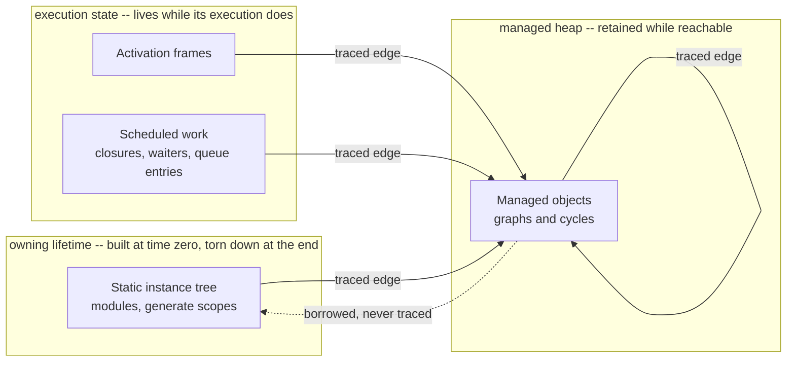

# Lifetime

The managed regime below is realized today by counting the shares held in each object rather than by
a tracing collector, so a cycle of objects nothing else reaches is never reclaimed and a weak
reference clears the moment the last share goes, and no activation frame is yet described to a
collector. The contract binds every layer regardless: nothing may be built that a tracing collector
could not serve.

## Purpose

Every piece of state this compiler produces belongs to exactly one lifetime regime, and this
document says which regimes exist, why each is the way it is, what each is analogous to, and what
keeps storage a call has bound by reference. SystemVerilog needs more than one regime because the
language is two languages: an object half whose reference model the standard says is Java's, and a
value half that is C++'s and Ada's. Neither half's answer works for the other, so borrowing one for
the other is the recurring design error this document exists to prevent.

## The regimes, and why there are three

| Regime         | Holds                                         | Ends when                     | Who ends it                         | Its analogue                        |
| -------------- | --------------------------------------------- | ----------------------------- | ----------------------------------- | ----------------------------------- |
| **Automatic**  | a body's own locals and what it makes         | the declaring scope ends      | the compiler, by emitting the end   | a C++ or Ada local                  |
| **Managed**    | class objects reached by handle               | nothing can reach it any more | a tracing collector, at a safepoint | a Java or C# object                 |
| **Structural** | a module or scope's members, and every static | the design is torn down       | construction's own inverse          | a C++ member of a long-lived object |

The first two are the language's two halves and the split is forced, not chosen:

- **A value has no identity.** `b = a` on a value makes an independent copy, so "is anything still
  referring to it" is not a question that can be asked. A collector answers exactly that question,
  so it has nothing to decide about a value.
- **An object is nothing but identity.** `b = a` on a handle makes both names mean one object, so
  its end cannot be tied to any one scope. Scope-based ending has nothing to decide about it.

So the two mechanisms are not alternatives that a tidier design would collapse; each is the only
answer to its own half. What a design can get wrong is applying one to the other -- reaching for a
collector for values, or for a scope for objects -- and both mistakes read as simplifications.

## Ending a value is the compiler's to emit, and the program never spells it

SystemVerilog has no destructor, and it is tempting to read that as "nothing ends". C++ users do not
write `~vector()` either; the compiler emits it, at every exit from the scope, including the ones
the source does not mention. **A language having no destructor syntax says what a program may spell,
not what an implementation must do.**

Java is the case where both are true at once, and the reason is worth keeping: its primitives are
flat, so there is nothing to end, and everything else is collected. That is why the absence is real
there and only apparent here.

Where each end falls is the source's own structure, as C++ and Rust place it. A declared variable is
one storage, reserved for the whole body and decided by its declaration alone; the variable in it
begins where its declaration is reached and ends where the block declaring it is left (LRM 6.21
gives an automatic variable "the lifetime of the call or block"), so a declaration reached many
times is one storage holding a fresh variable each time. The end is the block's and not the body's,
because a weak reference (LRM 8.30) makes an object's end observable, and a handle held to the end
of the body would keep its object past the block. A value the lowering makes to carry out one
evaluation is made in the frame of whoever made it and ends with the full-expression that made it,
as a C++ temporary does; a value handed on to a variable, a callee or a closure is owned by where it
went. An argument passed by value is the callee's own copy, which the body may write (LRM 13.5.1).
When a frame's bytes for a value are in use is a separate statement from the value's end
([`lir.md`](lir.md) invariant 9).

"Every exit" includes the one no statement of the body spells and no reader thinks of first: an
execution that is parked and never resumed, because whoever drives it ended it instead. That is an
exit from every scope the body has open, so it owes the same endings, and a backend that reaches its
scope exits only through statements will silently leak exactly there. It is the path a C++
coroutine's destroy takes, and the drop a Rust coroutine's transform generates: an ending the
compiler emits runs without resuming the body. SystemVerilog has no program-written ending -- no
`finally` -- so ending a variable is only ever that kind; `disable`, which does decide where an
execution goes next, is a departure ([`nonlocal_control_flow.md`](nonlocal_control_flow.md)) and a
different mechanism.

Which leaves the question that decides how much of this a value costs: **does the value's
representation own anything?** A flat sequence of bits owns nothing and ends by the scope's storage
going away, with nothing emitted. A run-time-sized container owns storage and must be ended. So the
automatic regime's real work is confined to the values of the second kind, and a representation that
gives the first kind something to own is paying that work for nothing.

## A regime is a property of the state, never of the code around it

The automatic regime says a value ends when its declaring scope does. That is a fact about the
declaration, and it stays the same fact however the body is written. Two things follow, and the
second is the one that is easy to lose.

**Where the storage physically sits is not part of the regime.** A local of a body that can suspend
has to survive the suspension, so it is placed wherever survival requires -- and that is the same
automatic object, placed by ordinary lowering. A language with coroutines does not gain a second
kind of local; the transform promotes the ones that must survive. A model that names them
differently has recorded a lowering result as a semantic distinction.

The same holds of an automatic variable a detached fork branch names, which LRM 6.21 requires to
outlive its scope for as long as the branch runs. It is held in a cell that the declaring scope and
each such branch share ([`compiler_generated_storage.md`](compiler_generated_storage.md)), and the
cell ends when the last of them lets go; the declaring scope's hold ends where its block is left, on
every way out. Each entry still makes a fresh variable -- it is automatic, not static -- and only
the end of its storage waits for the branches. Counting those holds is exact, because the graph they
form is acyclic: a cell owns only its value, never a process, a closure or a join, which is the one
property the object graph lacks.

**Where the storage is reclaimed from is not part of the regime either.** A region whose lifetime
happens to cover a value is a way of freeing it, not a statement of how long it lives. The moment a
value's end is read off which region it was allocated from, the region's shape -- and therefore the
shape of the control flow that opened it -- has become the answer to a question about the
declaration. The tell is that two variables with identical declarations get different treatment
because of something about the bodies they sit in.

Neither observation forbids regions. A region is a legitimate way to allocate, and pooling the
short-lived temporaries of one call is an ordinary optimization. What it may not be is the place a
value's lifetime is _stated_.

## What a static belongs to

A variable of static lifetime (LRM 6.21) is one cell for each thing that replicates its declaration,
existing for the whole run and initialized once. Lyra takes the lifetime the front end resolved,
which makes a bare declaration in a module's procedure static, and reads back no intent the front
end discarded.

| The declaration sits in               | Replicated by         | The cell is                             |
| ------------------------------------- | --------------------- | --------------------------------------- |
| the design hierarchy                  | the instance          | a variable of that instance's scope     |
| a class a structural scope declares   | that scope's instance | one per instance of the declaring scope |
| a class a package or `$unit` declares | nothing               | one cell the class keeps                |
| a package (LRM 26.2)                  | nothing               | one cell of the package                 |

A class object replicates nothing of the kind. A class method is automatic (LRM 8.6), and a static
it declares is "roughly equivalent to C static variables declared within a function" (LRM 6.21): one
cell for every object and every call. What does replicate a class is whatever replicates its
declaration, since an instance with a type declared inside it has a type of its own (LRM 6.22), so
the middle row is the first reached one step later. The same rule places all static state of a body,
a `disable` target among it ([`nonlocal_control_flow.md`](nonlocal_control_flow.md)).

A static a subroutine declares, the formals and result of a static subroutine (LRM 13.3.1, 13.4.1),
and a class's static property are entries of whatever keeps the subroutine or the class, named by
the path of scopes from it, and never variables of the body: another unit naming one has only the
declarer's published declaration and no body ([`north_star.md`](north_star.md) invariant 5).

Storage a type owns is brought up by whatever brings up the thing that replicates its declaration,
in the same two eager phases as every other static: every cell installed with its type's default,
then the written initializers run, all before any `initial` or `always` starts (LRM 10.5, which
names static class members under that rule). SystemVerilog has no use-triggered initialization, so
the JVM's lazy `<clinit>` is unavailable, and a unit compiled alone leaves no initializer list for a
host runtime to walk, so C++'s dynamic initialization is too: what remains is Go's package
initialization, two phases over every unit before the program starts. A mechanism of its own for a
class's statics could not be ordered right against the namespace's, since an initializer of either
may read the other.

## What a call's binding keeps

Storage a call binds by reference must go on existing until the call returns, whatever the program
does meanwhile to what held it: an element removed from its container "shall continue to exist
within the scope of the called subroutines until they complete" (LRM 13.5.2), and an object every
handle of which is dropped may not leave a dangling reference (LRM 8.29). The bound is the call, and
it is static: no data type holds a reference; a `ref` formal is illegal in a detached branch unless
`ref static` (LRM 9.3.2), which may not be passed an element of a dynamically sized array (LRM
13.5.2); and a deferred effect may not refer to one (LRM 6.21). So nothing has to discover at run
time how long such storage must live.

The binding of a `ref` or `const ref` actual takes a **lease** on each thing its reference reaches
through that the program can let go of while the call runs, and holds it until the call has
returned. A property step leases the object -- a share of it, as a class handle in an active scope
holds one (LRM 8.29), and to a tracing collector a root. An element step into a queue or an
associative array leases that element's storage, and one into a dynamic array the generation the
element lies in. A step into a fixed-size array, a structure, or anything an instance holds crosses
nothing the program can let go of and takes none; a path crossing several takes one each. Handing a
`ref` formal on to another is not a bind and takes none, since the outer lease covers the inner
call. Copying a reference, reading or writing through it and building a wait from it touch no lease.

A container honours a lease on what it keeps. Removing a leased element or replacing a leased
generation ends its membership and not its value, and the last lease ends the value and then frees
its storage; a pop of a leased element answers a copy. Every element committed to a container is
ended exactly once, after the last lease on it.

A lease is held by a value the full-expression containing the call makes, so it is released on every
way out of that full-expression -- falling off it, a departure passing through it, a process ended
while parked inside the call. That is never shorter than the call, and where calls nest an inner
binding's lease lasts to the end of the statement. A suspending callee needs nothing more, since its
call's full-expression spans the suspension. A binding whose reference a closure built before the
call holds -- receiving into a mailbox of no declared type (LRM 15.4.9) -- holds its leases in the
frame, which outlasts the call.

## The managed regime

A SystemVerilog class object is a dynamically allocated, language-managed object: created by `new`
at arbitrary simulation time, never explicitly freed, with no user-visible destructor, freely
copyable by handle, identity-comparable, and free to form arbitrary object graphs including cycles.
The simulator -- not the SystemVerilog program -- owns reclamation.

> Managed object liveness is reachability. A managed object is retained while reachable from runtime
> roots through managed-reference edges; an unreachable object is eligible for reclamation by a
> precise tracing collector at a runtime safepoint. A backend's control-flow mechanism may implement
> suspension and resumption, but every language-visible value that can survive a safepoint lives in
> compiler-described, runtime-traceable, Lyra-owned storage -- never in opaque backend execution
> state.

The governing split: Lyra owns semantic state; the backend owns control-flow realization. The
collector sees every managed edge precisely; backend-private state may never hide one.

The split is forced by the execution backend's own choice. Its bodies suspend through LLVM's
coroutine passes, which decide the frame's layout and which values survive a suspension, and a
frontend cannot enumerate what they spilled. A compiler either owns the representation of suspended
execution and describes it, as the mainstream managed runtimes do, or delegates it and keeps every
managed value out of it. Lyra delegates, so a managed value lives only in storage this compiler
describes; and since collection runs mostly while executions are suspended, the suspended state is
the case that decides, not an edge of it.

The model is a generic managed-runtime concept -- the object references of Java, C#, Go, and Python
-- not a SystemVerilog-specific mechanism. SystemVerilog classes are the first Lyra feature that
requires it.



The left two groups are the **roots**: what the collector starts from, and never itself collects.
Each is storage the compiler describes -- the static tree by each unit's member description, an
activation frame by a description of its slots for each callable, scheduled work by each closure's
captures -- and walking those descriptions is the whole of root enumeration. The one-way boundary is
the point to read off the picture: a managed object may refer back to the static tree, but only
through a borrowed reference the collector does not follow, so the tree's lifetime never depends on
the heap's.

## Owns

- The **set of lifetime regimes** and the rule that every piece of state belongs to exactly one, so
  that "how long does this live" has a single answer wherever it is asked.
- The rule that **a value's end is emitted and an object's end is discovered**, and that neither
  mechanism is applied to the other half.
- Where an automatic value's end falls: a variable's at the exit of its block, a value made for one
  evaluation at the end of its full-expression, on every way out including an abandoned suspension.
- What replicates a static, and how type-associated storage is brought up.
- The **lease** a call's binding takes on what its reference reaches through, and how long it lasts.
- The lifetime meaning of the **managed reference** (`gc<T>`): a traced edge that retains its
  target, with shallow-copy and identity that perform no retain/release, null a legal value, and
  cycles permitted. The reference _kind_ on the reference-kind axis is owned by
  [`object_model.md`](object_model.md); this document owns only what the reference means for
  lifetime.
- The **managed heap** and its **reachability semantics**: a managed object is retained while
  reachable from a root through managed-reference edges; an unreachable object -- including an
  unreachable cycle -- is eligible for reclamation.
- The **activation frame**: the Lyra-owned, compiler-described, traceable storage holding the
  language-visible values of a suspendable or allocating callable -- the home of every managed value
  that can be live at a safepoint.
- The **traceable representation** of deferred or scheduled work whose environment can contain a
  managed reference.
- The **root categories** collection starts from, and the **safepoint** contract: where collection
  may run and what must be reachable there.
- The **trace contract**: every traceable object can have its outgoing managed edges enumerated
  exactly. Which managed edges a value holds is answered by the value: no storage owes a separate
  description of what is inside it, and no root enumeration descends into one. The trace _mechanism_
  is not owned here.
- The separation of **control flow** (the backend's mechanism) from **semantic state** (Lyra's).

## Does Not Own

- The collector **algorithm and policy**: mark-sweep internals, collection cadence, and any
  generational or incremental strategy. The contract is reachability-based reclamation; the
  algorithm is a realization choice, within invariant 15.
- The **object structure** -- members, methods, base, dispatch, and the construction protocol. That
  is [`object_model.md`](object_model.md). This document owns only how long an object lives and how
  it is found.
- What has storage identity, and that a detached element goes on existing
  ([`storage.md`](storage.md)). This document owns what keeps it.
- The backend's **control-flow machinery** (its coroutine mechanism, awaiter and continuation
  plumbing). A backend may use it, constrained by the invariants below.
- **Physical layout**: managed-heap layout, frame field offsets, and trace-metadata encoding. Those
  are LIR and the runtime.
- The exact **MIR encoding** of `gc<T>`, of a lifted local's hold, and of a lease. That is
  [`mir.md`](mir.md), [`object_model.md`](object_model.md) and
  [`compiler_generated_storage.md`](compiler_generated_storage.md).
- The order in which the static instance tree is built and torn down
  ([`elaboration_lifecycle.md`](elaboration_lifecycle.md)). The tree is a root into the managed
  heap, not a resident of it.

## Core Invariants

1. **An automatic value's end is emitted by the compiler on every way out of its scope, the
   abandoned suspension included.** A variable ends where its block is left and a value made for one
   evaluation where its full-expression ends; a value whose type's end does nothing is owed none.
   _Serves LRM 6.21 and LRM 8.30, under which a handle kept past its block keeps its object
   observably alive; an execution ended while parked leaves every open scope without running any
   statement, so an ending reached only through statements leaks there._

2. **A static is one cell per thing that replicates its declaration, brought up with its declarer.**
   Every cell is installed with its type's default before any written initializer runs, and both
   phases finish before any process starts. _Serves LRM 6.21, 6.22 and 10.5; a cell per object
   breaks the one cell a method's static is, and a cell left uninstalled where no initializer was
   written is read before it holds a value._

3. **A lease is taken where a reference is bound for a call, and only there, and is held by whatever
   holds the call, never by the reference.** A container never ends what a lease holds; the last
   lease does. Every way out of the full-expression holding a lease releases it. _Serves LRM 13.5.2
   and 8.29 within the static bound LRM 9.3.2 and 6.21 give a reference._

4. **Liveness is reachability; reclamation is precise tracing at a safepoint.** A managed object is
   retained while reachable from a root through managed edges; an unreachable object is eligible for
   reclamation by a precise tracing collector at a runtime safepoint -- at the next collection, not
   at the instant it becomes unreachable. _Serves LRM 8.29: a simulation-lifetime arena that never
   reclaims is unbounded, and counting owners never reclaims a cycle._

5. **The managed reference carries a traced edge.** `gc<T>` is nullable, freely copyable,
   identity-bearing, and shallow-copy; copying performs no retain/release; it may point into cycles;
   the collector follows it. _Consequence: a class handle is never a borrowed raw pointer._

6. **Traceability is one total classification of types, and tracing is precise.** Every type answers
   whether a value of it can hold a managed edge, and a type added later fails to build until it
   answers: a class handle carries a claim on its object's life beside its address, while a
   `chandle` is only the address it holds (LRM 8.4, Table 8-1, LRM 6.14). For any traceable object
   the runtime enumerates every outgoing managed edge exactly. _Serves invariant 4: a list of the
   types somebody remembered answers false for the rest, which is a body holding a handle after its
   object is gone rather than a refusal. Consequence: the collector never scans native stack or
   memory guessing which words are pointers._

7. **Every managed value that can be live at a safepoint lies in storage this compiler describes.**
   Collection may run at an allocation mid-execution, so this covers every managed value a running
   activation holds, its frame's slots as well as its variables, and not only those across a
   suspension. Root enumeration walks the descriptions of the static tree, the activation frames and
   the scheduled closures, and nothing else. _Serves invariant 4, on the premise that the backend
   delegates the layout of suspended execution (The managed regime, above): what that layout holds
   no compiler can enumerate._

8. **A body running on a managed object roots it.** Every body that takes a managed object as its
   receiver -- an instance method, a constructor -- holds a managed reference to that object in its
   activation from where the body begins (LRM 8.29); the borrowed receiver used in the body derives
   from that root, `this` (LRM 8.11) is a copy of it, and a closure the body builds that reaches the
   object carries a copy of it rather than the borrowed receiver
   ([`binding_and_capture.md`](binding_and_capture.md) invariant 9). _Serves LRM 8.29: the object a
   method runs on cannot be reclaimed beneath it, nor beneath a branch it forked, even once its
   caller has let go of every handle._

9. **The execution-to-activation-frame edge is Lyra-visible and traceable.** The collector reaches
   an activation frame through Lyra-owned runtime state -- the process or scheduling record -- never
   through opaque backend execution state. _Serves invariant 7 for a suspended execution._

10. **Only managed-carrying state participates in tracing, and that follows from the types of its
    slots.** A frame, closure environment, or scheduler payload is traced if and only if its type
    recursively contains a managed edge, decided by invariant 6 rather than by where the storage was
    made. _Consequence: a design that declares no class has no root to walk and pays nothing._

11. **Allocation never reclaims its own in-flight result.** A new object is reachable from a root
    before any later collection runs, which is a property of where the allocation entry publishes
    its result. _Serves invariant 4._

12. **Safepoints coincide with runtime calls generated code already makes** -- allocation and the
    scheduler's boundaries -- so generated code gains no poll, no safepoint construct and no root
    registration. _Serves the backend's role as a mechanical translation: an instruction placed for
    the collector is a decision the emitter would make that MIR did not state._

13. **Reclamation runs no program code.** A managed object has no destructor or finalizer the
    program sees. What a program can observe of reclamation is a weak reference answering null once
    its referent is no longer strongly reachable (LRM 8.30), and when that happens is the memory
    manager's, as the standard leaves it. _Consequence: collection cadence may vary -- by allocation
    pressure, by scheduler boundary -- and changes nothing but when a weak reference clears._

14. **Control flow and semantic state are separated.** A backend's control-flow mechanism may own
    suspension, resumption, and native control bookkeeping; it owns no managed value that must
    survive a safepoint. _Consequence: the activation frame, not backend execution state, is the
    home of cross-safepoint managed state._

15. **An object a reference can point into does not move.** A reference to a class property is a
    pointer into the object (LRM 13.5.2), valid for the call it was lent to. _Serves LRM 13.5.2. A
    relocating collector is admissible only by pinning an object while a reference into it is
    outstanding, never by changing what a reference is, which would put a load on every access
    through it._

## Boundary to Adjacent Layers

- **Peer to [`object_model.md`](object_model.md).** That document owns object structure and the
  reference-kind axis; `gc<T>` is the managed entry of that axis. This document owns what the
  managed reference means for lifetime and how a managed object is reclaimed.
- **[`storage.md`](storage.md)** says which storage a reference may name and that a detached element
  goes on existing; this document says what keeps it, for how long.
- **[`mir.md`](mir.md).** `gc<T>` is a MIR type; an activation frame is an ordinary MIR object whose
  fields are the materialized managed values; a suspension point is the existing await expression.
  MIR states a local's scope and a full-expression's extent, which is where every automatic end
  falls; it states a lease as a value the call's full-expression makes. MIR carries no basic blocks
  and no resume-state field -- the state machine is the backend's control-flow concern.
- **[`lir.md`](lir.md)** states each end on every way out of its extent, and when a frame's bytes
  are in use, apart from the value's end.
- **[`callable.md`](callable.md).** A suspendable or allocating callable's cross-safepoint state is
  its activation frame; the receiver-rooting invariant refines the receiver rule for bodies run on a
  managed object.
- **[`runtime_model.md`](runtime_model.md) / [`scheduling.md`](scheduling.md).** The scheduler
  stores traceable work items, never opaque payloads that hide managed references; safepoints are
  scheduler boundaries together with allocation points.
- **[`backend_contract.md`](backend_contract.md), LIR, and the runtime.** The collector algorithm,
  the trace mechanism, the managed-heap and frame layout, and the choice of control-flow machinery
  are below this contract. Every backend realizes the same explicit frame and closure objects and
  hides no managed value in backend-private state.

## Forbidden Shapes

Each names the requirement it fails.

- **A collector asked to decide when a value ends** fails the value half's semantics: a value is
  copied rather than referred to, so there is no reachability question for it, and tracing every
  value's storage puts the collector on the path values are copied along.
- **A scope asked to decide when an object ends** fails LRM 8.29: a handle outlives whatever scope
  built the object, so tying the object's end to that scope ends it while other handles name it.
- **A regime chosen by which mechanism already exists** rather than by which half the state is in
  fails both of the above at once; it arrives as a simplification -- one mechanism instead of two --
  and what it simplifies away is the distinction between having identity and not.
- **An automatic value whose ending is emitted at the exits a statement spells and nowhere else**
  fails invariant 1 on the path an execution ended while parked takes.
- **A variable ended at the end of its body rather than its block** fails LRM 6.21 and, through a
  weak reference, LRM 8.30: an object a handle in an inner block named stays alive past the block.
- **A value's end read off the region it was allocated from** fails the rule that a regime is a
  property of the declaration: the shape of the surrounding control flow then decides how long a
  declaration's value lives, and two identical declarations get different answers.
- **A second lifetime regime introduced because the first could not physically hold something**
  fails the same rule. Survival across a suspension, and an address a reference can name, are
  placement requirements; meeting one by inventing a regime records a lowering constraint as a
  semantic class.
- **A static given a cell per object of the class declaring it** fails LRM 6.21, which makes it one
  cell for every call of the method.
- **Type-associated storage brought up by a mechanism of its own** -- a startup body per class, a
  host language's dynamic initializer -- fails LRM 10.5: it cannot be ordered against the
  namespace's two phases when initializers of each read the other, and a host's cross-unit order is
  unspecified.
- **A reference that owns what it reaches into**, as an interior pointer does in Go and .NET, fails
  LRM 8.30 and the cost of a copy: every copy of the reference would keep the object, so a wait
  would keep one a weak reference is meant to see released, and every forward would pay a count.
- **A registry of the addresses calls hold, consulted by every container's free path**, fails
  invariant 3's bound: an address is not an allocation, what must stay is the allocation the address
  lies in, and every container mutation would consult state of the whole run.
- **A managed value that can survive a safepoint living only in opaque backend execution state** --
  a backend coroutine-frame slot no description lists, a captured-callback environment, an awaiter's
  private field, or arbitrary foreign storage -- fails invariant 7.
- **Reaching an activation frame only through opaque backend execution state** fails invariant 9.
- **A simulation-lifetime arena that never reclaims, as the lifetime model,** fails LRM 8.29's
  automatic reclamation; **counting owners as the lifetime model** fails it for every cycle.
- **A method, a constructor, or a closure either one builds, relying on a borrowed receiver to keep
  its object alive** fails invariant 8.
- **Conservative scanning of native stack or heap to discover roots** fails invariant 6, and its
  cost is set by this heap's contents: a simulator's heap is mostly four-state vector payloads,
  arbitrary bit patterns that resemble addresses, so false retention would grow with the design.
- **The static instance tree made a resident of the managed heap** fails invariant 13 together with
  the tree's own lifecycle: the tree is built and torn down in an order the design observes, and
  reclamation is unordered and runs no code.
- **An allocation that can reclaim its own not-yet-stored result** fails invariant 11.
- **`gc<T>` modeled as a borrowed raw pointer with no traced edge** fails invariant 5.
- **A managed object exposed to foreign or native code across a safepoint without an explicit root
  or pin** fails invariant 7: an untraced foreign holder is a root the collector cannot see.
- **A resume-state or state-machine field materialized into MIR** fails invariant 14.
- **A finalizer the program sees, or an order of destruction guaranteed for managed objects,** fails
  invariant 13.
- **A collector that relocates an object a reference points into** fails invariant 15.

## Notes / Examples

The static instance hierarchy and the managed heap are two lifetime systems joined by a one-way
edge. Module and generate-scope objects are owned by the run's object tree, built at time zero, and
torn down at simulation end; a static object's field of managed type is a root edge into the heap. A
managed object reaches the static tree only through borrowed (untraced) edges -- for example a class
holding a virtual-interface handle -- so the collector never traces into the static tree and the
interface's lifetime stays independent. A lifted local's hold is a separate, counted system; a
lifted cell whose value contains a managed reference is a root the collector traces through, while
the cell's own lifetime stays counted.

A managed value live across a suspension illustrates the storage discipline:

```
initial begin
  C h = new;   // h is allocated in the managed heap
  #10;         // h is live across the suspension
  h.f();
end
```

`h` is a managed value live across the `#10`, so it lies in storage of the activation frame the
compiler describes; backend execution state holds only control bookkeeping and the Lyra-visible edge
to the frame. At a safepoint during the `#10`, the collector reaches the object through the
scheduling record, then the frame, then `h`.

A lease, on one call:

```systemverilog
int q[$] = '{1, 2, 3};
task automatic t(ref int x);   // x is bound to q[1]
  q.delete(1);                 // q leaves the element; the lease keeps it
  x = 7;                       // lands in the detached element, not visible through q
endtask
initial t(q[1]);               // the lease is released when this statement ends
```

The collector this contract calls for is precise, stop-the-world and single-threaded mark-sweep, and
those three are a realization choice. Non-moving is not (invariant 15); its accepted cost is
free-list allocation and fragmentation over long runs, and it also keeps borrowed receivers,
virtual-interface handles and foreign pointers stable. Generational and incremental strategies
change none of this.
