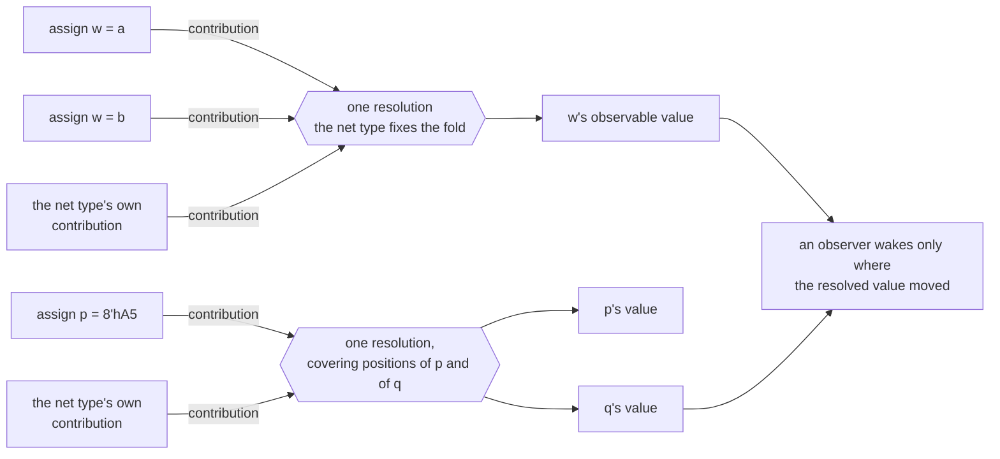

# Net Resolution

The compiler does not yet carry out every net this model covers. It refuses a driver whose 0 and 1
strengths differ (LRM 28.11), a delay on a net declaration that does not assign (LRM 10.3.3, 28.16),
an `interconnect` net (LRM 6.6.8), a net of a user-defined nettype (LRM 6.6.7), a net holding a
tagged union, a net of a dynamic array, queue, associative array or event type (LRM 23.2.2.3), a net
a package declares, and a procedural continuous assignment to part of a string, a queue, a dynamic
or associative array or to a member of a tagged union. It also refuses a join of nets whose types
resolve differently, and an `inout` port connected to a net of a different width, where invariant 9
takes the type Table 23-1 gives. The contract below binds each regardless.

## Purpose

Define what a SystemVerilog net is and how its value is produced. A net's value is not written; it
is the resolution of a set of independent driver contributions under the net type's resolution
policy (LRM 6.5, 6.6). What that resolution covers is not always one net, and not always the whole
of one: a bidirectional connection and an `alias` each state that positions across several nets are
the same physical net, resolving over the contributions of all of them, and a net nothing reached is
that same resolution with nothing coupled to it. This document owns the driver / contribution /
resolution model, what one resolution covers, the distinction between a net and a variable, and what
a procedural continuous assignment -- the one thing that displaces a resolution -- does to what a
net or a variable shows. It is the design-global net-resolution concern that
`reference_resolution.md` places outside its own scope.

The model is shaped by compiling per unit (`north_star.md` invariant 2): a net's drivers are not all
knowable when its unit is compiled -- a child's input net is driven by a port connection its parent
authored, from a count and expressions the parent's elaboration decides -- so the driver set is a
topology assembled as the design is built, never a list the net's unit gathers.

## Owns

- The rule that a net is a resolved observable value: its value is `resolve(contributions)`, where
  the resolver is fixed by the net type and the contributions are supplied by the drivers of every
  name reaching those positions and by the net type itself.
- The decomposition of a net into three parts: a resolved observable value, a set of driver
  contributions, and a resolver policy.
- The rule that each driver is an independent contribution with its own identity and provenance. A
  driver updates only its own contribution; what the net shows follows from the contributions and is
  never a second thing a driver writes. The driver is a capability handle its source owns -- for a
  port connection, the parent instance's connection state -- and the contribution is the net's.
- The rule that a contribution holds only the positions its driver drives. Each position resolves on
  its own (LRM 6.6.7), so a driver of part of a net takes no part in the resolution of any other
  position, and a change of it reaches only the resolutions of the positions it drives.
- The rule that what a net shows follows every change of a contribution, and that a change is
  published only when the value shown itself changes.
- The rule that resolving is what several contributions need. Every fold leaves a lone contribution
  as it stands, its high-impedance positions included (LRM 6.6.1 Table 6-2, 6.6.3 Tables 6-3 and
  6-4), and strength decides only between contributions (LRM 28.12.1), so positions one driver
  decides have no value apart from that driver's contribution: they show the contribution and
  nothing resolves them. Which positions one driver decides is a fact of the elaborated design.
- The rule that a net type states two things and no more: the fold it performs, and the contribution
  it makes to the net's own resolution -- a value and the strength it holds that value at (LRM 6.7.1
  gives a net type a default value and strength, LRM 6.6.5 a `tri0` "a continuous 0 value of `pull`
  strength driving it").
- The distinction between a net and a variable as a property carried by type, not a flag: a variable
  owns mutable state and is written directly (a procedural write, or a single continuous driver); a
  net owns a resolver and a driver set and is only ever driven. They share the read and observation
  protocol, the cross-unit route and the scheduler, and differ in the write capability.
- The rule that a driver's contribution carries both a logic value and a drive strength, and that
  resolution consumes both: strength decides between contributions of unequal strength, and the net
  type's fold decides among those of equal strength (LRM 28.12.1, 28.12.4).
- What a position is, which the standard settles rather than this model: for a net of a built-in net
  type, resolution runs per bit, numbered for a net of an unpacked type as its type numbers them
  (Notes). LRM 6.7.1 makes a net "composed entirely of 4-state bits", each carrying its own
  strength; LRM 6.5 makes every bit of a packed type an independent element; and LRM 6.6.7 names the
  unit outright -- an _atomic net_ is one "whose value is updated and resolved as a whole", and "a
  `logic` vector net is not an atomic net as each `logic` element is resolved and updated
  independently". So a vector net is as many resolutions as it has bits, and what the clause calls a
  single connection point is the set of them some connectivity relates.
- What resolves: a physical net, the set of positions the elaborated design's connectivity places in
  one resolution (LRM 10.11, 23.3.3.7). It is an object of its own, carrying the fold, the net
  type's own contribution and any procedural continuous assignment over those positions -- the facts
  a resolution needs and a name does not. Every name in one covers the whole of it, so a declared
  net reaches one per range of its own positions, holding its own contributions, its own observers
  and a copy of what each of those resolutions produced over the positions it covers; a net no
  connection reached is the one name of the single resolution covering it exactly.

  **A physical net is therefore one object per set of adjacent positions the design reaches
  identically, rather than one per position.** That is a compression of the bit-wise model above and
  is what gives it its own rule: a physical net covers exactly a maximal set of adjacent positions
  that agree on what reaches them -- the connections that place them in a resolution and the drivers
  that contribute to it -- so a connection or a driver reaching part of one leaves it no longer
  maximal and it is cut. A design whose connections and drivers reach whole nets has one physical
  net per net and never meets the cut.

- The rule that a resolution pools the contributions reaching its positions and never makes one
  resolution's value an input to another's.
- The rule that one resolution has one net type -- one fold, one contribution of the net type's own,
  and one answer to whether resolution keeps that contribution current -- so a join of nets that
  state different ones takes the type LRM Table 23-1 gives (invariant 9). What a net type states
  carries no width, so nets of unequal width state the same one.
- What a procedural continuous assignment (LRM 10.6) does to what its target shows: a takeover held
  on the target, per position, at one of two levels.

## Does Not Own

- The route by which a driver reaches a net across compilation units, and by which a net's value is
  read across units (`reference_resolution.md`).
- The phases in which drivers attach, connections join, and drivers first give a value
  (`elaboration_lifecycle.md`).
- The capability-type family and the observable-cell access protocol that a net's resolved value and
  a driver handle are members of (`mir.md`).
- Waking dependent processes when a net's resolved value changes, and what a write tells a wait
  (`scheduling.md`).
- Which connections join nets, and which positions of each they reach. Whether a construct places
  nets in one resolution is a property of the construct -- a port's direction, an alias statement --
  and so is which of their positions it reaches, which a select, a concatenation and an assignment
  pattern each state in their own terms. Turning what the source wrote into positions belongs to
  whatever owns that construct; this document owns what being in one resolution means.
- Which drivers a legal program may give a net, and which net types a connection may join: those are
  answered over the elaborated design by the front end (`compiler_overview.md`).

## Core Invariants

1. A net's value is the resolution of its contributions under the net type's resolver (LRM 6.5,
   6.6). With zero drivers the value is what the net type's own contribution resolves to; a single
   driver and many drivers are the N=1 and N>1 readings of the same resolution, so what a net shows
   and when it changes never depends on which of them it has. How positions one driver decides hold
   that value is invariant 10. Where a connection has placed positions of other nets in one
   resolution with positions of this one, "its contributions" are the contributions reaching every
   position that resolution covers, each read at the positions it occupies here; a net nothing
   reached is the case with nothing coupled to it and has no representation of its own.
2. A driver is an independent contribution with identity and provenance. A driver gives only its own
   contribution and reaches no other driver's, and its contribution holds the positions it drives
   and no other. The net owns the contribution storage and says where each contribution lies; the
   driver names its contribution by a stable identity, never by a borrowed pointer into that
   storage. Serves compiling per unit: a driver authored in another unit attaches to a net whose
   storage it never compiled against.
3. What a net shows follows every contribution change, but a change is published only when the value
   shown changes (LRM 4.3: an update event is a change in state). A contribution that moves without
   changing the value shown wakes no observer.
4. A net is never the target of a direct or procedural write; it is only driven (LRM 6.5). This is
   carried by the net being a distinct capability type, not by a classifying flag beside a value
   type.
5. Resolution is a function of the contributions as they stand and of nothing else. The one
   contribution resolution itself writes is the charge-retaining net type's own, which takes the
   resolved value at every position some stronger contribution decided -- the whole of the driven
   and the capacitive state (LRM 6.6.4); every other contribution is written by its driver or by the
   net type once.
6. A constraint on how many drivers a net may have is decided before this model. It is a property of
   the elaborated driver topology rather than of any contribution's value, and the front end's
   design-wide driver analysis answers it (LRM 6.6.2, 6.6.7), naming the driver that broke it and
   the one already there wherever either was authored; so nothing here holds a count of drivers
   against a limit and no net type is modelled as refusing a second one. A net type that admits one
   driver shows the one it has exactly as a net that happens to have one does.
7. Strength orders contributions and nothing else: where two contributions differ in strength the
   stronger decides the positions it drives, and where they agree the net type's fold decides (LRM
   28.12.1, 28.12.4). A contribution at the high-impedance strength decides no position, which is
   what makes a net with no drivers resolve to its net type's own contribution rather than to a case
   of its own. A contribution carries one strength per value, the one its source states or `strong`
   where it states none; this holds while every driver has one strength for its 0 and its 1, since a
   driver with two differing strengths whose value is unknown occupies a range of levels (LRM
   28.12.2).
8. A net's resolved value carries no strength. This holds while no modelled construct makes one
   net's resolved value an input to another resolution; a switch and a gate primitive are the two
   that would, and both are outside this document's subject. A bidirectional connection is not one
   of them: it pools the contributions rather than the results, which is what makes it
   non-strength-reducing (LRM 23.3.3).
9. One resolution has one net type. Where the nets a join covers state different types, the standard
   names the dominating type of each pair (LRM Table 23-1), and the resolution takes it. That
   relation is not transitive -- `tri0` dominates `trireg`, while `trireg` and `wand` tie and so do
   `tri0` and `wand` -- so a set a chain of connections joins has one type only where every pair's
   answer agrees; where they disagree the standard gives none, and the program is reported rather
   than answered. The check reads what the nets state, where the join is made.
10. Positions one driver decides show that driver's contribution, and nothing resolves them: the
    driver's update is the net's change there, published as invariant 3 requires. One driver decides
    the positions it drives where it is the only driver reaching them, the net type contributes
    there at the high-impedance strength and keeps nothing, and no connection placed them in a
    resolution another name reaches. Which positions a driver decides is settled per driver over the
    elaborated design, once every driver has attached and every connection has joined, and never
    where a unit is compiled. Under a procedural continuous assignment the driver's writes land in
    its contribution, which the net resolves under the assignment as any net does, so the positions
    it does not hold show the driver's value and the rest show it once released (LRM 10.6.2). Where
    one driver decides the whole net and carries the whole of a variable, another net, or a port
    declared as a variable, of the net's own type, unchanged, the contribution is that object's
    value, so the net shows the object where it lies, a wait on the net is a wait on the object, and
    nothing runs to carry it (LRM 23.3.3, 4.8). It shows its own undriven value until the driver's
    turn at time zero, so the first value is a change as any driver's first value is; a procedural
    continuous assignment puts it back on its own storage, which never reaches the object; and a net
    that shows another net shows whatever that one comes to show. A net names what it shows the way
    a port declared as a variable names its source, so the two follow binding and forcing by one
    rule.
11. A driver's contribution starts at high impedance and the driver gives its first value at time
    zero, in its turn after every `always` procedure is waiting (`elaboration_lifecycle.md`), so the
    net's first value is a change a waiting procedure sees (LRM 4.9.1). Attaching is therefore not
    itself driving, and N=0, N=1 and N>1 start alike.
12. A procedural continuous assignment is not a driver. It overrides every driver (LRM 10.6.2), and
    no strength does that: a wired-logic fold combines contributions of equal strength, `supply`
    included, rather than choosing one (LRM 28.12.4). So a takeover is state on the target's
    capability, at one of two levels -- an `assign`'s, outranked by a `force`'s, both outranking the
    target's own value source -- holding positions of the target rather than the target. Beginning
    one takes the positions it names from whatever held them at its level, and releasing ends the
    takeovers on the positions it names alone. A position shows the value of the takeover holding it
    at the highest level that has produced one, so a takeover that has not yet evaluated shows
    nowhere and no position shows a value no source gave it (LRM 4.3).
13. What a target shows is what its storage holds, so a read is untouched by takeovers and every
    cost they have sits on the write path. Serves the iteration-time target (`north_star.md`
    invariant 1): reads are what a simulation spends its time on, and almost no target is ever taken
    over.
14. A takeover's evaluation is the evaluate-then-await loop a continuous assignment runs, as an
    execution of no lineage (`scheduling.md`) started where the statement runs: LRM 10.6 makes the
    right-hand side continuously evaluated, and makes no process of it, so `wait fork` and
    `disable fork` do not reach it. It carries the generation each part of its target was taken over
    under and stops itself once no takeover of those generations holds a position at its level, so
    the ending statement needs no handle on it; with nothing whose change could matter it drives
    once and ends, since one is begun per execution of a statement and a parked evaluation per pass
    of a testbench loop would grow without bound.

## Boundary to Adjacent Layers

- `reference_resolution.md` owns the one route from a referrer to a target. A driver attaches to a
  net through that route, and a read of a net reaches the resolved value through that route; net
  resolution is the concern that doc names as design-global and out of its own scope.
- `elaboration_lifecycle.md` owns when. Drivers attach and connections join during Resolve, which
  completes design-wide before anything observes a net; a net's type facts are fixed at
  construction; drivers first give a value in Activate's second turn.
- The front end owns which drivers a legal program may give a net, as `compiler_overview.md` places
  every question answered over the elaborated design before HIR. A rule the standard states as an
  error rather than as a value -- a net type that admits one driver, a nettype declared with no
  resolution function -- is decided there, and this model resolves whatever topology it is handed.
  It also implements Table 23-1 per port connection and warns where the table says to; this model
  reads the table's answer for the nets a join covers (invariant 9) rather than restating it.
- `mir.md` owns the capability-type family. A net's resolved value is a capability type sibling to
  the plain observable cell (readable and observable, but not directly writable); a driver is a
  capability handle sibling to a reference. Beginning and ending a takeover are calls on the
  target's capability, as attaching a driver is, and MIR states no node for either.
- `scheduling.md` owns the wakeup that fires when a net's resolved value changes, and the
  evaluate-then-await loop a takeover's evaluation runs.

## Forbidden Shapes

The test each answers: does it fail what the standard says a net shows, or make a net's model depend
on something its unit cannot know where it is compiled?

- A net modeled as a plain writable cell that each driver writes directly, so the last write wins.
  It fails LRM 6.6: multiple drivers resolve, and a net's value is a projection of its
  contributions, never the most recent write.
- A net's net-ness carried by a flag beside a value type. It fails invariant 4 by construction:
  every consumer of the value type must then remember to test the flag before writing.
- One aggregate per-net process that reads every driver's expression and fixes the driver set at the
  net's owning-unit compile time. It fails compiling per unit: a driver may be a cross-unit port
  connection authored in another unit, and it leaves no per-driver identity for strength or
  provenance to live on.
- A driver holding a borrowed pointer into the net's contribution storage. It fails invariant 2: the
  storage is the net's, reorganizable as the design is built and as ranges are cut.
- A net given a single-driver representation where its unit is compiled, or a single-driver net
  modelled as a variable. It fails compiling per unit: a second driver may attach from another unit,
  so which positions one driver decides is settled over the elaborated design (invariant 10).
- A net whose positions one driver decides carried by a variable's type, or made the target of a
  procedural write. It fails invariant 4: such a net is still only driven and still a resolved net,
  so nothing that reads, waits on, drives or forces a net knows which of its positions one driver
  decides.
- Positions one driver decides showing, or publishing, anything a resolution of their one
  contribution would not. Whether one driver decides them changes what runs and never what a design
  observes (invariant 1).
- A net type modelled here as refusing a second driver, or any count of drivers kept so that a
  constraint can be checked against it. It fails invariant 6: a second authority for a rule the
  front end decides, which to name the earlier driver would carry a provenance record on every
  driver of every net. A net of a type no net type resolves is the one exception: only a forbidden
  text declares one, the front end checks none of its drivers, and so it refuses a second where that
  driver attaches (Notes).
- A net type realized as a resolver of its own, or as an alternative anything below this layer
  branches on. A net type says which fold and what it contributes (LRM 6.6.5, 6.6.6, 6.7.1); a type
  that pulls, supplies, or stores charge differs from a plain one in that contribution and in
  nothing else, so a value-only fold per net type freezes one strength comparison into a rule and is
  wrong for the first design that writes a strength.
- A value the net type contributes to itself modeled as a driver. LRM 6.6.5 does not count it as one
  ("when no driver drives a `tri0` net"), so it is never detached, never updated by anything outside
  the net, and never counted by a constraint on the driver set.
- A net publishing to its observers because a contribution changed while the resolved value did not.
  It fails invariant 3.
- A strength kept on the resolved value, per bit. It fails nothing the standard asks of the modelled
  language and is paid by every net: no modelled construct reads a resolved value's strength
  (invariant 8). A switch-level construct is what would reopen it.
- Strengths resolved at compile time, from the design's whole driver set. It fails compiling per
  unit, since that set is not knowable where a unit is compiled.
- Two nets joined by making one a reference to the other, or by deleting one and rebinding its name.
  A net a connection joins goes on being read, waited on, sampled, forced, and reached by a
  hierarchical name under its own name, and a child's compiled body addresses its own member, so
  nothing may move or remove its storage.
- A join realized by giving each side a driver fed by the other side's resolved value. It fails LRM
  23.3.3, whose one named property of a bidirectional connection is that it is
  non-strength-reducing: two `pull` drivers facing each other resolve to x as one net, and
  re-driven, each side sees the other's result at the re-driving assignment's strength, a fixpoint
  over values that never met at a common strength.
- A separate representation for a net no connection joined. Such a net is one range of positions
  that covers it, reaching the one resolution over it, which is the same walk every other net takes
  rather than a case beside it.
- A fact the resolution owns kept on a name: the fold, the contribution the net type makes to its
  own resolution, or a procedural continuous assignment over the positions. It fails LRM 23.3.3.7,
  read per bit range: different bits of one name may meet different net types, and a name cannot
  state one per range of its positions.
- A resolution the names in it encode between them rather than an object they reach -- a ring of the
  names, or a closed set of links relating them pairwise. It is correct for the values and fails
  everything a resolution owns, and a joint of K names costs K resolutions over K names'
  contributions where an object costs one fold and K copies.
- A procedural continuous assignment given a strength above every driver. It fails LRM 10.6.2, as
  invariant 12 says.
- A compile-time twin beside each target -- a shadow signal and an enable -- materialized because
  something forces it. It fails compiling per unit: what forces a target is usually a testbench in
  another unit reaching in by hierarchical name, so the target's unit could not be compiled until
  every unit that might reach into it had been seen.
- Shadow storage under every target a takeover could reach, consulted on each read. It fails
  invariant 13, and nothing needs restoring: a variable keeps the value a released takeover gave it
  (LRM 10.6.1).

## Notes / Examples

### What a resolution covers

```systemverilog
wire [7:0] w;
assign w = a;           // one contribution
assign w = b;           // another, independent of the first

wire [7:0] p, q;
alias p = q;            // one resolution now covers positions of both
assign p = 8'hA5;       // q is driven by nothing and still has a value
```



Three things the picture is for.

**Nothing writes a net.** Every arrow into a resolution is a contribution, and the arrows out are
values read. A driver that changes moves its own contribution and nothing else; what an observer
sees is the fold re-run.

**A resolution is the unit, and it need not be one net.** `q` is driven by nothing and has a value,
because the alias placed its positions in the resolution `p`'s driver reaches. That is invariant 1's
coupled case, and an uncoupled net is the same picture with one net in the box -- there is no second
representation for either.

**The net type contributes like a driver does.** It is in the same list, which is why a net with no
driver at all needs no special case: resolving contributes-nothing-but-the-type is the N=0 reading
of the same fold.

A single-driver wire `assign w = e;` has one contribution; resolving one contribution yields that
contribution's value, so `w` tracks `e`. What `w` shows is the N=1 reading of the general model, and
because no fold changes a lone contribution, `w` holds that contribution as its value instead of
resolving it (LRM 6.5, 6.6.1). Where `e` is the whole of a variable of `w`'s type, written
`assign w = v;` or as the connection of an input port written with no port kind, that contribution
is `v`'s value, so `w` shows `v` where it lies and the assignment runs nothing after its turn at
time zero.

A multiply-driven net `assign w = e1; assign w = e2;` together with a child output connected to `w`
has three contributions; the wire/tri resolver combines them per its truth table, yielding `x` where
they conflict and high-impedance where all contribute high-impedance (LRM Table 6-2). A `wand` /
`wor` net uses the and / or truth table instead (LRM 6.6.3).

A child's input net driven from its parent receives a driver the parent attaches through the route;
the child's net resolves its own drivers. The child cannot enumerate who drives it when it is
compiled, which is why a driver is an independently attached contribution rather than a member of a
list the net's unit builds at compile time (LRM 23.3.3).

### What a net type states

Each built-in net type is a fold and a contribution of its own, and nothing else:

| Net type         | Fold            | Own contribution                  |
| ---------------- | --------------- | --------------------------------- |
| `wire`, `tri`    | tri-state       | z at `highz`                      |
| `wand`, `triand` | wired-and       | z at `highz`                      |
| `wor`, `trior`   | wired-or        | z at `highz`                      |
| `tri0`           | tri-state       | 0 at `pull`                       |
| `tri1`           | tri-state       | 1 at `pull`                       |
| `supply0`        | tri-state       | 0 at `supply`                     |
| `supply1`        | tri-state       | 1 at `supply`                     |
| `uwire`          | tri-state       | z at `highz`                      |
| `trireg`         | charge-retained | x at the declared charge strength |

Resolution, as LRM 28.12.1 and 28.12.4 decompose it, needs no strength arithmetic beyond comparison:

```
resolve(contributions):            # each contribution is a value and one level
  result = high-impedance
  for level from supply down to small:
      group = contributions at that level
      if group is empty: continue
      g = fold(group) under the net type's truth table
      result = g where result is still high-impedance, else result
  return result
```

Where every contribution sits at one level -- every design that writes no strength and declares no
pull, supply or charge net -- the loop runs its body once and is the plain fold. LRM Table 6-5,
which gives `tri0` against two `strong` drivers, agrees in every cell, including the two that
separate a strength model from a value-only one: `(1, z)` is 1, because the strong driver outranks
the pull contribution, and `(z, z)` is 0, because nothing outranks it.

The single-driver `uwire` net shows its driver's value as any other net with one driver does; what
makes it single driver is that connecting a second one is an error (LRM 6.6.2), which is the same
rule the standard states generally for a nettype declared with no resolution function (LRM 6.6.7).
Being unresolved and admitting one driver are one fact, and it is a fact about the elaborated design
rather than about resolution, so no net type here is spelled differently for it.

A `tri0` net is "equivalent to a wire net with a continuous 0 value of `pull` strength driving it"
(LRM 6.6.5), which is the net type's own contribution: the tri-state fold decides every position
some driver drives, and the contribution decides the rest. A `supply0` net says the same thing at
the other end of the scale, so its contribution outranks every driver instead of deferring to them,
and a `trireg` says it with a contribution resolution itself keeps current (LRM 6.6.4, 6.7.1).

### Positions, and the physical net

A net's data type may be an unpacked aggregate whose elements are themselves valid for a net (LRM
6.7.1). Its positions are its parts', one part after another and the first part's first, which is
how a procedural continuous assignment numbers them too (LRM 10.6.2), and it resolves them as a
vector net resolves its bits; what they resolve to is laid into the parts they lie in, so a driver
of one element costs that element whatever the aggregate's size. An untagged union is the bits of
its widest member, every member a view of them from the first position, so its positions are its
storage's and a driver of a member, or of a part of one, drives the storage's positions that member
or part takes: drivers through two members resolve where their positions meet, as two drivers of
overlapping parts of a vector do, and a whole union value drives every position. Nothing about nets
names a union.

A net's positions resolve as 4-state bits under the net types' tables (LRM 6.6.1, 6.6.3), and a
2-state part shows what they resolve to with x and z taken as 0 (LRM 6.11.2), as a 2-state integral
net does, so an aggregate resolves where every bit it has is a bit of an integral value. A net of a
type no net type resolves -- a real, a string, a class handle, or an aggregate holding one, none of
which has bits a table reads -- which only an input port written with no port kind declares (LRM
23.2.2.3) -- is run as a net of a nettype with no resolution function (LRM 6.6.7). Its one driver
decides it, where nothing drives it it shows its type's default, the net type it was declared with
contributes nothing, and a second driver is the design's error, refused where it attaches. It is a
net of its own kind from MIR down, since how its value is arrived at shares nothing with a net
resolving positions but being driven, read and observed.

A bidirectional port connection is "a non-strength-reducing transistor connection" (LRM 23.3.3), and
the standard settles what that means by merging the nets on both sides into one simulated net (LRM
23.3.3.7). Merged, a pull inside the child and a strong driver in the parent meet at the strengths
they were driven at and the strong one decides, which is the property the phrase names; a driver in
either module reaches both names; and a chain of such connections is one resolution across every net
in it, with no step in the chain resolving anything of its own. An `inout` port is therefore less
machinery than an `input` or an `output`: one join where those install a process.

LRM 10.11's own example is why a name reaches one physical net per range of its positions rather
than one per name. Its byte swap relates `A[7:0]` to `B[31:24]` and `A[15:8]` to `B[23:16]` in one
statement, two alignments that `A` at one base in one space cannot satisfy both; cut into ranges,
each byte of `A` is the one name of a range in the resolution its byte of `B` reaches, and nothing
is ever rebased. A connection states a position-wise overlay -- LRM 10.11 gives it "the bit overlay
rules ... for a packed union with the same member types", correspondence running from the most
significant end -- so it is taken in the pieces both sides have whole, and the range a net names its
positions by is read once, where the source wrote the select. Composed connectivity has meaning only
in positions: `a` joined to `b` and `b` to `c` meet at positions of `a` and `c` that no select of
either names.

A fact that belongs to a resolution rather than to a name is stated on the physical net, which is
where each of these lands: a net delay standing between what the resolution produces and what its
names show (LRM 28.16), an `interconnect`'s type chosen at elaboration (LRM 6.6.8), a resolution
function over the drivers as one array (LRM 6.6.7), and the strength of a resolved value a resistive
switch reads (LRM 28.14).

### A procedural continuous assignment

What a displaced write does differs between the two targets, because the standard makes it differ,
and getting this backwards is the easy mistake. A procedural write to a variable under a takeover is
discarded at the positions the takeover holds and is never observable there at any later time --
which is what lets a released variable keep the value the takeover gave it rather than revert (LRM
10.6.1). A net's drivers go on updating their contributions the whole time it is forced, and only
what the net shows is overridden, because a released net immediately takes the value its drivers
determine (LRM 10.6.2): a contribution discarded while forced could not answer then.

Each takeover in effect records what it last evaluated to, including while a higher level covers it,
since its operands go on changing; so the standard's "reestablish that assignment" recomputes
nothing. "Schedule a reevaluation" is an event, not the instant of the release: the positions a
release leaves to something beneath it go on showing what they showed until a reevaluation scheduled
in the Active region runs, where a continuous assignment's update runs, so the releasing process
reads the forced value until it yields. A variable a continuous assignment drives is the case
release owes more on (LRM 10.6.2): its continuous driver is the level beneath both takeovers, so
what the driver writes while covered is kept beneath -- from what the variable held when first
covered, existing only while something covers it or the reevaluation is still to run, consulted by
no read -- and shown at each position a release leaves no takeover holding. Whether a variable is
driven continuously is not a fact of its declaration, since the driver may be in another unit, so
each continuous driver states it to the storage it writes, once, as the design is built.

Positions are numbered by the target's type: an integral value's bits, a real's IEEE 754 bits, a
structure's members and an array's elements one after another, an untagged union's storage, and one
for any other value, which is held whole. A part of a value whose parts move -- a string, a queue, a
dynamic or associative array -- and a member of a tagged union, which only its tag says is there,
lie at no fixed position and are no run of positions. Showing what a takeover holds at a run of
positions is one question every type answers, its operation of taking those positions from another
value of it.

A target that owns no storage -- a port that stands for what its connection drives it with -- is
given a variable of its own when first forced, taken over as any variable is and driven continuously
by the connection, so the positions no takeover holds go on following the source (LRM 23.3.3); the
variable is kept for every later force, so the generations of its takeovers go on counting. A
takeover reached through a reference acts on what the reference names, which follows from how each
instance is connected, so the statement is lowered one way whatever its target.
