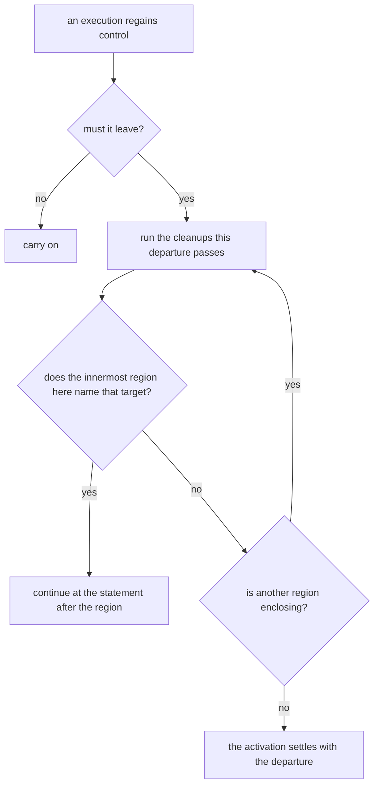

# Non-local control flow

How a program says "this scope can be left from anywhere within it", what each layer states about
it, and how a backend realizes it. The subject is the generic control construct, not any one use of
it: cancelling a running activity is built on this, and is not the same thing.

## The construct

One body, one landing. Execution anywhere dynamically inside the body -- including inside a callable
the body invoked -- can be sent to the landing, and continues at the statement after the region.

```systemverilog
initial begin
  begin : blk
    x = 1;
    disable blk;   // sends this execution to the landing
    x = 2;         // never runs
  end
  y = 3;           // the landing: execution continues here
end
```

Three properties make this more than a jump, and each one rules out a simpler mechanism:

| Property                                             | What it rules out                              |
| ---------------------------------------------------- | ---------------------------------------------- |
| The request can come from a different execution      | A local branch: the requester is not there     |
| It reaches executions any number of call frames deep | A lexical jump: the callee is not written here |
| One region can hold several concurrent executions    | Naming an execution: the region names a scope  |

## The four pieces

A language that supports this has exactly four things, and no fewer:

| Piece       | What it is                                                        |
| ----------- | ----------------------------------------------------------------- |
| **Target**  | The runtime identity a request names, one per region per instance |
| **Effect**  | A request in flight, carrying the target it names                 |
| **Region**  | A body plus the landing an effect naming its target reaches       |
| **Cleanup** | Work that runs on every way out of a body                         |

The cleanup is not optional. An execution can be sent to a landing from any point where it regains
control, so anything the body must release has to be released on a path the body did not choose.

## Two layers, and the split is the point

These four are not one layer. Two of them are language constructs and two are library values, and
mainstream languages draw the same line:

| Layer          | JVM world                                        | Here                                   |
| -------------- | ------------------------------------------------ | -------------------------------------- |
| Language       | `try` / `catch` / `finally`, and the raise       | The region, the raise, and the cleanup |
| Library on top | `Job`, `coroutineScope`, `CancellationException` | The target and the effect              |

Kotlin's cancellation is a library built on the JVM's exception and cleanup constructs; the JVM
knows nothing about cancellation. The same holds here: the semantic IR knows a region, a raise, and
a cleanup, and nothing about why a program would want them. What makes a target cancellable, when it
is invalidated, and who is woken are runtime-library concerns reached through ordinary calls.

The consequence to hold on to: **no control construct below the source language may name
cancellation.** The constructs a body carries stay generic; the library values they operate on, and
the calls that reach them, name whatever the runtime's own concepts are.

## The library on top: `disable`

`disable` of a named block or task (LRM 9.6.2) selects its targets by static declaration, in any
process and regardless of lineage, so it reaches every execution inside the block, including several
executions of one reentrant task. The library answers it with one value per target and one number on
it.

**A target is one per thing that replicates its block.** It is static state of the declaring scope,
placed by the rule that places every static ([`lifetime.md`](lifetime.md)): a design element's block
has one per instance, so `u1.blk` and `u2.blk` are separate; a block of a class method has one per
replication of the class, shared by every object, because LRM 9.6.2 disables a block inside an
automatic task "for all concurrent executions of the task". A target the statement's own declaration
scope declares is named by holding it; any other on the design hierarchy is reached by a route, as
every name that leaves a scope is ([`reference_resolution.md`](reference_resolution.md)).

**Being inside a target is state of the running process.** Each target carries a generation. An
execution entering the target captures the generation and joins the target's list for as long as it
is inside; the set spans a call, because a called task runs inside whatever targets its caller was
inside. An activity spawned inside a target takes the membership at the spawn, from its spawner's
live set, because it is a member by where its spawner was (LRM 9.6.2) and does not run until its
spawner blocks or ends (LRM 9.3.2), so a `disable` can land while it exists and has run nothing.
Each membership records, at the entry or at the spawn, whether a `disable` of that target resumes
the execution past it or ends it ([`activation.md`](activation.md) owns the record).

**`disable` invalidates and releases; it never inspects.** It bumps the target's generation and
fires the target's list, the same act an event trigger performs. A member that resumes past the
target is woken where it is blocked; one running or runnable is passed over and reaches the gate on
its own; a suspended one takes the gate when it is resumed (LRM 9.7). An activity started inside the
target has nothing past it to regain control for and runs nothing of the design on its way out, so
the `disable` ends it there and then, the act `kill` performs (LRM 9.7), and it reads KILLED once
the statement completes.

**The gate is the question of invariant 5, asked by the runtime where control is regained.** An
execution must leave when a target it is inside has been disabled since it entered -- its captured
generation is not the target's current one -- when its process has been terminated and it has yet to
unwind for that, or when it ended the run; the three are asked together, and are kept on the running
execution rather than on a process, because code on no thread ends the run too. A departure for a
disabled target names the outermost one it is inside that was invalidated, since leaving that leaves
everything nested in it; the other two name no target, which makes them departures no region may
claim.

**Where it lands.** The departure stops at the region that names the same target and leaves the
execution owing nothing more -- not one inside an earlier activation of the same reentrant task,
which the `disable` also reaches, and not one inside an execution whose termination is due -- as a
Trio cancel scope steps aside while an enclosing scope's cancellation is still in force. Every
target is such a region wherever its block stands, since LRM 9.6.2 gives one rule, "Execution shall
resume at the statement following the block": a named block continues after the block, a task named
by the `disable` completes normally so its enabling statement resumes, and a process whose own
statement is the target resumes past it with nothing left -- an `initial` procedure runs out and
reads FINISHED, an `always` procedure goes round again, a `final` procedure returns to the next. The
9.6.3 sentence that a disable "terminates a process when applied to the named block or statement
being executed by the process" stands where the clause contrasts which processes `disable` and
`disable fork` select, and is read as that selection, since read as a rule for status it would
contradict 9.6.2's resumption wherever something follows the block.

## Where the effect goes



Two things this diagram fixes. The effect is discovered where an execution regains control, never
delivered into the middle of a statement -- a simulated process cannot be made to run code partway
through a statement of the design. And every departure runs the cleanups it passes, before it
reaches the next landing.

## The one boundary a departure may not cross

Every frame in that diagram is one this compiler emitted, and a departure travels through them by
whatever means the target language gives it. A frame belonging to another language is not: it cannot
be unwound by a departure and it cannot be skipped, and while the run lasts it ends only by
returning; once the run is over, the release of the whole stack unwinds through it and runs nothing
of that language's, running what each frame of the design's on that stack owes. So a departure stops
there, and what crosses in its place is a value that language's own convention defines.

**Every function this compiler defines for foreign code to call is a region that lands whatever no
region inside it claimed** -- an exported subroutine's entry, and the program-wide symbol in front
of a module's entry, since resolving which entry it calls can fail as the design's error. A run-time
error of the design and a failure of the tool are landed there too: the region receives whatever
unwinds into it, so nothing the design or the tool raises reaches the foreign frame, even a foreign
handler that would catch anything. Rust guards every function it defines with a non-unwinding ABI
the same way, and aborts there; here the foreign side regains control instead.

**What crosses is the standard's own answer.** For DPI-C, an exported task returns the int LRM 35.8
gives it, saying whether a disable is active on this thread of execution, whichever way its boundary
ended; an exported function, given no such value by LRM 35.9, answers the zero of its result's C
type. An execution that ended the run is not handed back to foreign code, which told nothing of the
run's end could call in for ever while LRM 20.2 has the simulator exit, as Java's `Runtime.exit`
"neither returns nor throws": an exported task's entry then waits where the stack stands until the
run's end releases it, and an exported function, which cannot wait, answers its zero and runs
nothing.

**The protocol asks a narrower question than the gate.** Whether the execution is disabled -- a
target or a termination, the first two of the gate's three sources -- is what LRM 35.9's protocol is
about, since only there does the run go on past the execution and need the foreign frames beneath it
to return; the run does not go on past its own end, so nothing asks them to cooperate with that.
That narrower question answers the exported task's int and `svIsDisabledState`, and decides the
foreign programmer's obligations LRM 35.9 has the simulator check: what an imported task returned,
whether an imported function acknowledged, and whether an exported subroutine was reached once the
state was entered. A breach of any is reported and ends the run, and the departure, already due, is
taken at the boundary where control comes back. An exported subroutine reached from outside the call
of a `context` import is the error LRM 35.5.3 makes it, raised inside the entry's own region, which
reports it and stops the execution for it.

**The boundary is where the execution leaves.** Whether a departure is due is answered rather than
stored (invariant 5), so the execution derives it again at the first frame of its own that it
reaches, which is the call that entered the foreign code. That call is the one place a body states
the question for itself: every other point at which an execution regains control is a resumption,
which each target already gates its own way, and a foreign call that consumed no simulation time
suspended nothing there was a resumption to hang it on. Only a `context` import may reach an export
(LRM 35.5.3), so only its boundary carries this; a plain import's boundary carries nothing, as the
standard keeps a non-context call free of it. A `$finish` or `$stop` foreign code asks for through
`vpi_control` is carried out at the same boundary, upon the import's return (LRM 38.4). Terminating
an execution that holds an unreturned foreign call is a request and not a settlement: it is handed
control once more, leaves at its own gate once its foreign frames return of their own accord, and is
settled only then ([`activation.md`](activation.md) invariant 8).

## What each layer states

| Layer       | States                                                               |
| ----------- | -------------------------------------------------------------------- |
| Source-near | The construct the source wrote: a named block, a task                |
| Semantic    | A region with its landing, a raise, and a body paired with a cleanup |
| Execution   | Basic blocks and edges; the cleanup copied per place a way out goes  |
| Runtime     | Whether an execution must leave, and which target it leaves for      |

The semantic layer states the construct once. The execution layer has no scopes -- only edges -- so
a body's ways out are enumerated there and the cleanup is emitted once per place they go. A backend
that consumes the semantic layer directly does not enumerate anything: it hands the construct to its
target language.

## Core invariants

1. **A region is named by a value, not by a type or a lexical label.** The same region declaration
   exists once per instance, and several executions can be inside one at the same time, so neither a
   type nor a label distinguishes the one a request names. _Serves LRM 9.6.2, which disables a block
   in every execution of it and in no other instance's._

2. **A body carries the region and nothing else.** A suspend, a call, and a request to leave are the
   same program whether or not any region encloses them. Discovering that a departure is due, and
   carrying it past frames that do not land it, are the runtime's. _Serves the split above: a task
   suspends and resumes identically whether or not a target encloses it, so a check in its body
   would put cancellation into code that has nothing to do with it._

3. **An extent's two ends are both stated.** Entering a region and leaving it are each an operation
   the program states. Marking membership with a value whose lifetime is the body's asks the target
   language to run code at scope exit, which is a facility only some have. _Serves every backend,
   the execution backend having no scope-exit rule of its own._

4. **A cleanup runs on every way out, and the ways out are enumerable.** Falling off the end, a
   return, a loop exit, and an effect passing through are all ways out. A layer with scopes gets
   this from the target language; a layer with only edges gets it by emitting the cleanup on each
   edge. The cleanup's own code has one way out, running to its end: it runs while a departure may
   already be leaving, so a second one starting inside it has nowhere to go, and leaving it partway
   skips what it owes. So nothing a cleanup calls may leave, by its declaration, and the semantic
   layer's verification refuses a cleanup holding any other way out. C++ ends the program where a
   destructor's own code throws, and rustc's MIR gives a call in a cleanup only a terminating
   unwind; both allow it because their users write that code, where every cleanup here is the
   compiler's own.

5. **Whether a departure is due is answered, never stored.** The answer is derived when asked from
   the generation each target carries and the one the execution captured entering it, so nothing is
   queued and nothing has to be cleared. A region is re-entered under one identity -- a reentrant
   callable, a loop body -- so a one-shot mark cannot express "since this entry", and a single
   "disabled" signal cannot say which target or how far.

6. **A departure no region lands settles the activation, rather than returning a value.** Every
   target is a region wherever its block stands -- a process's statement, a block nested in one, a
   call's body -- so a departure naming a target is landed there, unless the execution's own
   termination is owed, and the execution resumes past it, running out if nothing follows. What no
   region lands is a departure naming none: a kill, a disable of a target the execution was started
   inside, a run-time error, the run's end. That outcome is the activation's, not a result its
   caller reads.

7. **Whether a call can leave is a property of its callee's declaration, never of what the callee
   does.** Nothing proves a callee cannot leave; one that cannot says so where it is declared. A
   proof would need the callee's body, which another unit may hold, and a call written before the
   proof existed would have to be revisited when it changed. _Serves north star invariant 5
   ([`north_star.md`](north_star.md))._

8. **A run-time error is the departure no region may claim from the first region or execution top
   that receives it.** It is reported there, once, and then travels as every other departure does,
   so every cleanup it passes runs and it stops at a foreign frame's entry like the rest.

9. **No departure crosses a frame this compiler did not emit.** Every function foreign code calls is
   a region that lands what nothing inside it claimed, and what crosses instead is the answer the
   foreign convention defines. _Serves LRM 35.9, whose protocol gives the foreign side a cleanup of
   its own that an unwound or skipped frame loses._

10. **Which targets an execution is inside is state of the running process, captured where it enters
    a target and where it is spawned inside one.** _Serves LRM 9.6.2, which reaches a task called
    from inside the target and a branch spawned inside one -- neither written inside the block --
    and LRM 9.3.2, under which a branch can be disabled before it has run a statement._

## Forbidden shapes

Each names the requirement it fails.

- **A control construct below the source language that means "cancellation"** fails invariant 2:
  what a body carries is a region, a raise, and a cleanup, each generic, and a node or terminator
  meaning "cancel" collapses the language layer into the library one. A library value, and a call
  reaching one, is not this -- naming a target or an activation's outcome at the boundary to the
  runtime is naming the runtime's own concepts, which is what a boundary is for.
- **A region identified by an exception type** fails invariant 1: a type cannot distinguish two
  instances of one declaration, which is what a request names.
- **An extent held by a value's lifetime** fails invariant 3: it states the entry and leaves the
  exit to a target language's scope-exit rule, so a target without one cannot realize it, and the
  ways out that are easy to forget -- a return or a loop exit leaving the body -- are the ones it
  hides.
- **A stored "a departure is due" flag, or a resume reason on the activation,** fails invariant 5:
  it needs an owner, a clearing point, and a rule for a region re-entered before it was cleared, and
  it cannot name which target or how far. Deriving the answer needs none of these.
- **A departure threaded across a callable boundary by the program** -- every call handing back
  whether it left, every caller branching on it -- fails invariant 2: no frame between the leaving
  and the region can do anything with the answer but pass it on, since the source language has no
  way to catch one, and calls inside expressions would be forced apart into statements.
- **A landing reached by an edge the execution layer does not show** fails the execution layer's own
  contract that every transfer is an edge ([`lir.md`](lir.md)).
- **A `disable` that searches the live executions for those inside its target, or branches on
  whether each is running, waiting or runnable,** fails [`activation.md`](activation.md) invariant
  9: a target is a list, fired as an event's is, and the entitlement is reconciled at one gate.
- **Membership in a target rebuilt from where a body is written** fails invariant 10.
- **A departure unwound through a foreign frame, or carried across one and raised again on the other
  side,** fails invariant 9 and invariant 5: the first loses the foreign side's cleanup or aborts,
  and the second needs a place to keep the departure, an owner and a rule for a boundary re-entered
  before it was consumed.
- **An exported entry reached in the disabled state answering its caller a refusal** fails LRM 35.9:
  its one channel to the caller is the value the protocol already spends, so a breach is reported
  and ends the run instead.

## Notes / Examples

The current semantic IR spells the three constructs `TryStmt` (the region and its landing),
`RaiseStmt` (passing a departure outward), and `FinallyStmt` (a body paired with a cleanup). The
runtime library spells the two values `CancellationTarget` and `ControlEffect`.

The C++ backend realizes the region as `try` / `catch`, the raise as `throw`, and the cleanup as a
scope-exit object declared ahead of the body -- C++ states an extent's exit through a destructor
rather than through a construct of its own. The execution backend has neither, so it runs the
cleanup on each way out of the body and asks the runtime, at the points inside a region where an
execution regains control, whether it must leave. A departure no region of the body claims is itself
one of those ways out: a body called directly carries it on to its caller, and a body the runtime
drives as a suspended execution completes and hands it to the execution, the way a C++ coroutine
hands an escaping exception to its promise. Both realize the construct the way a C++ compiler
realizes the same C++: a call is assumed able to leave unless its callee is declared not to be, and
that declaration is true because the callee's definition is `noexcept` -- so a wrong one terminates
rather than letting a departure slip past a landing.

Both backends' regions catch whatever the platform's unwinder carries and ask the runtime what it
was, and so does the top of an execution. A control effect is itself. A run-time error is settled
there -- reported, the run ended, the execution asked to stop -- and carried on as the departure no
region may claim, so it is reported once, by the first region or execution top it reaches, and every
cleanup after that runs as for any departure. The release of a suspended stack, which must pass
every frame running what each owes, the runtime raises again from inside that question, unchanged.
Which exception is which is a question only the language the runtime is written in can answer, and
naming that language's type identity from generated code would make a fact of the runtime's own
spelling -- its mangling, and which translation unit holds the one definition of the identity --
something every artifact links against. Rust's `catch_unwind` has the same shape for the same
reason: its landing matches anything, and the runtime then decides from the exception it was handed
whether the raise was its own.

The lowering to the execution layer keeps the scopes a departure can meet -- cleanups, the end of
each value the body owns, and regions alike -- on one stack in the order they nest, as Clang's
exception handling does; a value whose type's end does nothing is owed no end, as rustc schedules no
drop for a type that needs none. What a way out owes is a chain of nodes, each one cleanup and the
node it continues to, made once for that pair as rustc's drop tree is. A call that can leave names
the first block of what it owes, as rustc's MIR names a call's cleanup block, and calls that owe the
same share it; what one call owes alone -- the bytes its value would have been made in -- is a node
of its own ahead of the shared part. A call that owes nothing on the way out names no block:
unwinding from it leaves the body, as rustc's `UnwindAction::Continue`, and leaving the body ends
every byte of its frame, so the bytes a frame keeps are owed only on a way out that stays in the
body. The chain's blocks are reached only by unwinding and run once on the way out, until a region
of the body takes what is unwinding or the chain goes on out of the body. Taking it is one step: the
runtime is asked what arrived, a departure of the design is handed to the region as a value and the
handler goes on in ordinary code, and anything else goes on unwinding as the same raise, to what the
body owes outside the region, so nothing in a body is ever still being handled. Every way unwinding
goes on out of the body -- the end of a chain, or what a taking point with nothing owed outside it
does not take -- does so at the body's one block that resumes unwinding, as rustc's unwind drop tree
ends at one resume block and clang's cleanups and unmatched catches at a function's one `eh.resume`,
because a target may pay for the whole frame at each way out of a function -- an address sanitizer
clears its shadow there -- and that cost is then paid once a body. A cleanup's own code is lowered
with none of the body's scopes open, so nothing in it can lead back into a scope around it. A body
entered as a coroutine stands in a region of its own, as a C++ coroutine's body stands in a `try`
whose handler hands what escaped to its promise, and every way it is left by unwinding is a block
that says so. A cleanup's code therefore appears once on the unwinding path however many calls
inside it can leave, while the ordinary ways out -- falling off the end, a return, a loop exit --
still copy it, as below. A value whose end passes to storage or to the caller stops being owed at
that point, and a node never changes once a way out recorded it, so the ways out recorded while it
was owed keep ending it and those recorded afterwards do not. An object being constructed is such a
value. Its creator's reference to it is owed on every way out of the construction, so a departure
that leaves the construction partway ends that reference and nothing else, and the object goes on
existing while anything else refers to it.

How the execution backend carries an unwind is its own: a landing pad for each block a call names,
which catches where the way out through that block ends where the body takes what is unwinding, so
the platform's search for a taker stops in this frame, and otherwise only runs what is owed; one
slot per frame keeping what arrived; and at a taking point the C++ ABI's own begin of a catch, the
runtime's question, and the end of the catch on both ways out, as clang realizes the C++ backend's
`catch (...)` around the same question.

Ending an execution is the other construct the opening names, built on this one. Three requests end
executions -- a `disable` of a target an execution was started inside, `disable fork`, and `kill()`
-- and each chooses its own: the executions started inside the target, the caller's descendants, the
target process and its descendants. Once chosen, all three end them one way: an execution stopped at
a wait is torn down where it stands, and one that is running, or inside a foreign call, is asked to
stop and leaves by the departure no region claims at the next point where it regains control. A
cleanup that withdraws something from whatever is running tolerates nothing running, because an
execution still suspended when the run ends has its frame released where it stands.

Enumerating a body's ways out is what every compiler targeting a control-flow graph or a stack
machine does with a cleanup construct. JVM bytecode has no `finally`; the compiler copies the
cleanup onto each exit path. An earlier design jumped to one shared copy and returned, which was
withdrawn because the resulting graph could not be verified. Copying per target, shared by the ways
out of one scope to it, is the standard answer, and the cost in the lowering is the stack of open
scopes and the tree of what their ways out owe.

Adjacent contracts: [`activation.md`](activation.md) owns what an activation is, which activations
are cancelled together, and the record of each target a process is inside; [`lir.md`](lir.md) owns
the control-flow graph the cleanup is emitted into; [`mir.md`](mir.md) owns the semantic layer's
primitive set; [`scheduling.md`](scheduling.md) owns the engine that resumes an execution at the
points where it can discover a departure; [`lifetime.md`](lifetime.md) places a target, as it places
every static.
