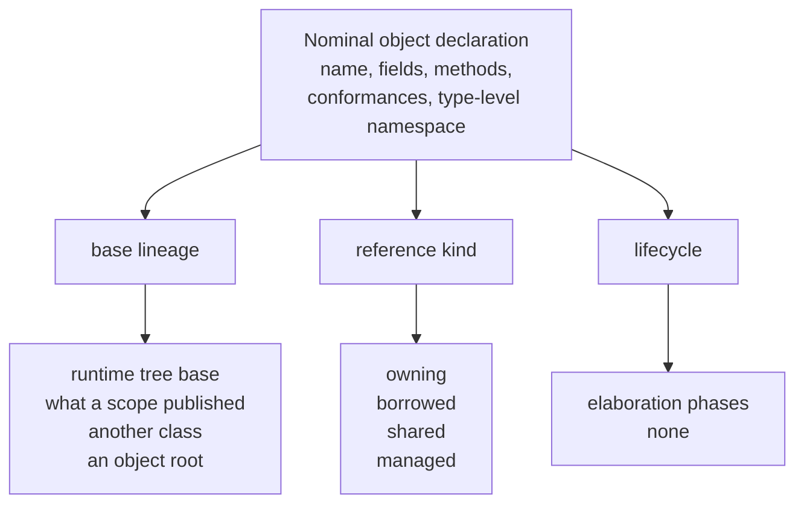

# Object Model

Three parts of this contract are not yet what the compiler does. No step below MIR states a class's
dispatch tables once (invariant 8): each backend lays the tables out and fills them itself from the
overrides MIR states. A managed reference (invariants 4 and 16) is realized as a share of its
object's ownership, so an object is reclaimed when its last handle drops and a cycle nothing outside
reaches is never reclaimed. And where two interface ports of one instance are bound to the instance
declaring a class, a reference to that class starts at the first of them rather than at the one the
source wrote (invariant 14). The rules below bind every layer regardless.

## Purpose

The object model is MIR's one shape for a nominal object type. A module instance, a generate scope,
and a SystemVerilog class are the same kind of entity: a named type with fields, methods, a base
lineage, and a construction protocol. They are not three object systems sharing some helpers; they
are one object system whose members differ only in which base they extend, which reference reaches
their instances, and which lifecycle they participate in.

The model is generic object-oriented, not a SystemVerilog construct and not a C++ class.
SystemVerilog `class`, `extends`, `virtual`, `interface class`, and `new` flow in through HIR and
are translated into this generic vocabulary at HIR-to-MIR; a module read as a class (see
[runtime_model.md](runtime_model.md)) is the same translation from the other direction. What the
standard fixes about classes -- single inheritance, interfaces that add no storage, an object that
is of its own class from creation on, reclamation by reachability -- is what the model is built to,
and a target language's own object rules are never borrowed in its place. The governing thesis:

> One nominal-object reference, one generic declaration-level override relation, and one
> construction model. Compilation-unit boundaries determine how an object type's identity is
> represented, never its semantic category.

The three axes are independent, and that independence is the model. A module instance, a generate
scope, and a SystemVerilog class are three readings of one declaration along them; collapsing any
two -- reading a reference kind as membership in the runtime tree, or a class handle as the shared
reference -- destroys a distinction a consumer has to read.

## Owns

- The nominal object type declaration: a name, instance fields, instance methods, an optional single
  concrete base, a set of interface conformances, and an associated namespace of type-level members.
- The nominal object reference: how one object type names another -- as a base, a field's pointee, a
  receiver type, a constructed type -- carrying identity whose representation follows the
  compilation-unit boundary.
- The reference kinds that reach an object instance and the lifetime / reachability each denotes:
  owning, borrowed, shared, and managed; and the class handle as a value.
- The construction model: creating an object whole, then entering its constructor on it, with the
  base's construction a step of the constructor, as concepts distinct from an ordinary callable.
- The dispatch model: the override relation between a method and the behavior it overrides, the
  naming of a behavior by the method that introduced it, which body answers each behavior for each
  class and each interface it conforms to, and the dispatched call.
- The class's definition: the one description of a class every object of it points at, which answers
  what a reader compiled without the class asks of an object -- whether it is of a class, how it
  ends, which body answers a behavior.
- Member naming: a member is named by the class that declares it and the slot that class gave it.
- Type-associated storage and type-associated functions (static properties and static methods), and
  how many cells a static property has.
- The relation between a class declared inside an instance and that instance.
- Runtime-tree participation as a base-lineage fact: an object that extends the runtime scope base
  is a node in the runtime object tree and participates in the elaboration lifecycle.
- The unit-wide registry of local nominal object declarations, the single canonical local identity
  of each, and the separation of that identity from lexical name resolution and from where a backend
  places the emitted code.
- What a published class promises about itself and its lineage.
- What the classes of the built-in package `std` are made of, and how each waits, holds messages of
  any type and holds its referent weakly.

## Does Not Own

- The value-type system (integral, real, string, aggregates) and the non-object wrappers. Those are
  [mir.md](mir.md). The object model is the object half of MIR's type system; the value half stays
  there.
- The callable concept -- callable code versus value, the result type as call protocol, the
  environment and capture model, and which bodies have a receiver. That is
  [callable.md](callable.md). Methods and constructors are callables; the object model uses them and
  does not redefine them.
- The ordering of the elaboration phases (build, resolve, initialize, activate) and when each runs.
  That is [elaboration_lifecycle.md](elaboration_lifecycle.md). The object model states that the
  lifecycle bodies are the class's own; that doc states when they execute.
- The runtime object tree's shape and its faithfulness to elaboration. That is
  [hierarchy_and_generate.md](hierarchy_and_generate.md).
- When and into what a cross-unit reference resolves. That is
  [reference_resolution.md](reference_resolution.md) and [emission_model.md](emission_model.md).
- Which lowerings of a unit are one body, and which body holds a class's code. That is
  [specialization_model.md](specialization_model.md).
- Physical layout: object storage layout, dispatch-table layout and slot numbers, frame allocation,
  and the collector algorithm that realizes managed reachability. Those are LIR and the runtime.

## Core Invariants

1. **One nominal object type.** A module instance, a generate scope, and a SystemVerilog class are
   one declaration kind -- name, instance fields, instance methods, an optional concrete base,
   interface conformances, and an associated type-level namespace. There is no second object IR and
   no flag classifying a declaration as a module versus a class. The differences between these
   objects are expressed through generic mechanisms -- which base, which reference, which lifecycle
   -- so every consumer handles one shape and none branches on a source category.

2. **One nominal-object reference; one identity per class in a unit.** Every place one object type
   names another uses one reference abstraction, and its identity is the unit's own handle for the
   class, whichever unit defines it, or an imported library declaration where the target is a
   runtime-library type. Across units a class is known by its stable key, the declaring unit and the
   class's published name; a unit turns a key into its handle once, where it reads the name, and a
   key naming the unit itself lands on the class it defines. What is known of a class is one answer
   for either: what this unit states of its own, or what the declaring unit published, read back. A
   class a design element declares is a type of that element's instance (LRM 6.22), and its shape is
   one per unit, so the element publishes it and a referrer outside names it like any other
   published class. No consumer tells a class of this unit from another unit's to name or reach it;
   only what an artifact emits follows which unit defines the class.

3. **Inheritance is one concrete base plus a set of interface conformances.** The concrete base
   determines instance layout and constructor chaining; an interface conformance is a method
   contract that introduces no instance storage (LRM 8.26), and one interface reached along several
   paths is one type (LRM 8.26.6.3). So every class an object is of, base or interface, starts where
   the object does, and converting a handle to any of them forms nothing. The two relations are
   represented separately because they carry different facts.

4. **The reference reaching an instance carries its lifetime, orthogonal to the object's category.**
   The kinds are owning (one owner controls the lifetime), borrowed (refers, owns nothing), shared
   (a reference-counted, acyclic-by-construction owner), and managed (a language-managed object
   handle: null is a legal value, identity is comparable, copies are shallow, it is created by
   construction, and it is never explicitly freed; its lifetime model is owned by
   [lifetime.md](lifetime.md)). A SystemVerilog class handle is a managed reference, distinct from a
   shared one. Whether an object is a node in the runtime tree is read from its base lineage, never
   from the reference kind that reaches it. Topology, lifetime, and category are three axes, and a
   backend reads each separately.

   Which object a reference names and what a consumer may assume going through it are two facts, not
   one. The object type a reference carries is its **static view** at that program point; the
   object's identity is established when the object is created and is the same through every view of
   it, including a view that names an ancestor, a view that names an interface the class conforms
   to, and no view at all. Identity is therefore never derived from a view, and two references are
   equal exactly when they name one object, whatever each was declared as.

   **A static view governs the operations a program point may perform through a reference; it never
   governs the reference's representation.** Two units holding one storage under different static
   views is the ordinary case -- a handle declared with a base class and one declared with the class
   itself may hold one object -- so a representation that followed the view would put two
   representations on one cell. A backend may spell references held under different views
   differently, and may not lay them out differently.

5. **A class handle is a value, and its value is which object it names.** It satisfies the contract
   every value domain satisfies -- equality and case equality with one meaning and a known one-bit
   answer, change detection, the declared default `null` -- and claims no ordering, because LRM
   Table 11-1 gives it the "Any data type" row and no relational operator. Every position the
   language states over a data type -- an element, a member, an associative array's index, an
   operand of `%p` -- therefore admits a handle without being granted it. An associative array
   indexed by a class orders by which object (LRM 7.8.3), and `%p` prints a text that only one
   object has and that is `null` for none (LRM 21.2.1.6). A realization may carry more than the
   identity so that a member can be reached; what it carries beyond the identity is never part of
   the value.

6. **An object is created whole, then constructed.** Creation brings the complete object into
   existence -- every member of every class of its lineage at the value its type starts with, and
   the object's own class as what it dispatches and casts as -- and runs no code of the program.
   Construction is the class's constructor entered on that object, an ordinary body of the class
   that, in order, records what the compiler keeps for the object (the instance its class belongs
   to, a scope's place in the hierarchy), calls its base's constructor on the same object with the
   arguments the class states for it, gives each of its own properties its start value and then its
   initializer in declaration order, and runs what the source wrote (LRM 8.7). A class extending an
   object root makes no base call. Because the object is of its own class from creation on, a
   dispatch, a cast and a call to a pure method made during construction answer for that class (LRM
   8.17 NOTE 2, 8.16, 8.21), and a property read before its initializer runs holds its type's start
   value, one of the values LRM 8.7 leaves undefined.

   A `new` evaluates the arguments the source wrote, creates the object, takes the creator's
   reference to it, evaluates on it each argument the source left to a default, and enters the
   constructor. A construction left partway -- its process killed, or a run-time error -- ends the
   creator's reference and nothing else, so the object lives on while anything else refers to it
   (LRM 8.29). An instance of the design hierarchy is created and constructed the same way; its
   owner is unique rather than managed. The constructor is selected by the type written at the `new`
   and is never inherited or dispatched, so it is not on the class's definition: the code that asked
   for the object enters it, as a derived constructor enters its base's.

7. **Override is a resolved relation, and a behavior is named by the method that introduced it.** A
   method that overrides records the behavior it overrides as a resolved reference, never a textual
   name, as the front end resolved it (the `virtual` qualifier is optional on an override, LRM
   8.20). A class states the behaviors it introduces, in the order it declares them, and the ones it
   overrides -- nothing about its lineage, as it carries its own members and not its base's. A
   behavior's identity is the method that introduced it, which is its introducing class and an
   ordinal within that class's declarations, so naming one reads that class alone. A dynamic call
   names its receiver and that behavior; a direct call to a virtual method (a `super` call, LRM
   8.15) names the body, and whether a call dispatches is stated at the call, never inferred from
   the receiver's type.

8. **Which body answers each behavior is fixed when the program is compiled, and MIR states it.** A
   SystemVerilog class hierarchy cannot change after compilation, so every class's tables are
   constants. A class's own table holds each behavior its objects dispatch on -- those of the class
   it extends first, in that class's order, then those it introduces, in declaration order -- so a
   behavior sits at the same position in every class extending its introducer, and a call needs to
   know only the class its handle is of. A class has one table more for each interface it is a value
   of, in the order that interface declares its methods. MIR states, per class, which body answers
   each behavior of each of these tables, including an interface method answered by an inherited
   body, which the table names directly. How a table is laid out and which slot a behavior occupies
   are decided below MIR, with the whole lineage in hand; every consumer reads one stated table, and
   no backend works a table out on its own.

9. **What a reader that does not know an object's class asks is answered by the class's
   definition.** Every object starts with the part the runtime library defines, whose first word
   names its class's definition, written once at creation and never changed. The definition is a
   constant the declaring unit emits and other units name by symbol, which their signatures already
   make an explicit dependency; nothing is declared to the library at run time. It states what the
   class extends, the interfaces it implements and its tables, the entry ending an object of it,
   what an instance of the design hierarchy does in each elaboration phase, what `randomize()` asks
   of an object, the DPI-C exports an instance answers, and the body answering the instance the
   object belongs to. Whoever holds an object without knowing its class -- a handle's last owner, a
   scope's parent, the solver, the library -- calls what the definition names, so no class has a
   host-language virtual function.

10. **Whether an object is of a class is asked of the object.** A class declared anywhere may extend
    a class declared here, so no unit holds the set of classes that are of a given one, and only the
    object, through its definition, can answer: the library walks the object's class, the classes it
    extends and every interface each names, and answers the handle it was handed or one naming
    nothing. A null handle is of no class. Nothing is converted, because every class an object is of
    starts where it does (invariant 3). An enumeration is the opposite case: its members are fixed
    where it is declared, so the type answers a cast toward it.

11. **A body entered on an object has a receiver; a type-associated function has none.** The
    receiver rule is [callable.md](callable.md) invariant 2's. What it fixes for a class is that a
    static method is entered on no object (LRM 8.10), so where it needs a value no object carries --
    the instance its class belongs to (invariant 14) -- that value is an ordinary parameter, never a
    receiver standing for one.

12. **A member is named by the class that declares it and the slot that class gave it.** Which
    storage an access reaches is fixed where the access is written, by the class the access names,
    never by the object it runs on (LRM 8.14, 8.15, 8.23), so the access states its declaring class
    and the type the access arrived at is checked against it rather than consulted to find the
    member. An inherited member keeps its slot: a class's storage is its base's storage extended
    with its own members, so a member sits at the same position in its declaring class and in every
    class extending it. Storage selection is static; method selection may be dynamic (invariant 7).

13. **Type-associated state is not an instance member, and its cells follow what replicates the
    declaration.** A static property and a static method belong to the type's associated namespace,
    shared across every object of the type, not to each object's field or method set. How many such
    cells exist is answered by how many times the declaration is replicated: a type a package or the
    compilation-unit scope declares has one; a type a structural scope declares has one per instance
    of that scope (LRM 6.22, 8.9); a specialization on such a type is a type of each instance of
    that scope too (LRM 8.25) and has one per instance. The declared initializer runs once per cell,
    inside the bring-up of whatever holds it and before any procedure (LRM 10.5).

14. **A class declared inside an instance belongs to that instance.** Each instance declaring a type
    creates a unique type (LRM 6.22), and the class's methods name the declaring scope's
    declarations through the upward search (LRM 23.9), so an object records the instance its class
    was declared in, as a borrowed member its constructor sets before anything else runs. Each class
    of a lineage records its own, since a base's methods search outward from where the base was
    written; the derived class's constructor reaches the base's instance by climbing a count of
    scopes fixed by where the two declarations are written. An interface class records nothing,
    having no storage; which instance's copy a name of it means is fixed by the declaration writing
    the name. One compiled class serves every instance, the instance an object belongs to selects
    whose code runs (invariant 15), and a cast toward such a class or interface also asks whether
    the object belongs to the instance the cast names. A class or interface class another instance
    declares is named only through an interface port bound to that instance (LRM 6.18, 25.10), so a
    reference to it -- as a base, an implemented interface, a constructed or a cast-to type --
    starts at the port the source wrote, ahead of any hierarchical name that passes through one of
    that instance's classes: a route starting there reads alike in instances whose ports are bound
    to different instances, which is what lets them share one body (invariant 15).

15. **A class's code is the code of the scope body that compiled it.** The class itself -- its
    layout, its tables, one entry per operation -- is stated alike by every body of its unit from
    the declaration alone. The class the declaring scope published introduces a virtual method per
    operation of each class belonging to the scope's instance, and each body realizing the scope
    overrides them with the code it compiled, so an operation reads the instance the object belongs
    to and dispatches on it. Two lowerings that differ only in a class's code are two bodies, and a
    body whose construction built no block holds no code of what the block declares.

16. **Managed reachability is realized by precise tracing.** A managed object is retained while
    reachable and reclaimed by a precise tracing collector; an unreachable cycle is reclaimed, not
    leaked. The collector algorithm and cadence are realization choices; the reachability model and
    the storage discipline that makes tracing precise are the contract, owned by
    [lifetime.md](lifetime.md).

17. **A compilation unit owns one canonical registry of its local nominal object declarations, and
    identity, lexical name resolution, and emitted placement are three separate relations.** Every
    object type -- a module, a generate scope, a class -- is one registry record with one canonical
    local identity, and a reference names that identity. A lexical scope resolves a source name to
    an identity; the registry is not a flat global name table. Structural containment (which object
    builds or owns which) is a separate relation over identities, and where a backend places the
    emitted code is not a relation the registry carries at all, which keeps a declaration's name
    meaning one thing everywhere its unit is reachable. A forward (incomplete) declaration is a
    registry record that exists before its body (LRM 8.27), so mutually-referential types resolve
    against a stable identity; a parameterized class is a generic declaration plus one record per
    specialization.

18. **A published class promises what it declares and the class it extends, never what it
    inherited.** The promise states the properties another unit may name, in slot order, then the
    type of each it keeps to itself (LRM 8.18), unnamed; its static properties another unit may name
    (LRM 8.9); its constructor's prototype, unless it is an interface class (LRM 8.7); every method
    it declares, with its prototype and its part in dispatch -- no object for a static method,
    otherwise not virtual, introducing, or overriding, and whether pure (LRM 8.20, 8.21); the class
    it extends; and the interface classes its declaration names, in the order written (LRM 8.26.2).
    Nothing an ancestor declares appears, so deriving a promise reads nothing outside its unit
    ([incremental_build.md](incremental_build.md) invariant 8). Publication is a property of each
    member, stated by its declaration, and a published property's slot is ahead of every unpublished
    one, so what a unit keeps to itself moves nothing it published. The promise states storage whole
    because every unit is compiled by Lyra itself, never distributed as a binary: a class of another
    unit extending it is laid out at compile time, and a call reads what it passes off the promise.

19. **A referrer names anything inherited by the class that declares or introduces it, and that
    class's unit is its dependency.** A property is named by its declaring class and slot, a
    behavior by its introducing method, as the front end resolved the name along the lineage of the
    class the source wrote. The coordinate is then the same whichever class the source reached it
    through, and the referrer's output reads the introducing class's promise, so a change to what
    that class declares rebuilds the referrer, as [incremental_build.md](incremental_build.md)
    invariant 11 requires of every dependency.

## The classes of `std`

The classes of the built-in package `std` -- `semaphore`, `mailbox` and `weak_reference` (LRM 15.3,
15.4, 8.30) -- are classes of this model like any other, defined by SystemVerilog text that Lyra
compiles in the package's name. The front end declares `std` itself, every method with no body, and
the text gives each class the name, the parameters and the methods, with their arguments and
defaults, the front end declares for it, so every call and every class extending one is checked
against that declaration and reaches this definition. The text is a compilation-unit scope rather
than a package, so it states no time scale (LRM 3.14.2.3). What only the runtime can answer, an
object's identity for `get_id`, has no definition there.

**A waiter is served in the order it arrived, and one that stops waiting holds back nobody** (LRM
15.3.3, 15.4.5). Each kind of waiter -- a `semaphore`'s getters, a `mailbox`'s putters and its
getters -- is a list of the waiting processes' handles in arrival order. Each waiter is a process
forked for the wait alone, so a caller that stops waiting by any route, killed (LRM 9.7) or leaving
a block disabled around the call (LRM 9.6.2), ends it too. Nothing of a process runs as it ends, so
the list drops a waiter whose process has finished or been killed wherever it is next asked who is
first, and a waiter behind the first watches the first end. A `try_` form succeeds only where its
waiting form would not wait, so it never passes a waiter already listed.

**A message is a value kept with its type's equivalence class.** A `mailbox` of no stated type holds
messages of any type (LRM 15.4.9). Each is kept with a text naming its type's class of equivalent
types (LRM 6.22.2), composed where the value is made, so a value made where one unit compiles is
tested where another does with nothing shared between them; the text names no queue's bound, since
two queues differing only there are equivalent. A `get` or a `peek` is handed a reference of any
type to the asking variable and writes the message there only where the variable's text and the
message's agree, at the moment it writes (LRM 13.5.2, 15.4.5); where they do not, the message stays,
and a `try_` form answers below zero (LRM 15.4.6). A mailbox of a stated type holds its messages the
same way, each an object of its own, so the two share one text.

**A weak reference is a property held weakly.** A `weak_reference #(T)` keeps its referent in a
property the text declares weakly held, which no source type can state: a read of that property is
the library's upgrade, answering null once nothing else refers to the object, and a write is its
downgrade (LRM 8.30).

## Boundary to Adjacent Layers

- **Peer to [mir.md](mir.md) and [callable.md](callable.md).** `mir.md` owns the overall MIR shape
  and the value-type system; this doc owns the object model within it. `callable.md` owns the
  callable concept that methods and constructors are, and the receiver rule invariant 11 applies to
  a class.
- **HIR carries the source vocabulary.** `class`, `extends`, `virtual`, `interface class`, and `new`
  survive verbatim in HIR ([hir.md](hir.md)); HIR-to-MIR translates each into this generic object
  model, and states each override and each conformance as the front end resolved it.
- **[elaboration_lifecycle.md](elaboration_lifecycle.md) owns when the lifecycle runs.** This doc
  owns that the lifecycle bodies are the class's own, named by its definition.
- **[reference_resolution.md](reference_resolution.md) and [emission_model.md](emission_model.md)
  own cross-unit resolution.** This doc owns that a cross-unit object reference names a class
  another unit published and what that class promises.
- **[specialization_model.md](specialization_model.md) owns which body compiles a class's code.**
  This doc owns that the class is stated alike by every body and that the instance selects the code.
- **[lifetime.md](lifetime.md) owns what a managed reference means for lifetime** and that a value
  states its own managed edges.
- **LIR and the runtime own physical realization.** Object layout, dispatch-table layout, slot
  numbers, the definition's encoding and the managed-reachability mechanism are introduced below
  MIR, each read off what MIR states.

## Forbidden Shapes

Each entry names the requirement the shape fails; where the failure rests on a premise that could
change, the premise is named too.

- A second object IR, or a flag on a declaration classifying it as a module versus a class. It fails
  the one-shape requirement of invariant 1: every consumer would branch on the category, and each
  later kind of object would widen the branch.
- A global object-id space, or a cross-unit object reference naming another unit's internal id. It
  fails independent compilation ([north_star.md](north_star.md) invariants 4 and 5): units share no
  identifier space.
- A referrer minting an identity for an object type another unit declares. It fails invariant 2:
  what it invented and what the declaring unit owns become two names for one type.
- A class a design element declares left off what the element publishes. It fails the requirement
  that nothing is looked up by name on the simulation path
  ([reference_resolution.md](reference_resolution.md)): a referrer would have no class to compile
  against and would ask by name at run time.
- An object's identity derived from its static view, or recomputed when a reference is converted. It
  fails LRM 11.4.5 equality: two references naming one object would compare unequal because they
  were declared differently.
- A reference's representation following its static view. It fails independent compilation: one
  storage reached from two units under two views would have two layouts, and reaching it would rest
  on their agreeing, which neither side states.
- A reference carrying its object's class as a run-time field for the referrer to read. It fails
  invariant 4: what a consumer may assume through a reference would become a run-time question.
- An interface class laid out as a part of the object, or reached as an ordinary or virtual base. It
  fails LRM 8.26 and 8.26.6.3: an interface adds no storage, and one reached along two paths is one
  type.
- One flat list of bases mixing the concrete base with interface conformances. It fails invariant 3:
  the two relations carry different facts.
- Deriving runtime-tree membership from a reference's ownership kind, or reaching a class handle
  through the shared reference. Each fails invariant 4's separation of topology, lifetime and
  category, and the second also fails LRM 8.29, since a shared reference cannot reclaim a cycle.
- A handle granted admission position by position -- a predicate letting it past the value contract
  for an element, a member, an index -- instead of meeting the contract. It fails invariant 5: every
  position the language states over a data type follows from the one contract.
- Construction represented as a plain call to an ordinary method, or base-constructor ordering left
  to a backend convention. It fails LRM 8.7, which orders the base's construction, the initializers
  and the body.
- An object that takes its class one base at a time while its constructors run, as a C++ constructor
  does. It fails LRM 8.17 NOTE 2: a call during construction must answer for the object's class.
- A construction left partway that ends what it built and frees the object. It fails LRM 8.29: the
  object may already be referred to by a handle its constructor handed on.
- A constructor stored on the class's definition, to be entered by the library. It fails LRM 8.7's
  selection of a constructor by the type written at the `new`: what the definition holds is shared
  by every object of the class, and one entry there would give every constructor one prototype,
  erasing the arguments each call passes.
- An override recorded as a textual method name; a backend re-deriving the override family by name
  or signature matching; whether a call is dynamic inferred from the receiver's type. Each fails
  [mir.md](mir.md) invariant 10: a consumer re-derives a fact MIR did not state.
- A behavior named by an absolute position counted across the lineage while lowering. It fails
  invariant 7's requirement that naming a behavior reads one class: counting needs every base's
  declarations, which another unit may own.
- A dispatch table built or composed by the library at run time, or a dispatch that asks the library
  for a body. It fails iteration and run time ([north_star.md](north_star.md) invariant 1) for no
  gain, premised on a class hierarchy that cannot change after compilation.
- A backend working out a dispatch table's structure, or writing a function a table holds, that MIR
  did not state. It fails [backend_contract.md](backend_contract.md)'s mechanical translation: two
  backends would settle the same table twice.
- A per-class table of the classes that may extend it, tested for a cast. It fails independent
  compilation: the set is open across units, so any one unit's table answers a closed-world question
  wrongly, and only for programs spanning units.
- A member reached by deriving its declaring class from the type the access arrived at. It fails LRM
  8.14: the arrived-at type cannot tell a shadowed member from the one shadowing it.
- A type-associated function carrying a receiver, or a fabricated receiver standing in for "no
  instance". It fails invariant 11: a static method is entered on no object (LRM 8.10).
- A static property modeled as a field replicated into every object, or placed program-globally for
  a type that is itself replicated. Each fails LRM 8.9 read with LRM 6.22: one cell per replication
  of the type.
- A class compiled once per instance of the scope declaring it. It fails per-unit artifacts
  ([north_star.md](north_star.md) invariant 2): artifacts would scale with instance count.
- A class object placed in the runtime tree so that a parent edge reaches its declaring instance. It
  fails LRM 23.6 and invariant 4: the object would become nameable by a hierarchical path and would
  gain an owning parent.
- MIR stating a reference-counted realization, or the absence of cyclic reclamation, as the meaning
  of a managed reference. It fails LRM 8.29, which reclaims by reachability.
- Two declaration-storage systems -- one for module and generate-scope objects, another for classes;
  an object's lexical position or emitted placement used as its identity; a second local identity
  inter-convertible with the first. Each fails invariant 17: every consumer would have to choose
  which storage or which identity is canonical, and a lexical position cannot identify a class with
  no lexical parent.
- An emission placement stored on the generic object declaration. It fails invariant 17: placement
  is a backend's own, and storing it lets one declaration's name mean different things at different
  reference sites.
- A runtime registry of per-slot type metadata. It fails the one-statement rule of [mir.md](mir.md)
  invariant 10: a member's type is known from the MIR type system where it is read, and a parallel
  table is a second answer that can disagree.
- A promise that restates what its class inherited. It fails
  [incremental_build.md](incremental_build.md) invariant 8: deriving it would read the base's
  promise in another unit, ordering the signature stage.
- A referrer naming an inherited member by the class the source wrote and resolving the chain at
  elaboration. It fails [incremental_build.md](incremental_build.md) invariant 11: the dependency on
  the introducing class's unit is real and would go unrecorded. The premise is that nothing is
  replaced between compiling a unit and linking the program.
- A separate list of published members, publication inferred from a name or a position, or an
  unpublished member placed among the published ones. The first two fail invariant 18's single
  statement; the third fails iteration time ([north_star.md](north_star.md) invariant 1), since
  adding a member nothing outside reads would rebuild every referrer.
- Waiters of a class of `std` holding a ticket counted out on arrival and served by number. It fails
  a waiter that stops waiting holding back nobody: the ticket of a caller that was killed is a
  number every later waiter waits behind until something notices.
- A type's address, or MIR's identity for a type, used as the class a message of any type is
  received by. It fails LRM 6.22.2: two units compile one type to two addresses, and a type's
  identity is its declaration (LRM 6.22.1), which tells apart types the standard calls equivalent.
- A message copied into the asking variable after `get` returns. It fails LRM 13.5.2: the variable
  is a `ref` argument, written through as the call runs.
- A queue's bound in the text a message is kept with. It fails two equivalent queues exchanging
  messages, since a bound is no part of a queue's equivalence (LRM 6.22.2).
- A second definition of `mailbox` for messages of no stated type. It fails the one statement of the
  waiting rules: each definition would state arrival order and the `try_` rule again, and the two
  would be held in step by nothing.

## Notes / Examples

A module instance, a generate scope, and a SystemVerilog class differ only along the three generic
axes:

- A module instance extends the class its unit published of one, which is itself rooted in the
  runtime's tree, and participates in the elaboration lifecycle; who owns it and how its parent
  reaches it are [hierarchy_and_generate.md](hierarchy_and_generate.md) invariant 4's.
- A generate scope is the same shape: a hierarchical name steps into one from anywhere (LRM 23.6),
  so it extends the class it was published as, participates in the same lifecycle, and is held as a
  module instance is.
- A SystemVerilog class extends another class or the class-object root, is reached by a managed
  reference, and is built by `new`.

A class the lowering makes for its own use is a fourth reading, and may extend the plain managed
object root instead of the class-object root, where nothing is running to give a new object its
random generator (LRM 18.14).

The post-construction lifecycle bodies are the class's own, named by its definition rather than
carried on a reference to a base: what roots a value in the tree says nothing about how one runs,
and a class rooted there supplying none is what a scope publishes of its object. The published class
holds the published members first and one virtual method per subroutine, which the realization
overrides with the body, and the realization extends it with what lowering adds. A published class
may be realized by several classes, one per body its code compiled to, so a referrer reaching a
published subroutine calls it through the object, which answers with its own class's body.

The tables of invariant 8 are the shape every runtime with single inheritance and interfaces has: a
class's own table indexed by position, and a table per pair of a class and an interface found
through the class -- HotSpot's vtable and itable, CoreCLR's virtual stub dispatch, Go's `itab`,
Swift's class metadata and witness tables, rustc's vtable per type and trait. Systems that assign
positions later, a JVM linking a class or the Objective-C runtime, do so because classes arrive
while the program runs, which SystemVerilog does not allow.

A `$cast` is a sequence: the value is settled once, the question of invariant 10 is asked of it, the
destination takes it where the answer is yes, and the answer is the expression's value. The task
spelling is the same steps plus a severity report where the answer is no, and the destination is
left unchanged (LRM 6.24.2). Where the declared types already settle the answer, it is a constant,
and a pair that can never succeed answers 0 rather than being refused.

Current implementation: the C++ backend renders a class's C++ constructor as creation only and the
SystemVerilog constructor as a member function the `new` helper enters after creating the object; a
base's construction is a qualified call of the base's. The execution backend gives each class a body
creating it, emitted by the declaring unit and called by symbol from any other, so a unit creating
an object of another unit's class reads nothing of its size.

A static method is an associated function under the type, invoked without an instance. A static
property is a single cell the type owns per replication, observed identically from every object of
that replication.
