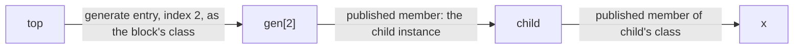

# Reference Resolution

The compiler does not yet realize one connection of invariant 6 as stated: an output port whose
actual is a whole variable of the port's type still keeps a cell on each side and copies the port's
value into the variable by a continuous assignment, rather than making the variable a reference
bound to the child's port storage. Everything else here binds every layer as written.

## Purpose

Define how a reference reaches its target. A route from referrer to target is an anchor, a sequence
of typed steps and a leaf, each compiled against a declaration the referrer has for it. A route that
descends into a scope or crosses into another instance executes once, while the design is resolved,
and binds an endpoint; a route of parent edges is walked where it is used. The one endpoint serves
both accessing the target's value and observing its changes.

## Owns

- The decomposition of a reference's route into an anchor, steps and a leaf, and the rule that every
  step and leaf is compiled against a declaration the referrer has for its target.
- The rule that a step realizes as typed navigation -- through an in-artifact member identity, or
  through a member the target scope published, resolved at the referrer's compile time -- and that a
  name the target scope did not publish is refused where the referrer compiles.
- The anchor of an upward name: the enclosing scope of the class the front end's search landed on,
  an instance or a generate block.
- The rule that each use of a name is a reference of its own, whose route ends only at what that use
  reaches, and that an endpoint is identified by its route rather than by what it ends at.
- The contract that route execution is total: a route the front end accepted always reaches a
  constructed object, and one that does not is a compiler-invariant violation, never a run-time
  fallback.
- The contract that port connections, hierarchical references, calls on another instance's object
  and cross-instance trigger subscriptions all flow through the same route mechanism.
- The rule that a route whose leaf is an object reference binds how to reach the target rather than
  where the target is, and that a name continuing past it is an access compiled against the class
  the reached storage was declared with.
- The rule that connectivity is linkage between objects, and where a port connection's sink names
  its source's storage rather than holding a copy.
- The rule that what a name denotes is answered by a total classification, and a reach not built is
  a refusal rather than one of its answers.

## Does Not Own

- The shape of the object graph, the construction order, and the graph's faithfulness to the
  frontend's elaboration (see [`hierarchy_and_generate.md`](hierarchy_and_generate.md)). This doc
  relies on that faithfulness but does not establish it.
- What each unit kind and each scope publishes, which is what decides which names a referrer may
  reach (see [`compilation_unit_model.md`](compilation_unit_model.md)).
- The compile-time identity kinds used to thread route steps (see
  [`identity_and_ownership.md`](identity_and_ownership.md), [`hir.md`](hir.md), [`mir.md`](mir.md)).
- The lexical axis of reference: how a value reference names a binding in its own callable body, and
  how a binding crosses a closure boundary by capture (see
  [`binding_and_capture.md`](binding_and_capture.md)). This doc owns the object-graph and cross-unit
  axis; a multi-segment reference splits cleanly between the two, with the receiver value resolved
  lexically and the object-graph hops resolved here.
- How an observed change wakes a dependent process (see [`scheduling.md`](scheduling.md)).
- Storage placement and offsets of members (see [`lir.md`](lir.md)).
- The phases the route executes in (see [`elaboration_lifecycle.md`](elaboration_lifecycle.md)).
- Net resolution, what it means for a connection to join two nets into one of them, and what a force
  on a port does to what the port shows. Those are design-global concerns
  ([`net_resolution.md`](net_resolution.md)), which reach the drivers, the joined net and the forced
  port through this route.

## Core Invariants

1. Every reference is a route from a structural origin to an endpoint. The route is an anchor, a
   sequence of steps and a leaf; the endpoint is the canonical access point for every read, write,
   and observation against the reference. A name a view joins several declarations under (LRM
   25.5.4) stands for several things, so it is one reference over one route to each.
2. Every step and every leaf is compiled against a declaration the referrer has for its target: a
   class its own artifact owns, or a member the target scope published. Its realization is typed
   navigation, with no string lookup and no runtime call naming the target at simulation or
   elaboration time, and no part of a route carries a string. A step is one element of the path the
   source wrote (LRM 23.6), the declaration it names and the selects written beside that name, so
   every kind of step selects the same way. A step onto an instance is the published member holding
   it, selected; a step into a loop's block is the construct's published entry, asked for the block
   built where the index stood at the value the source wrote (LRM 27.4), since how many blocks came
   before it is the object's and not the referrer's; a step into a block a conditional chose is the
   construct's entry, which holds at most one object and takes no select. Either block step views
   what it reached as that block's published class. A step through a published member that holds
   another unit's object -- an interface port, an instance the scope declares -- is the same step as
   ending on one, continued. A leaf is a published member, a published disable target, or a call
   through the object to a published subroutine; a subroutine or a member of the reader's own scope
   is the route of no steps.

   A step's identity comes from one of two places, which changes nothing about its cost or its
   realization: an in-artifact member identity when the emitting artifact owns both classes, and the
   member's name resolved against the target's publication at the referrer's compile time when it
   does not. A step into a loop's block, and every step after it, takes the second even where the
   artifact owns the block, since the select picks a different block in each object. A name the
   target scope did not publish has no declaration to compile against and is refused there, as a
   compile error and never as a run-time failure.

3. A route that descends into a scope or crosses into another instance executes once, in Resolve,
   and binds its endpoint, which is read directly thereafter. A route of parent edges within the
   instance passes nothing that can be missing, so it executes nowhere ahead of time: its access
   follows those edges, a fixed number of loads, and the edge it follows is a member of the block's
   own published class ([`hierarchy_and_generate.md`](hierarchy_and_generate.md) invariant 4). Which
   of the two a route is follows from its own segments, never from a phase the intermediate form
   states. Either way simulation-time access performs no lookup, no descent, and no name matching,
   and one endpoint serves both value access and change observation.
4. Route execution is total. The frontend fully elaborates and validates every reference, and the
   constructed object graph is faithful to that elaboration
   ([`hierarchy_and_generate.md`](hierarchy_and_generate.md)). A reference to a target no object
   stands for -- an alternative a conditional generate did not select, an instance-array element out
   of range -- is the front end's error, reported where it elaborates the design; a route that
   nonetheless finds nothing to bind is an `InternalError`.
5. Port connections, hierarchical references, calls on another instance's object and cross-instance
   trigger subscriptions share one route mechanism. There is no parallel resolution path per
   reference kind, per direction, or per lexical form.
6. Connectivity is linkage between objects, and what one unit connects to another never changes how
   the other's members are realized: a unit cannot know its actuals, so its code is one whatever
   each instance is wired to. A port connection is a continuous assignment of source to sink (LRM
   23.3.3), and the standard lets the sink see the source's value the moment it is written (LRM
   4.8), so where the connection is a whole variable of the port's type the sink names the source's
   storage and nothing runs. Each side is decided by the unit that owns the sink, where it compiles.
   An input port of a variable kind (LRM 23.3.3.2) is a reference member of the child in every
   instance, bound in Resolve to the actual's own storage where the actual is a whole variable of
   the port's type or another such port, and otherwise to a cell the instantiating scope keeps,
   driven by the implied continuous assignment or holding the data type's default where nothing is
   connected. An output port's actual that is a whole variable of the port's type is a variable the
   instantiator states together with the connection, so the instantiator realizes it as a reference
   bound to the child's port storage. Every other connection keeps a cell on each side and assigns
   continuously, moving only the range the source's write reached. Every variable's storage exists
   from the moment its scope is built, so binding is free of order. Nets are no exception to
   linkage: joining two of them into one resolution leaves both nets' storage and addressing exactly
   as they were.
7. The endpoint inherits the access protocol of the target it reaches. A reference to an observable
   storage cell reads and writes through the cell's protocol; a reference to an event participates
   in the event's protocol. The endpoint is not a new access category; it is the target's access
   surface reached through a bound direct path. A forwarding chain -- a `ref` port bound from
   another `ref` port, an input port bound from an input port -- binds each link to what the link
   before it names, so every endpoint reaches its final storage directly.
8. A route whose leaf is an object reference binds **how to reach** the target, not **where** the
   target is. The reference's value is a value the design computes and overwrites, so no address
   survives the bind; what the route binds is the storage holding the object reference. Where the
   source continues into a property or a behavior, the body reads the reference at each access and
   applies an ordinary member access to whichever object it holds. The class that access is compiled
   against is the one the reached storage was **declared** with, which the declaring scope
   published, never the one an object turns out to be. A virtual interface is this case for an
   instance: its type names the interface and the parameters its instantiation hands it (LRM 25.9),
   which fix one unit and every position in it, and only which instance is a run-time value; using
   one that holds none is a simulation error (LRM 25.9).
9. Resolving a name against a class is not choosing which override runs. A property resolves to its
   member and a behavior to a body. For a virtual behavior that is the virtual call on the object
   the reference holds, so which override finally runs is still the object's own answer at the
   moment of the call, and no route binds it.
10. An upward name (LRM 23.8) is anchored at the nearest enclosing scope of the class the front
    end's search landed on -- an instance or a generate block, since the search passes through both
    -- or, past the topmost, a top-level instance of it, reached by one runtime query and a static
    downcast to that class. Which class the search lands on is part of what tells a referrer's unit
    apart (LRM 23.8 resolves an upward name per instance, so two instances of one definition may
    land on different declarations of different types), and a route never carries a type that
    differs between the instances sharing its code. A construction of a class another instance
    declares, and a call of that class's own method, are handed that instance by such a route,
    starting where the name the class's type came through landed.
11. Each use of a name is a reference of its own. A value read, written or waited on ends at data; a
    call or a construction made on another object ends at that object, and the subroutine is a name
    on what the object's unit published, so no endpoint ends at a callable; a `disable` ends at a
    disable target. The path is one shape for every use; only what it may end at differs.
12. An endpoint is identified by its route, never by what it ends at. A name through a port follows
    whatever that port is bound to in each instantiation, and a hierarchical path follows the path,
    so two references landing on one object in the instance being lowered are still two endpoints
    when one went through a port and the other did not.
13. A connection binds one object at each position the port stands for, and pairs the two sides by
    their declared ranges alone, left index to left index (LRM 23.3.3.5, 7.6): each side counts its
    positions from the left end of its own range, and the agreement of the child's published shape
    with the shape the actual names decides how many objects are bound and which stands where. An
    actual naming a whole member, a part of it, or one element is one statement at three widths.
14. A resolution answers what a name denotes with a total classification of the declaration kinds
    the language admits. A reach this compiler cannot build is a refusal raised where the reach is
    attempted, a fact of the compiler rather than of the name, and never an alternative of that
    classification. A consumer never asks a narrower predicate in its place: a narrower predicate
    can only subtract, and what it subtracts is every kind its author did not think of, which is a
    dependency of a legal program dropped with nothing said.

## Boundary to Adjacent Layers

- [`compilation_unit_model.md`](compilation_unit_model.md) owns the signature each unit kind
  publishes, which is what decides which names a referrer outside the unit may reach.
- [`hierarchy_and_generate.md`](hierarchy_and_generate.md) owns the object graph the routes navigate
  and the faithfulness of that graph to the frontend's elaboration that makes route execution total.
- [`runtime_model.md`](runtime_model.md) places route execution in the constructor context and
  access in the simulation context.
- [`elaboration_lifecycle.md`](elaboration_lifecycle.md) owns _when_ a route executes: one that
  descends or crosses an instance executes and binds in Resolve; one of parent edges is walked where
  it is used.
- [`identity_and_ownership.md`](identity_and_ownership.md) owns the identity rules that route steps
  thread.
- [`scheduling.md`](scheduling.md) owns the wakeup that fires when a bound endpoint's underlying
  cell changes, including a wait through a virtual interface.

## Forbidden Shapes

Each shape below fails a requirement this doc or [`north_star.md`](north_star.md) states.

- Compiled body code that depends on another unit's layout beyond what that unit published. It fails
  [`compilation_unit_model.md`](compilation_unit_model.md) invariant 11: what the realization adds
  moves with every body edit, which then reaches every referrer.
- Route mechanism dispatched on the frontend's lexical-form classification or on source order. It
  fails invariant 5: the form is not visible past the AST-to-HIR boundary, and two forms naming one
  target would take two mechanisms.
- Resolving a hierarchical name by its text while the design elaborates or runs: a scope registering
  its signals, statics or disable targets under their names, a search of child scopes by name, a
  scope or class carrying a table of subroutine or member names, or a route carrying a string for
  the runtime to match. It fails invariant 2: a misspelling or a type that differs between instances
  surfaces at run time or not at all, an unchecked cast stands where a compile-time check belonged,
  and every instance pays a registration per declaration. A scope's hierarchy segment, the records
  of the scopes a class declares and its DPI-C export table are not this: none resolves a
  hierarchical name the design writes, and a name from outside the design is read by the one search
  [`hierarchy_and_generate.md`](hierarchy_and_generate.md) describes.
- Resolution driven from the target's side: the referenced unit wiring, pushing, or storing its own
  member into the units that reference it. It fails [`north_star.md`](north_star.md) invariant 5: a
  unit compiles against its own signature and cannot know who references it, so it never drives
  resolution for a consumer and never carries a list of its referrers.
- A typed step naming a declaration the target scope did not publish -- something lowering added to
  its realization, such as a route's slot, process state or a closure's home. It fails invariant 2:
  what decides is publication, so such a name is refused where the referrer compiles and never falls
  back to another way of reaching it.
- A resolution path for ports distinct from the one for hierarchical references, or a callable
  endpoint category beside the route that ends at the object. It fails invariant 5: two mechanisms
  for one cross-instance reach describe the same route twice.
- Resolution by flattened symbol-name lookup or a design-global path table that mirrors the object
  graph. It fails [`north_star.md`](north_star.md) invariant 5: the table depends on every unit.
- A per-access runtime lookup on the simulation path. It fails invariant 3: a route that descends or
  crosses an instance executes once in Resolve and the hot path reads its bound endpoint; following
  a fixed number of parent edges is neither a lookup nor a descent.
- A route that binds an object reference to the address of whichever object it held when bound. It
  fails invariant 8: the reference's value is the design's to change, so such an endpoint is correct
  only until the first assignment and silently wrong afterwards.
- A source name carried into a body to be resolved against an object there. It fails invariant 8:
  the name is resolved where the referrer compiles, against the class the storage was declared with.
- Elaboration choosing which override a virtual behavior runs. It fails invariant 9: the access
  makes the virtual call, and the object answers which override that call reaches.
- An access compiled against a class the referrer assumed rather than the class the reached storage
  was declared with. It fails invariant 8: a position read off the wrong class addresses whatever
  sits at that position in another class's layout, with nothing to catch it.
- Reaching another unit's declaration by arranging for the two sides' representations to agree,
  rather than through the class both compile against. It fails invariant 2 wherever a target
  language lays the two out differently, which is a failure confined to the shapes where agreement
  does not hold.
- A referrer's unit told apart by where an instance sits -- the length or path of an upward name's
  climb. It fails [`north_star.md`](north_star.md) invariant 2: it splits units that compile to the
  same code, when the class the climb lands on is what changes the code.
- A route keyed or resolved by a design-global coordinate, ordinal, or instance id. It fails
  [`north_star.md`](north_star.md) invariant 5: every unit would depend on the numbering.
- A reference whose failure to bind is silently swallowed at run time. It fails invariant 4: a
  target the front end accepted always exists, so a missing one is a compiler defect raised as
  `InternalError`, and substituting a null, a default or another target would hide it.
- A binding installed in the constructor body. It fails invariant 3: a route that descends may reach
  a scope not built yet, so it executes in Resolve, and construction allocates the shell only.
- A runtime library wrapper for a particular resolver strategy appearing as an IR concept. It fails
  invariant 7: HIR and MIR name only the reference, its route, and its endpoint, and the wrapper is
  the runtime's.
- A forwarding wrapper observed on the hot path. It fails invariant 7: a forwarding chain binds each
  link to its final storage, so a bound endpoint reaches its target directly.
- Two references that reach one target by different routes sharing an endpoint. It fails invariant
  12: whichever was lowered second silently follows the first's route.
- A connection's pairing read off the objects the front end found at the far end of a forwarding
  port. It fails [`north_star.md`](north_star.md) invariant 2: those objects belong to one
  instantiation of a module with one compiled body.
- A member realized one way or another by what another unit wires to it -- an input port that is a
  reference in one instance and a cell in another, or a layout that follows the actuals. It fails
  invariant 6 and [`north_star.md`](north_star.md) invariant 2: the child's code would follow how
  each instance is connected.
- A resolution answering an `optional` whose absence stands for several outcomes -- a kind the name
  may not denote, a reach not built, nothing found -- or a consumer answering an absence by going on
  to the next name. It fails invariant 14: a legal program's dependency is dropped silently, and
  which outcome the absence meant is lost where it could be reported.
- Two cells and a continuous assignment for a connection that is a whole variable of the port's
  type. It fails invariant 6: the value is held twice and every write to it is copied, where the
  standard lets the sink name the source.

## Notes / Examples

**Same-unit sibling reference.** `always_comb from_b = b.bx;` inside generate block `a` of `Top`,
where `b` is a sibling generate of `a`. The route has two parts: `a -> Top` (the typed parent edge)
and `Top -> b -> bx` (typed member access into the sibling generate's class then into its variable).
Both are typed against classes the referrer's own artifact holds. The route executes the typed chain
once and binds the variable's cell. The mechanism does not depend on whether `a` is declared before
or after `b`.

**A port and an internal variable are reached alike.** `always_comb r = c.p;` and
`always_comb r = c.x;` inside a parent module, where `c` is a child module instance, `p` is one of
its ports, and `x` is an internal variable. Both routes begin with the same step `parent -> c`,
reached through the `c` member's pointer type the parent's artifact owns, and both end at a member
of `c`'s published class: the child publishes every data object a hierarchical name may reach, not
only its ports. A renamed `p` or `x` fails where the parent compiles, and a name the child never
declared is refused there too. Both bind a cell, and the body and its sensitivity read the bound
endpoint.

**A route through generate blocks and another unit.** In `top.gen[2].child.x`, `top -> gen[2]` is
the loop construct's published entry asked for the block built at index 2 and viewed as the block's
published class, `gen[2] -> child` is the published member holding the child instance, and
`child -> x` is a member of `child`'s published class. Every step is typed, whether its class
belongs to the referrer's own artifact or another unit published it.

Nothing about a route is decided by how many units it crosses, by how deep it goes, or by the syntax
that named the target; every step is the same kind of typed step.

**An upward name.** `always_comb y = Top.g;` inside a module instantiated somewhere below `Top`. The
front end's search lands on `Top`'s class; the route's anchor is the nearest enclosing scope of that
class, found by one runtime query and a static downcast, and `g` is a member of `Top`'s published
class. Another instance of the same module whose search landed on a different class is a different
unit, so neither carries a type the other would need.

**A route that continues past an object reference.** `holder.h.tag`, where `h` is a class-typed
variable of another unit and the class is declared inside that unit's design element. The step
reaching `h` is a published member like any other, and the class `h` is declared with is published
by that element. What follows is not another step of the same kind: `tag` is a property of an
object, and which object is a value `holder` overwrites whenever it likes. So the route binds the
storage holding the reference, and the body reads the reference and applies an ordinary member
access for `tag` to whichever object it holds. Replacing `tag` with a virtual behavior makes the
access a virtual call, with the object still answering which override that call reaches.
`holder.q[0].tag` is the same picture with a collection in the middle, and `vif.data` through a
virtual interface is the same picture with an instance in place of the class object.

**A port and a hierarchical name to one interface.** A module with port `Bus p` whose instance is
bound to `top.bus` names both `p.data` and `top.bus.data`. In this instance the two land on one
cell, and they are still two endpoints: the first follows `p` into whatever each instantiation binds
it to, and the second always reaches `top.bus`.

**Port connections share the routing.** An input or output port is a continuous-assignment edge
between the two objects' storage (LRM 23.3.3), except where the connection is a whole variable of
the port's type, whose sink names the source (invariant 6); the cross-unit side reaches the partner
through one route, whose leaf is a member of the module's published class. A `ref` port (LRM
23.3.3.2) is a reference bound in Resolve to the connected storage. An `inout` port reaches the
child's net through the same route and then joins it to the parent's into one resolution
([`net_resolution.md`](net_resolution.md)), which is a fact about the two nets rather than a second
way of reaching one. An interface port is a member holding a borrowed reference to the instance the
connection names, bound once in Resolve; it installs no driver and waits on nothing.

**Routing is deferred to Resolve, not dynamic.** The deferral keeps each unit independently and
incrementally compilable; it carries no semantic uncertainty. The frontend has already proven every
reference has a determinate target, so route execution always succeeds.
