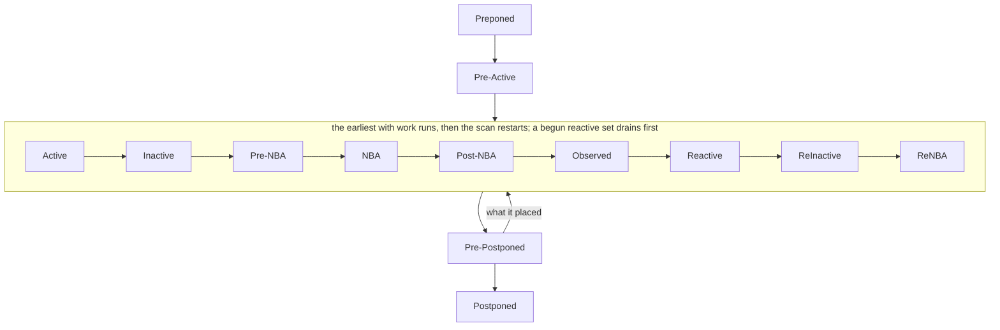

# Scheduling

The compiler does not yet refuse a `ref` argument used inside a `join_any` or `join_none` branch
under the tolerant reading: such a branch is compiled, and a write through the argument after the
caller has returned reaches storage that has ended. Everything else here binds as written.

A lyra simulation runs as a set of executions coordinated by a stratified event scheduler. Each
SystemVerilog process -- `initial`, `always*`, a continuous assignment -- runs as a coroutine, or,
where its body runs to its end each time it is triggered, as a reaction the run calls. The scheduler
pulls executions from time-slot region queues and runs each; it runs until it stops, and lands on
whichever queue its own wait chose. Deferred effects (`<=` writes, `$strobe` prints) are not yields:
the execution makes a closure of its inputs in the run's storage for effects, keeps it in the region
it is due in, and continues running. The engine invokes those closures when their owning region
runs, and where the slot to run in is not yet knowable, what is handed over is an execution that
finds it.

This doc covers the engine and what an execution waits for: the process model, what a wait watches
and what a write tells it, region structure, deferred work, how a run ends, what a run counts of its
own work, and the MIR boundary. What an activation is belongs to [activation.md](activation.md), the
order processes start in at time zero to [elaboration_lifecycle.md](elaboration_lifecycle.md), what
a net shows to [net_resolution.md](net_resolution.md), and what an assertion evaluates and when to
[assertions.md](assertions.md).

## Processes and tasks are coroutines, or reactions

The execution instance a process or task runs as -- its identity, completion outcome, ownership, and
cancellation -- is the activation, defined in `activation.md`. This doc owns the engine that parks
and resumes activations; `activation.md` owns what an activation is. The scheduler holds an
activation token (a payload-neutral handle) and never sees an activation's completion type.

A process body -- and a task body, which may consume time -- runs as a `Coroutine`. The scheduler
holds the activation token and resumes the body; a `co_await` in the body suspends it again. Process
state -- procedural locals, the implicit program counter -- lives in the coroutine frame, which the
engine does not introspect. A body that stops only at the head of its loop is not compiled as one:
it is a setup and a pass, plain bodies the run calls on the object they belong to, and it runs as a
reaction -- an activation that is no frame, holding the wait between passes, and the thing the
scheduler queues. A body that never stops is its setup alone. The engine runs either through the
activation's own entry -- a frame resumed, a reaction's part called -- and tells them apart nowhere.
Such a process is still one (Annex P): its object, which `process::self()` returns and process
control acts on, is made the first time the language asks for it, and its generator is drawn as it
is created (LRM 18.14.1). The runtime holds one thing as running at a time -- a thread of frames, a
reaction, or code on no thread. The code running reads what is in force from it, and a stop parks
it.

Every wait is part of that state too. A body stops in exactly one way, at a wait it holds, through
the one entry every timing control shares; the only other way it gives up control is a foreign task
carried on a fiber (LRM 35.9), which waits for no occurrence. A wait enrols on what it watches for
its whole life, which is as short as its use allows: outside the innermost loop around its stop for
a wait on storage that stays the same every time the body reaches the stop, so each pass stops at
the one wait, and in a block of its own around the stop where no loop repeats it. One only the stop
can name -- a delay's amount, a fork's branches, what an evaluation reached -- is built at the stop,
and so is one that reads a variable the body declares, which exists only from its declaration on
(LRM 6.21) and is reached in the frame that declared it. A stop only marks the activation as parked
on it; an occurrence while one is parked wakes it, and any other occurrence wakes nothing. That is
the C++ and Rust shape of the same thing -- an awaitable is a local of the coroutine, declared where
its inputs are known, and a stop only awaits it. A wait on a standing state is reached by each
change on the way there and asked whether the state holds now: a `join` watches each branch's
termination, which a killed branch reaches as surely as one that ran out (LRM 9.3.2), `wait fork`
the process's children (LRM 9.6.1), an `await` its target's termination (LRM 9.7).

A procedure's timing control asks afresh at its next stop, since it waits only for what happens once
it is reached (LRM 9.4.2); a continuous assignment or a procedural continuous assignment is
sensitive whenever it executes, its own update included (LRM 4.9.1, 4.9.2), so its wait keeps a
change the process makes itself while it runs, and its next stop places it again in the Active
region of its set. Only a change the process makes itself is kept: one another process makes while
this one waits in a queue is read by the evaluation that run makes. Stopping a process from outside
takes it off its wait and keeps the wait; starting it again asks the wait afresh -- an event control
measures from what its expression is worth then, a delay compares its deadline, and a `wait (cond)`
answers "satisfied" so that the body's own loop reads the condition, which is why a level wait is
built by a call of its own (LRM 9.7, `activation.md`).

A task is enabled with `co_await`: enabling a time-consuming task suspends the enabling process
until the task completes (LRM 13.3). The scheduler resumes the innermost suspended frame, and each
completed task transfers control back to its enabler, so suspension flows through the whole enable
chain without the engine tracking call depth.

A stackful thread per process fails the iteration-time target (`north_star.md` invariant 1): its
stack multiplies memory by orders of magnitude for any nontrivial design, where a coroutine frame
holds only the locals live across a suspension. A hand-rolled state machine fails `mir.md`'s
structured form: HIR-to-MIR lowering would thread resumption state through every statement that
might suspend.

## What a wait watches, and what a write tells it

`storage.md` keeps three identities apart -- the storage a write lands in, the entity its update
event is raised on, and the expression a process waits on -- and owns what a write reports: which
entity it updates and what it compares (its invariants 12 and 13). This section owns the expression
a process waits on and how a write's report reaches the waits.

### An event control watches an expression

An event control waits for a change in the value of its expression from where the wait began (LRM
9.4.2). That value is no storage's, so the wait keeps it and compares, and nothing else keeps it. An
event list is a list of leaves, each with its own expression, its own last value, its own predicate
-- any change, or an edge of the least significant bit -- and its own gate. `or` ORs events rather
than operands (LRM 9.4.2.1), so `@(a or b)` fires on a change of `a` whether or not `a | b` moved;
`iff` binds to one leaf and is read only once that leaf's expression has moved, never watched (LRM
9.4.2.3). A leaf's last value advances on every candidacy, fired or held back by its gate, so it is
never compared against a value the design has left behind. A named event is a leaf over the object
the event names where the wait begins, compared by how many times it has been triggered (LRM
15.5.2), which is why an event and a value change stand in one list and `wait (e.triggered)` needs
nothing of its own. An event that names no object is one nothing can trigger: triggering it does
nothing, a wait on it waits as long as the run lasts, and its `triggered` answers 0 (LRM 15.5.5.2).
An edge operand is anything of the standard's integral set (LRM 6.11.1).

What a leaf depends on is what its last evaluation reached, not what its text names. LRM 9.4.2
requires a change to an object's data member, an aggregate element or a dynamic array's size read by
a method to reevaluate the expression, and permits reevaluating for members the method never read.
So a class object is one event source for all of its properties, and a write publishes to the
innermost object its place dereferenced, or to the declared variable where it dereferenced none.
Each evaluation re-collects what the leaf depends on and compares against the last value like any
other: `p = q` satisfies `@(p.status)` exactly when the new object's `status` differs, which is the
clause's own example. A null handle reached is the program's error (LRM 8.4, 25.9). One source per
property is admissible wherever it pays and is never owed. A wait on a class handle or `chandle`
variable itself ends at a write naming a different object or pointer, null included, and a write
naming what the variable already names is no event (LRM 9.4.2); a wait on a property of the object
is another wait, on the object.

An implicit sensitivity -- an `always_comb` or `always_latch` body, an `@*`, a `wait (cond)`, a
continuous assignment, the evaluation of a procedural continuous assignment -- has no value to
compare: being reached by a change of what it reads runs it (LRM 9.2.2.2.1, 9.4.2.2, 9.4.3, 10.3).
`wait (cond)` is a loop that retests the condition around such a wait, which is what makes a
compound condition correct where a one-shot control on the same reads would not be. An empty list is
legal and never wakes: a process whose list is empty runs once and waits for ever.

### What an implicit list holds

The list is what the text reads, each read as the longest static prefix of what it selects (LRM
11.5.3, 9.2.2.2.1), less what the node itself brings into being -- an automatic it declares, a
formal, an array method's iterator, a pattern's binding -- none of which holds anything from outside
it (LRM 6.21). A static a wait's expression or an `@*` statement declares exists from time zero and
stays; an `always_comb` or `always_latch` leaves out every variable its block declares, statics
included (LRM 9.2.2.2.1). Read from the text:

- **No path is ruled out by a value.** A branch a parameter or a generate index never takes is read
  all the same, since the clause lists what is read within the block. The requirement is that one
  body compiled for many constructions reads the same in each (`north_star.md` invariant 2); a
  branch's constant is supplied at construction. It costs wake-ups and never a value.
- **Reads keep the order the text makes them**, so two lowerings of one text compare equal and stay
  one body.
- **Each read keeps the names that reached it.** A name through an interface port reaches whatever
  each instance binds the port to (LRM 25.3), so it is watched through the port, as an expression
  through the port is read.
- **A query whose answer is its operand's current extent reads the operand** -- `$bits` of a
  dynamically sized value, `$size` of a queue (LRM 20.6.2, 20.7) -- and one the type fixes reads
  nothing, which the query's lowering decides where it folds the constant.
- **An `always_comb` or `always_latch` leaves out what its block and the functions it calls write**
  (LRM 9.2.2.2.1), where the write's part is named exactly (below) and a read of that part is taken
  out whole or by bits. An `@*` keeps them, since another process's write of what it both writes and
  reads changes what it computes (LRM 9.2.2.2.2).
- **An `@*` leaves out a variable its statement uses only to control its `for` loops.** Assigned
  before every read, it carries nothing in, so leaving it out changes how often the statement runs
  and never what it computes, and two statements looping over one shared variable settle instead of
  waking each other for ever. A control variable the statement names outside its loops stays.
- **A called function reports what it reads where the call reaches it.** Ahead of the procedure's
  first run, each call it makes is handed the report parameter a wait hands (below), told to run
  nothing: the function states what its text reads and writes and makes each call the list follows,
  with every argument defaulted. A call on a class object or through a virtual interface adds only
  its arguments (LRM 9.2.2.2.1). The list follows no handle, so it is collected once at time zero,
  each place listed once, and no unit reads another's body (`north_star.md` invariants 4 and 5).

### Who evaluates

A wait is decided by its process: a change to anything its last evaluation reached makes the process
a candidate, and it evaluates the expression and the qualifier once, compares, and waits again on
what that evaluation reached (LRM 4.5, 9.4.2, 9.4.2.3). Where the expression and qualifier read
nothing but storage elaboration bound, the change decides instead, evaluating them where it lands:
LRM 4.7 permits that schedule, and such an evaluation does nothing, fails in no way and depends on
no process, so nothing can tell it from the process evaluating. It saves resuming a process to learn
a change was no event -- every falling edge of `@(posedge clk)`. Which side a wait is on is a
question about the expression, answered as clang's `Expr::HasSideEffects` walks: a call, a write, a
read through a handle or a virtual interface, or a property read makes the process decide.
Evaluating any other expression at the change fails LRM 4.5, which makes evaluation an event of the
waiting process: the writer would run the waiter's calls, writes and failures on its own stack, and
a call writing what it watches re-enters its own evaluation.

The one evaluation states what it reaches, because a second evaluation runs a function's effects
twice. Every function and class constructor takes one more parameter, the report of the evaluation
it runs in, and hands it to each call and construction it makes; an ordinary call hands none. Handed
one, a body states the cells its text reads as it is entered -- whole, however it branches, which
LRM 9.4.2's permission to reevaluate covers -- and each object it reads a property on and each
interface variable it reads through a handle as it reaches it. A function is compiled in two forms
from its body: the one every call, dispatch slot and export reaches, which states nothing and,
handed a report, defers to the other; and the recording form, reached only through the first, so it
has no name of its own anywhere a call is resolved. Units compile apart, so what a callee reads can
only be stated by the callee as it runs (`north_star.md` invariants 4 and 5). Foreign code is
reached only through the exports it calls, and a parameter cannot cross the foreign boundary, so an
export finds the evaluation in progress from the running execution -- the one place the report is
found rather than handed. What no wait can watch fails the simulation at the wait that reached it,
as the design's run-time error, and leaves the function compiling as before.

A wait watches what it read and keeps none of it. Handles keep an object (LRM 8.29) and a wait is
none, so an object nothing else refers to ends, and its end tells the waits on its properties
nothing, since nobody can write what is gone. A handle's last value is a weak reference to the
object, so one made where an expired one lay is another value. An object a weak reference answered
is watched for its expiry, which changes what the reference answers (LRM 8.30.3); its waits are told
once the execution running at the expiry hands back control, in the slot it expired in, never during
the destruction, since a wake can run the design's code at once.

### What a write tells

A write raises one update, on the declared variable it reaches or on the innermost object its place
dereferenced, whatever depth it landed at ([`storage.md`](storage.md) invariant 12); which one is
resolved at run time where the place goes through a handle or a reference. The update says which
part it reached. A part of a variable is named by the path of steps that reach it -- a member of an
unpacked structure by its index, an element of an unpacked array by its ordinal (LRM 7.2, 7.4) --
ending at a range of bits inside a packed value and at a range of elements for a slice (LRM 7.4.1,
7.4.6). Two paths concern the same storage exactly where one is a prefix of the other. A path holds
a bounded number of steps; past the bound, at a select no step stands for (an associative array's
index, LRM 7.8), and from a queue or dynamic array a reference points into -- whose element is not
its position (LRM 13.5.2, 7.10.3) -- the path ends and is inexact, covering more than the source
wrote, so it misses no write and no wait; a procedure's own write is taken out of its list only
where its path is exact. No layer states where a part lies: HIR states the select the source wrote,
MIR a variable and its steps.

A variable keeps its waits on a tree shaped like its parts, each node made when a wait first needs
it. A write that changed something tells the waits on the part it reached what it did there, the
waits on what that part lies in which element or member of theirs it went into, and the waits inside
it whether their part changed; waits anywhere else are not visited. The requirement is twofold: a
process waiting on part of a variable is woken by a write exactly when the write reached some of it,
which an implicit sensitivity is owed because its list is stated part by part (LRM 9.2.2.2.1); and a
write costs what it wrote and the waits on what it wrote. Where writing a part changes more than the
part, the written path stops sooner than a watched one: every member of a union is one storage (LRM
7.3), so a member's write reports the union, and a character's write reports the string. A written
path is therefore a prefix of every watched path it can change, and the walk reaches every wait the
write can affect.

What the write compares, and where it can say only that a part may have changed, is
[`storage.md`](storage.md) invariant 13; a write of bits of a packed value tells each wait which of
its bits moved. An observer that answers for a value compares for itself, while an implicit
sensitivity takes the telling as it comes, an extra run costing time and no value.

So what a change is measured from has one holder per kind of observation: an observation of storage
asks the write, which holds what it replaced; an observation of an expression's value keeps that
value itself; a per-interval observer is told from the originals its interval keeps (below). The
engine keeps no earlier value of anything.

Where a wait on a place watches is asked of the type that stands for the place's storage, and every
place a wait or a read report names is handed to that one question however it was reached: a
variable's cell answers itself, a net what it shows its value through, and a reference the member it
was bound into, so a wait built on a port follows a force on it (LRM 10.6.2). A place that is no
variable, net or reference is storage nothing is told a write to.

### A build that coalesces combinational updates

Every write is told to every wait as it is made (LRM 4.3, 4.7), with one exception a build asks for:
in a design built to coalesce combinational updates, where an `always_comb` or `always_latch` writes
what another reads, the reader is triggered by the net change the writer's execution leaves of it
(LRM 9.2.2.2). Each execution of such a procedure is an interval, and one interval is open at a
time. A write announces the part it modifies immediately before it lands, with no code run between.
Where an interval is open and a per-interval observer watches the variable, the variable keeps that
part's original, unless it keeps one of a part holding it already, and the write is accumulated: a
per-change observer is told it as it lands, a per-interval observer only when the interval ends,
from the original against what the part then holds, so a value written and written back within one
interval wakes nothing. What is kept follows what the writes touched: a write of bits of a packed
value keeps the words those bits lie in, the words kept of one value forming one run from the first
the interval modified to the last, and a member of an unpacked union keeps the union every member
reads; an array whose size the run sets is kept whole, at its first modification in the interval. A
part a path names inexactly -- past the bounded depth, or through a reference into an array whose
size changes -- is never kept itself; it is accumulated only where a part holding it is kept, and
told as it lands otherwise, which costs its reader a run and never a value. A class property's
write, and any occurrence that is no write of a variable, are told as they land.

The interval ends as the execution ends, and whenever such a reader begins or stops listening --
armed, stopped or started again, or moved by a force or a release -- so none is told what changed
before it listened, nor misses what changed while it did. It ends for every per-interval observer at
once, which is the dialect's stated limit: a reader beginning or stopping to listen while another
procedure's execution is under way cuts that execution's interval in two, so a change the whole
execution cancels can be told, and its reader run once more.

### One membership primitive for every wait and queue

One membership primitive serves every target a wait or a queue enrols on -- a cell, an object, a
named event, a cancellation, a fork's parent, a process's termination, a region queue: an intrusive
ring the target anchors with one member of its own closing the ring, whose member unlinks itself
without naming the target, and whose fields mean what its target says. The ring is what lets a later
slot's queue join the current one in constant time. What decides whether a change is an event is one
object for each expression a wait watches, which every membership enrolled for it holds a share of,
never a copy of its own. A target that needs an operation the ring lacks is a reason to revisit the
ring; a second primitive beside it puts two kinds of membership in every list the scheduler walks.

## The engine is a mechanism, not a semantics holder

The engine does three things: it holds queues of runnable executions, it runs them, and it parks
each one on whichever queue the code it just ran asked for. It never inspects what an execution
represents, why it stopped, or what it waits for. A coroutine frame is opaque to it, and so is a
reaction.

Construct semantics live entirely in what an execution waits for. Each suspending construct builds
one of those for the body to stop at, and the wait answers how a stop there carries on -- at once,
on an occurrence, later in this time step in a named region, or at a time -- which the one stop
arranges through a small fixed set of construct-neutral scheduling verbs. What those verbs take is a
**placement** -- which time slot, and which region of it -- because that is what an LRM 4.4 event
is: a time, a region, and the thing to do there. A stop places its activation; a satisfied wait
wakes it into the current slot, in the Active region of its thread's region set (Reactive for a
program's); a spawning construct may adopt a coroutine and place it; and a construct may ask that
the simulation stop. The verbs name _where and when_ a handle becomes runnable again, never _why_.
Distinct constructs -- a delay, an event wait, a task enable -- bottom out in the same verbs, and
the engine cannot tell them apart.

Taking the placement as an argument rather than encoding it in the verb's name is what keeps the set
complete. A verb per combination covers points of that space and leaves the rest unreachable, and a
missing combination is invisible, because it is the absence of a name and nothing reports a name
nobody wrote. A nonblocking assignment carrying a delay wants the NBA region of a future slot; a set
that can say "a future slot" only about the Active region has nowhere to put it, and says so by
being silent.

This is the division a host event loop draws: the loop runs its queues and knows nothing of the
timers, I/O, or callbacks that fill them; the meaning lives in the APIs that enqueue, not in the
loop. The payoff is additivity. A suspending construct is added by writing what its execution waits
for, which schedules through the existing verbs; a process-spawning construct may also add one
construct-neutral verb (adopt a coroutine and schedule it). Either way the engine gains no
per-construct branch.

**Invariant:** the engine branches only on queue and region, never on the kind of construct an
execution came from, because what a construct means lives in what it waits for. A per-construct case
inside the engine's resume or dispatch path fails that additivity, and so does a note an execution
leaves for the scheduler to read in place of a placement. When a construct seems to require the
engine to ask "is this an X?", the neutral verb set is missing a primitive -- add the primitive, do
not teach the engine the construct. Which region set a thread runs in is not such a note: the
standard places a thread by it as it places one by time (LRM 24.3.1), so it is part of the
placement, chosen where the placement is and never read by the dispatch. Nor is where a satisfied
wait places an execution: in the Active region of its set, as every thread is, or at the occurrence
itself, once every wait it reached has been asked and before the execution that made it occur goes
on, which is how a covergroup is sampled on its event (LRM 19.3). It is held beside the region set,
chosen where the execution is started and passed on to nothing it starts, and read by the one verb
that wakes; an asynchronous runtime holds the same choice in the same place, as the dispatcher of a
coroutine's context, one of which resumes a coroutine in whatever resumed it. The executions an
occurrence wakes there run in the order their waits enrolled on it, which stopping at a wait again
never changes, and a wait first made from inside the occurrence enrols behind every one already
there, so executions that began to wait in some order keep that order across every occurrence they
wait out; the placements they then make into one region of one slot run in the order made. A
clocking block's drives rely on exactly this to land, of those maturing together, in the order they
were made (LRM 14.16.2; [verification_constructs.md](verification_constructs.md)). Running it only
once the waits have all been asked is what an event library does when it copies its listeners before
calling them: no code of the design runs while the list it was reached through is walked.

## Deferred work is a closure submit, not a suspension

When a process needs an effect to happen later -- a non-blocking write to a signal, a nonblocking
event trigger, a postponed `$strobe` print -- it does not yield. It snapshots its inputs into a
closure (see `mir.md` for the MIR-level shape) and submits the closure to a placement, then keeps
running. A submit takes the same placement a suspension does, which is what lets a nonblocking
assignment carrying a delay reach the NBA region of a later slot (LRM 4.4.2.4, 10.4.2) with no
second mechanism.

A deferred effect made by suspending the process fails LRM 10.4.2, which commits a nonblocking write
in the NBA region of its slot wherever the process is by then: a process doing `q <= d; #5; ...`
would be held at `#5` until the write committed.

**Forbidden:** routing deferred writes into per-signal queues. It fails LRM 4.6, which performs a
slot's nonblocking writes in the order they were made; every closure is submitted to one region
queue, so commit order is the region's, not a function of which signal a write targets.

### How long an effect lives, and where it is made

**An effect lasts exactly as long as its region holds it, and is made where its region's keeper
says.** Every execution schedules an update of its own (LRM 4.9.4), from the statement until the
region runs it, and every effect a region holds -- the program's and the library's own alike -- ends
there. So the region holds its effects in the order they were made and runs them in it, ending each
once it has run or, never run, once the region's effects end. Each is made in bytes the run keeps
for its effects, which go back once it has ended, so what is held follows how many effects are
pending at once and never how many times they are due at, as SystemC's kernel keeps its timed events
on one free list. A pass owns what it runs alone; what is submitted meanwhile goes to the region it
is due in, never into the pass. A later slot's effects become the current slot's by joining two
orders, with nothing moved. An effect keeps the procedure whose operation made it, a timer the one
that owns it, and what is owed at the end of the run the one that asked for it, and whatever runs
one of these publishes that procedure for the extent of what it runs, so a report made while no
process runs names the instance a report of that procedure names (LRM 20.10), a process that has
ended included. Each keeps only what a report reads, since an effect is made on the nonblocking
path. The scheduler keeps no place in the source: a nonblocking update and a `$strobe` body are
closures of the program, whose own calls hand theirs, and an effect the library itself defers and
that can report keeps its place in its own capture and binds it when it runs.

### A deferred body runs on no thread

**A deferred body that evaluates what the source wrote runs on no thread, in what it took where it
was made.** A `$strobe`'s arguments, a concurrent assertion's tick, a clocking block's sample and
the settling of its output at the end of a pass, and a covergroup sampled under `strobe` run code of
the design once their region runs them, with no process running, and that code asks what a process's
code asks: which generator it draws from, whether its thread may schedule past a function's return,
which disable targets it is inside, which foreign calls. The standard names no thread for any of
them, so each runs on no thread, as a static initializer does (LRM 18.14.1): no initial or always
procedure created it, it belongs to no program, `process::self()` answers null and `disable fork`
ends nothing. What it runs in -- the procedure, the seeds and the region set an execution of no
lineage started where it was made would take, and a generator what made it hands over -- is taken
there and captured by the body, as an asynchronous runtime's callback captures the context it was
scheduled in and runs inside it, and the body opens by entering it until the effect running it
returns. A nonblocking update applies values already evaluated and takes none of this, so no effect
grows.

What is handed over to run where no thread runs it -- this body, and the executions of no lineage
below, an update waiting on an event and a deferred or concurrent assertion's action -- draws from a
generator made from the giver's state and how many it has handed over since it was last seeded,
without stepping it: handing work over is neither a draw nor a thread creation, so it moves nothing
the giver draws (LRM 18.14), and it depends on the giver alone, never on the order other threads ran
in (LRM 18.14.2).

### Once the Postponed region is reached

**Once the Postponed region is reached no earlier region of the slot runs again** (LRM 4.4.2.9), so
the Postponed region runs what is placed in it while it runs, a final deferred assertion's action
among it (LRM 16.4.1), and a placement into an earlier region of the slot is the design's error,
reported once the region has run. A violation report made there matures there -- it belongs to the
process that made it ([runtime_model.md](runtime_model.md)) -- since the slot has no Observed region
left and the active set can glitch no more; an observed deferred assertion reached there has no
Observed or Reactive region left and is refused at its statement. Once the simulation is over no
region runs at all, so a violation report or a final deferred assertion made in a final procedure
matures, and acts, as it is made, and an observed one is refused as in Postponed. How a deferred
report matures and is withdrawn is `assertions.md`'s.

### What an effect is and when it is due

**What an effect is and when it is due are two questions, and only the second decides the shape.**
The standard writes the second one the same way wherever it appears: a nonblocking assignment and a
nonblocking event trigger both name an optional delay-or-event control and both land in the NBA
region of the slot it names (LRM 9.4.5, 15.5.1). So the deferral is one envelope taking whatever the
effect is, and a construct that gains a deferred spelling adds no placement machinery of its own.
What the effect acts on is fixed where the statement stands, as a nonblocking assignment's target is
(LRM 10.4.2): a nonblocking trigger reads its event there and triggers the object that event named
then, whatever the variable names by the time the effect runs. One statement's whole effect goes in
one of these, however many places it writes -- a destructuring left-hand side (LRM 11.4.12) included
-- which is what makes a control it carries read once rather than once per write.

### An effect due on an event is an execution of no lineage

**Where the placement is not yet knowable, what is handed over is an execution rather than a
closure.** An effect due on an event (LRM 9.4.5, 15.5.1) has a region but no slot: which slot it
lands in is whichever one the event happens in, and nothing where the statement stands can say. So
the process freezes what the effect writes and where, as it does for every nonblocking update (LRM
10.4.2), into an execution that waits for the event and then places itself in the NBA region of the
slot it lands in, and writes when it resumes there. The execution is run up to its wait as the
statement is reached, before the process carries on: the control is executed by the statement, so a
change the process makes straight after it is an event for the wait, and a run-time error evaluating
the control before the wait begins is the statement's, raised in the process. Once it waits, an
error is its own. A repeat count (`repeat (n) @(ev)`) is read once at the statement and is a loop
around the wait. Two updates of one variable from one procedure land in the order the statements
ran, since their executions began to wait, woke and placed themselves in that order. A `disable`
that reaches the process does not cancel a pending update -- LRM 9.6.2 leaves the outcome open, and
this is the answer an update carrying a delay already gives.

That execution belongs to no lineage. The standard makes no process of a pending update, so nothing
that names processes may find it: `wait fork` does not wait for it and `disable fork` does not reach
it (LRM 9.6.1, 9.6.3). **Forbidden:** giving such an execution a parent to reuse the spawning path,
which fails LRM 9.6.1 and 9.6.3 by putting the update under process control the standard never put
it under. A membership naming a closure rather than an activation fails the single membership
primitive above, since every consumer of a fired membership would branch on which it got.

An assertion's action is another execution of no lineage. Its placement is known -- Reactive, or
Postponed for a final deferred assertion -- but what runs there is a procedural statement that may
wait (LRM 16.3, 16.4, 16.14.1), so the region starts it as an execution rather than calling it, and
runs it to its first stop at once, since nothing in the region runs ahead of it.

A covergroup sampled on its clocking event is a third (LRM 19.3): `new` starts it, the standard
makes no process of it, and each occurrence of its event runs it in place, once every wait the
occurrence reached has been asked and before the execution that made the event occur goes on.

### What a function may schedule past its return

**What a function schedules past its return is checked where the statement is written, against the
thread calling it.** A function may schedule what takes effect after it returns -- a nonblocking
assignment, a nonblocking event trigger or a clocking drive, under any control, and a
fork-join_none, the statements LRM 13.4.4 names -- only where the thread calling it was created by
an initial or always procedure, or a fork of one, and it is an error otherwise (LRM 13.4.4); the
final procedures' thread and code that runs on no thread are neither. Whether a statement runs
during a function call is fixed by where it is written, and which thread calls the function only by
the run. So the lowering states the question as an operation of its own ahead of each such statement
in a body that runs as a function call, and the runtime answers it from what created the running
thread. The submit itself asks nothing, because the same statement outside a function is never
refused -- an assertion's action may write `x <= 1` directly -- and one thread runs both, with no
record of how deep in calls it is.

### An effect a later event can take back is a timer

**An effect a later event can take back is a timer, held by whoever owns it.** A continuous
assignment carrying a delay schedules each new value to propagate, and a different value computed
before it lands deschedules it (LRM 10.3.3). So that propagation is one event at most, which arming
again replaces: the owner holds a timer that is itself the queue node, linked into the region queue
of the slot it is due in and unlinked when replaced, as a stopped activation is withdrawn. A slot
left holding nothing is then passed over as any slot whose events were taken back is (LRM 4.5). This
is the timer of an event loop -- Linux's `mod_timer`, asio's `expires_after` -- rather than a
counter the generated body compares, because taking an event back is the engine's business and not
the program's. The timer is bound once to what firing does, which reads its owner rather than a
value captured per change, and the delay a value takes among rise, fall and turn-off delays (LRM
28.16, 10.3.3) is a function of the runtime, so a net's own delay can reach the same rule from
inside the net. Where a delay of some steps is due -- the Inactive region of its region set now for
none, that set's Active region at its deadline otherwise -- is one answer, shared with a process
stopped at a delay. The wait an expect statement stops at holds two more, which queue each tick of
its property into the Observed region of the time step it happened in and each change its disable
condition reads into the Active region, and which ending the wait takes back with it (LRM 16.17).

## Region structure

A time slot runs regions in LRM 4.4 order: Preponed, Pre-Active, Active, Inactive, Pre-NBA, NBA,
Post-NBA, Observed, Reactive, ReInactive, ReNBA, Pre-Postponed, Postponed. Of that clause's PLI
regions, these are the ones LRM Table 4-1 places a callback of foreign code in (LRM 4.10, 38.36.2;
[foreign_interface.md](foreign_interface.md)); the rest -- Pre-Observed, Post-Observed, Pre-Re-NBA,
Post-Re-NBA -- no callback names, so nothing is ever placed in them and they are not kept.

### How a slot runs its regions

Preponed runs once on entry, then Pre-Active once, before the regions that repeat (LRM 4.5); what is
placed in Pre-Active while it runs runs there too. Postponed runs on exit until nothing placed in it
while it runs is left (LRM 16.4.1). Between them the slot repeats one step: take the earliest region
from Active through ReNBA that has anything pending -- or, once the reactive set has begun and while
it holds anything, the earliest of Reactive through ReNBA -- run it, and look again; and once none
of those holds anything, run Pre-Postponed, whose callbacks may write and so start the step again.
Running a region produces work that lands back in the slot -- an NBA commit wakes a process into
Active, a resumed process submits an NBA -- so the step repeats until nothing between those bounds
is left.



That one step is LRM 4.5's loop. The reference algorithm writes it as two inner loops, one per
region set, each moving the earliest nonempty region of its own set into that set's first region and
running it again until the set is empty; running the region where it stands reaches the same order.
So work the reactive set schedules into the active set waits until the reactive set has drained,
which is when LRM 24.3.2 has a design process woken by a program run.

Two consequences carry the weight. A process woken by a blocking write runs while the active set
drains, before the NBA region commits the nonblocking writes issued beside it -- deferring it past
NBA is the classic wrong answer, because the process then reads values that in the standard's order
it cannot yet see. And a process woken by an NBA commit belongs to the slot whose NBA woke it, so it
runs before that slot's Observed region rather than being pushed to the next time slot.

The reactive group (Reactive, ReInactive, ReNBA) is reached only when the active group has drained.
It holds program-block statements, checker code, the action blocks of concurrent assertions, and the
action a matured observed deferred assertion runs (LRM 16.4.1). A `#1step` sample (LRM 14.13,
16.5.1) is taken in the Postponed region of a slot the sampled place changed in, which LRM 4.4.2.1
makes the same as taking it in the next slot's Preponed region, so no sample is placed in Preponed.

`#0` delays land in **Inactive**, not Active. A user writing `#0` is asking the engine to let other
already-pending active work finish first, then come back at this same simulation time. Pushing
`#0`-suspended processes to the back of Active would let them re-enter ahead of work that arrived
earlier, defeating the intent.

### Which region set a thread runs in

A thread runs in one region set for its whole life: the one the thread that started it runs in, as a
coroutine inherits its context from the scope it is launched in and from its parent, and whatever
code it calls, since a subroutine runs in its caller's thread (LRM 24.3.1, 24.5). A process runs in
the set named by the class of the instance whose code it evaluates. The design's code runs in the
active set and a program's in the reactive one (LRM 24.3.2). That instance is the one whose text
creates the process, except for the drive across a child's output port. The instantiation creates
that drive and it evaluates the child's code (LRM 4.9.6), so the instantiating scope launches it as
the child's without needing to know whether the child is a program. Its generator is still split
from the instantiating scope's seeds (LRM 18.14.1). A placement a thread asks for in the terms of
its own work names a region of its own set -- where a wake or a delay resumes it, where a `#0` does,
where its nonblocking updates land -- and the two sets are each other's dual region for region. A
placement whose region the standard names itself names that region, whatever set the thread runs in:
a deferred assertion's report matures in Observed and acts in Reactive (LRM 16.4.1), a synchronous
drive lands in the Re-NBA region of the slot its skew names (LRM 14.16), and a skewed input of a
clocking block is read in Observed from a copy kept in the NBA region (LRM 14.13). One placement
names no region at all but the end of the pass of the region running now: what a pass did is settled
there as one, after everything the pass held and before what it placed, as a clocking block puts
onto an output's variable only the last value the pass's drives gave it (LRM 14.16.2). At time zero
each set starts its processes in the same turns (`elaboration_lifecycle.md`, Activate), the reactive
set's once the active set's have settled; an execution of a scope woken inside each occurrence of
what it waits for, which is no procedure, starts in the always procedures' turn.

### The current slot and the later ones

LRM 4.4 gives every event one time, the current one or a later one, and the engine holds the two
apart. Nearly every event -- a wake, a nonblocking write with no delay -- lands in the current slot,
which lasts the whole run and is reached without looking anything up, so its queues keep their
storage from one slot to the next. The later slots are kept in time order, and time moves only to
the earliest of them that holds something (LRM 4.5): a slot whose every event was taken back -- the
delay of a process stopped or killed before its time came -- is passed over, and the time it named
never becomes the time. Moving there hands that slot's events to the current slot, empty by then, in
the order they were placed -- which is the order its nonblocking writes are performed in (LRM 4.6).
This is how SystemC's kernel and an async runtime such as Tokio hold what runs now apart from their
timed events.

## How a run ends

Every ending is a composition of three operations, and nothing else ends a run:

```text
a report     severity, the file and line the call is written at, the hierarchical name of the scope
             it is made in, and the simulation time (LRM 20.10). Ends nothing.
a stop       the run is over, and whether it was asked as $finish or $stop (LRM 20.2).
a departure  this execution leaves, and no region may claim it (nonlocal_control_flow.md).

$info / $warning / $error   report
$fatal                      report, stop, departure
$finish / $stop             stop, departure
$exit                       a departure of every thread of the calling thread's program; from a
                            thread of no program a warning and nothing else (LRM 24.7)
the last program ending     stop, while the simulation runs (LRM 24.3)
a run-time error            report, and stop and departure where its severity is fatal
```

A report and a stop are separate operations, and `$fatal` is both, as LRM 20.10's "implicit call to
`$finish`" writes it. A task that ends the run departs from the execution that called it and never
parks it: no statement after the call may run (LRM 20.2), and the call is legal in a function (LRM
13.4), which cannot suspend; the stop and the departure are one call, since nothing may run between
them. The stop verb records that the run is over, and no process resumes after that: the record is
read where a process would be entered, so whatever is still parked in the in-progress slot is
drained without running a statement. A process that ended the run reports `KILLED` afterwards (LRM
9.7), its execution having departed rather than run out its body, and nothing of the design runs in
it again, a subroutine foreign code calls into later included: an exported function answers the zero
of its result, and an exported task an imported task called never returns to foreign code, while one
reached from anything else answers as an exported function does. A foreign frame beneath such an
execution is told nothing (LRM 35.9 binds a foreign call to the disable protocol only where a
`disable` targets it, and the run does not go on past its own end).

`$stop` ends the run as `$finish` does, since a tool with no interactive mode cannot resume a
suspended run, and the Table 20-1 diagnostic is the whole of what separates the two; it exits zero,
since LRM 20.2 places it beside `$finish` rather than among the severity tasks. The diagnostic a
stop prints is fixed by its level and printed where the task executes, because level 1 prints the
call's location and time, facts of that moment; it states what the tool did and carries no severity.

### A run-time error of the design

A run-time error of the design is a report Lyra writes for the design, at a severity it chooses per
condition, and is not a separate ending. Where the standard defines no value for the evaluation to
go on with, the severity is fatal, so the error asks for the ending `$fatal` asks for, and the same
tail runs. It becomes a departure at the first landing that takes it (`nonlocal_control_flow.md`).
An error raised while variable initializers run or processes are created is a run-time error, since
both are simulation at time zero (LRM 4); one raised while the design is built or its references
resolved precedes the simulation, and no `final` procedure exists to run.

### What runs once the run is over

Deferred effects already submitted for the in-progress slot do still run, so a nonblocking write
issued before the request commits and a `final` procedure can read it. LRM 20.2 says only that
`$finish` makes the simulator exit and does not say how much of the in-progress slot still happens,
so this is a choice rather than a requirement -- which is why the corpus does not hold a case for
it.

The `final` procedures then run in registration order, because a `final` procedure occurs at the end
of simulation time (LRM 9.2.3), which a run reaches by being asked to end, by a run-time error of
the design ending it, and equally by running out of work. They are not processes of their own but
function calls one thread makes in turn, as C's `exit` calls what `atexit` was handed on the thread
that called it: each unit registers a call of its procedure on its instance, and the run makes the
thread once the simulation has ended, so `process::self()` answers that thread in every one of them
and its generator carries on from one to the next. Each call runs in its own procedure's scope,
place and seeds, and is a landing of its own. No initial or always procedure created that thread, so
process control may not act on it (LRM 9.7) and nothing it runs may schedule what takes effect after
the call returns (LRM 13.4.4). A `$finish` a `final` executes -- directly, through `$fatal`, or by a
run-time error of the design -- ends the simulation immediately, so the ones still registered do not
run. Before them, an assertion attempt still in flight is settled by what the finished trace says of
it (`assertions.md`); after them, what the design asked to have done once the simulation is over --
writing the coverage database a covergroup asks for (LRM 19.9) -- is a call held from wherever it
was asked for and run, as `atexit` holds a function.

### An ending the language does not define

The one ending that runs none of them is the tool being unable to carry the run on -- an internal
error of Lyra's, or an exception nothing handles -- which is no ending the language defines: a
`final` procedure is design code, and the state it would read is already known to be wrong; so is
what writes the coverage database. The run reports the failure and exits failing. A request of the
design's to end, made after the tool has stopped the run, does not turn that ending into the
design's. What the engine owes either way -- the immediate cover report (LRM 16.3), what the design
wrote delivered to where it wrote it (`runtime_distribution.md`), the exit status -- is owed because
the run is over, not because of how it ended. A request for memory the host refuses ends the program
where it asked, delivering what the design wrote and nothing else, since anything run after it may
ask again.

### The last program ending

A program ends its own threads, and the last program to end ends the run (LRM 24.3). Once every
initial procedure of a program has ended, whatever they started that is still running is ended with
them; once that has happened to every program, the run ends as `$finish` ends it, printing nothing
because no call was made. A simulation that has already ended has nothing left for that to end, so a
`final` procedure that ends the last program leaves the other `final` procedures to run (LRM 9.2.3).
`$exit` ends the program the calling thread originates in, that thread with it, and from any other
thread does nothing but warn (LRM 24.7). The program's continuous assignments are not its threads,
so neither ending reaches them.

## What a run counts of its own work

A program built with `--runtime-statistics` counts each kind of scheduling work as it does it: time
slots; for each region, its passes, the activations it ran, those run again in the same execution of
the region (its passes since a pass of another region last ran, LRM 4.5's `execute_region`), the
deferred effects it ran and the timers it fired; the activations run at an occurrence; and the
changes told, the memberships they reached, those a change passed over as unaffected, and the
activations woken. Run with `+lyra+stats=<file>`, it writes them as it ends, as a JSON object whose
`work` maps each kind to its count, the shape of the compiler's own `--stats-file`, and
`tools/trace/report.py` reads and compares either. A file it cannot write fails the run as the
tool's failure.

Only a program built to count carries any counting, because a count is work on every event
([building_a_program.md](building_a_program.md)). The counts are kept by region, never by the
construct an execution came from, and nothing the engine decides reads them.

## What a deferred closure may refer to

**Every reference a closure holds is valid for every run of the closure that can use it, and the
compiler establishes this for every closure alike.** No construct carries a check of its own, so a
construct that gains a deferred form is covered from the start.

Three questions are kept apart, because each has its own owner and none answers another:

- Whether the program may refer to a variable there at all is the language's, and the front end
  answers it. LRM 6.21 and 13.3.2 forbid a nonblocking or continuous assignment to an automatic, and
  tracing one with a system task such as `$monitor`, which the front end reads as covering `$strobe`
  too; LRM 9.3.2 forbids a `ref` argument inside a `join_any` or `join_none` branch. A tolerant
  reading the front end can be asked for (`--compat all`) lets the last through as a warning; the
  lowering then refuses such a branch, since it can outlive the storage the argument reaches.
- What the closure sees when it runs -- the value at the statement, or the variable as it is then --
  is the construct's, and the standard states it construct by construct. A nonblocking assignment
  fixes its value and its target at the statement (LRM 10.4.2); `$strobe` evaluates its arguments
  when it prints (LRM 21.2.2); a deferred assertion's report takes its arguments at the failure (LRM
  16.4); a procedural concurrent assertion takes its automatics and its constant casts when it is
  queued, and keeps them for the attempt it starts (LRM 16.14.6.1); a fork branch shares the
  enclosing variables (LRM 6.21).
- Whether the storage a reference names still exists when it is used is the compiler's. This section
  is about that one.

How long a closure can run, measured against the body that made it, is one of three, and the runtime
entry it is handed to states which, beside the kind it asks of the closure
(`compiler_generated_storage.md` invariant 10), as a Rust callee bounds a callable parameter by a
kind and a lifetime, the lifetime being none past the call for `sort_by`, the scope's for a scoped
thread and `'static` for `spawn`. Where the closure is erased, the type it is handed over at carries
its kind and its signature and no lifetime:

| How it is handed on                         | Examples                                                                                                                     | What its references must reach                                                                                                                                                               |
| ------------------------------------------- | ---------------------------------------------------------------------------------------------------------------------------- | -------------------------------------------------------------------------------------------------------------------------------------------------------------------------------------------- |
| lent for a call                             | an exported task's body, which the call foreign code makes runs to its end                                                   | anything alive across the call                                                                                                                                                               |
| held while what the entry answers is held   | an event control's watch, an `iff` condition, a foreign task's body, the write-back a reference seen as another type carries | anything alive while the frame that made it holds that answer -- the wait it stops at, the reference it hands on -- because what holds the closure ends with the answer, however a wait ends |
| detached: able to run after its scope ended | a deferred effect, a delayed assignment's timer, an assertion's action, a branch                                             | static storage, a variable whose storage the closure keeps alive through a handle it owns, or an object it holds a share of -- followed through every closure it was captured through        |

A fork branch that `join` waits for is the second kind; one under `join_any` or `join_none` is the
third. The second kind relies on the runtime: what keeps such a closure is owned by the answer the
frame holds -- a waiting closure by the wait the execution's frame holds (`activation.md`
invariant 4) -- so stopping the execution from outside ends it with the wait, and nothing the
runtime keeps can call into a frame that is gone.

**Storage is extended only where the language requires a reference to outlive its scope.** Of every
detached closure, only a fork branch refers to an enclosing automatic: every other one is held by
the language to a value it took or to static storage. So the automatic variables a detached branch
names -- a subroutine's formal arguments among them -- are held in a cell of their own that the
declaring scope and each such branch keep alive, and every reference to the variable reaches that
one cell. Extending a variable's storage changes nothing else about it: not when anything is
evaluated, not when an `output` or `inout` argument is copied back to the caller, which happens when
the task completes (LRM 13.3), and not when a closure that refers to it is cancelled.

## MIR boundary: a place model, not storage layout

MIR carries a place model in the shape of Rust MIR and LLVM IR: a borrowed pointer type, `DerefExpr`
(pointer -> place) and its dual `AddressOfExpr` (place -> pointer), a reference type for `ref`
formals and alias captures, a pointer cast, and a null pointer literal. `self` is a borrowed
pointer. What MIR does not carry is storage _layout_ -- offsets, byte sizes, alignment -- which
belongs to LIR; the engine, not MIR, owns where storage lives.

The deferred-write pattern -- "this place, written later" for an NBA commit, a postponed strobe, a
callback -- is still expressed as a closure whose capture list owns the place. Whether a captured
field is a snapshot or an alias is the field's _type_: a value-typed field is a snapshot, a
reference-typed field aliases the live storage (LRM 6.21). The discipline is that a place held
across a suspension or a region boundary is a reference-typed capture field, not raw pointer
arithmetic threaded by hand. The C++ backend realizes such a field as an owned reference value (the
library's reference captured by value, never a `&` lambda capture), so a write through it still
wakes the cell's subscribers and nothing dangles when the closure outlives the frame that built it.

MIR states waiting as a source language writes it, with no decomposition, and two constructs as two
nodes: awaiting an execution, which ends when another body completes and hands back what it
completed with (LRM 13.3), and waiting on a call that has already arranged this execution's
resumption and answers whether control must be given up (LRM 9.4). Each operation the runtime
declaration both backends read names is a function, never a protocol object of one target: generated
IR cannot form the coroutine handle a C++ awaitable takes, so a declaration naming one makes the
other backend write a second body, which fails `backend_contract.md`'s one meaning for both
backends. The decomposition into a call, a branch on its answer and a suspend edge is MIR-to-LIR's
(`lir.md`).

A value-change wait is ordinary calls: one builds the wait over the whole trigger set, the stop
every timing control shares takes it, and starting a stopped process waits on it again. A trigger --
the place watched, the bit projection read, what decides an event -- is a runtime value the IR
constructs and forwards without inspecting, and the edge an event control was written with is one
enumeration the compiler and the runtime share. The set goes in one call, because what waits is one
execution: between per-leaf calls the wait would stand for none of the control. Building reads
nothing of the engine, since memberships live on what is watched and the wait in the frame, so only
the stop takes the engine handle, as every runtime effect does; which frame parks is the runtime's
to know, since a called task takes its process's thread over and gives it back. MIR has no node for
an event control, a trigger, a sampled read or a takeover: a node invented for a runtime library's
shape fails `mir.md`'s test that a mechanical backend translates every node without deciding
anything.
