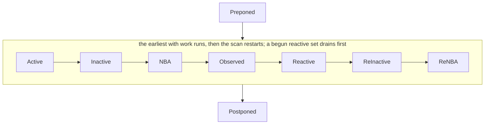

# Scheduling

A lyra simulation runs as a set of coroutines coordinated by a stratified event scheduler. Each
SystemVerilog process -- `initial`, `always*`, `final` -- runs as a coroutine. The scheduler pulls
coroutines from time-slot region queues and resumes them; a coroutine runs until it suspends, and
lands on whichever queue its own `await_suspend` chose. Deferred effects (`<=` writes, `$strobe`
prints) are not yields: the coroutine snapshots its inputs into a closure, hands the closure to the
engine, and continues running. The engine invokes those closures when their owning region runs, and
where the slot to run in is not yet knowable, what is handed over is an execution that finds it.

This doc covers the decisions behind the engine itself: process model, suspension protocol, region
structure, deferred work, how a run ends, and the MIR boundary. Sensitivity tracking, change
detection, and edge detection are separate runtime subsystems.

## Processes and tasks are coroutines

The execution instance a process or task runs as -- its identity, completion outcome, ownership, and
cancellation -- is the activation, defined in `activation.md`. This doc owns the engine that parks
and resumes activations; `activation.md` owns what an activation is. The scheduler holds an
activation token (a payload-neutral handle) and never sees an activation's completion type.

A process body -- and a task body, which may consume time -- runs as a `Coroutine`. The scheduler
holds the activation token and resumes the body; a `co_await` in the body suspends it again. Process
state -- procedural locals, the implicit program counter -- lives in the coroutine frame, which the
engine does not introspect. A body that stops only at the head of its loop is not compiled as one:
it is a setup and a pass, plain bodies that one coroutine of the runtime calls, and that coroutine
is what the scheduler resumes, holding the wait between passes
(`decisions/a-process-stopping-only-at-its-loop-head-is-called.md`). The engine sees one kind of
execution either way.

Every wait is part of that state too. It is built where what it waits for stops changing and enrols
on what it watches for its whole life: once in the body's outermost block for a wait on storage that
stays the same every time the body reaches the stop -- nearly every wait on storage -- and at the
stop for one only the stop can name, a delay's amount or a fork's branches, or one that reads a
variable the body declares. A stop only marks the activation as parked on it; an occurrence while
one is parked wakes it, and any other occurrence is ignored. That is the C++ and Rust shape of the
same thing -- an awaitable is a local of the coroutine, declared where its inputs are known, and a
stop only awaits it. `decisions/a-wait-is-storage-of-its-activation.md` holds why.

A task is enabled with `co_await`: enabling a time-consuming task suspends the enabling process
until the task completes (LRM 13.3). The scheduler resumes the innermost suspended frame, and each
completed task transfers control back to its enabler, so suspension flows through the whole enable
chain without the engine tracking call depth.

Fibers are rejected: per-process stacks would multiply memory by orders of magnitude for any
nontrivial design. Coroutine frames hold only the locals live across suspension points. Hand-rolled
state machines are rejected: they would force HIR-to-MIR lowering to thread resumption state through
every statement that might suspend, defeating the structured form MIR is designed to carry.

## The engine is a mechanism, not a semantics holder

The engine does three things: it holds queues of runnable coroutine handles, it resumes them, and it
parks each one on whichever queue the code it just ran asked for. It never inspects what a coroutine
represents, why it suspended, or what it waits for. A coroutine frame is opaque to it.

Construct semantics live entirely in what an execution waits for. Each suspending construct builds
one of those for the body to stop at, and the wait answers how a stop there carries on -- at once,
on an occurrence, later in this time step in a named region, or at a time -- which the one stop
arranges through a small fixed set of construct-neutral scheduling verbs. What those verbs take is a
**placement** -- which time slot, and which region of it -- because that is what an LRM 4.4 event
is: a time, a region, and the thing to do there. A stop places its activation; a satisfied wait
wakes it into the current slot, in the Active region of its thread's region set (Reactive for a
program's); a spawning construct may adopt a coroutine and place it; and a construct may ask that
the simulation stop. The verbs name _where and when_ a handle becomes runnable again, never _why_.
Distinct constructs -- a delay, an event wait, a task enable -- bottom out in the same verbs, and
the engine cannot tell them apart.

Taking the placement as an argument rather than encoding it in the verb's name is what keeps the set
complete. A verb per combination covers points of that space and leaves the rest unreachable, and a
missing combination is invisible, because it is the absence of a name and nothing reports a name
nobody wrote. A nonblocking assignment carrying a delay wants the NBA region of a future slot; a set
that can say "a future slot" only about the Active region has nowhere to put it, and says so by
being silent.

This is the division a host event loop draws: the loop runs its queues and knows nothing of the
timers, I/O, or callbacks that fill them; the meaning lives in the APIs that enqueue, not in the
loop. The payoff is additivity. A suspending construct is added by writing what its execution waits
for, which schedules through the existing verbs; a process-spawning construct may also add one
construct-neutral verb (adopt a coroutine and schedule it). Either way the engine gains no
per-construct branch.

**Invariant:** the engine branches only on queue and region, never on the kind of construct a
coroutine came from, because what a construct means lives in what it waits for. A per-construct case
inside the engine's resume or dispatch path fails that, and so does a note a coroutine leaves for
the scheduler to read in place of a placement. When a construct seems to require the engine to ask
"is this an X?", the neutral verb set is missing a primitive -- add the primitive, do not teach the
engine the construct. Which region set a thread runs in is not such a note: the standard places a
thread by it as it places one by time (LRM 24.3.1), so it is part of the placement, chosen where the
placement is and never read by the dispatch.

## Deferred work is a closure submit, not a suspension

When a process needs an effect to happen later -- a non-blocking write to a signal, a nonblocking
event trigger, a postponed `$strobe` print -- it does not yield. It snapshots its inputs into a
closure (see `mir.md` for the MIR-level shape) and submits the closure to a placement, then keeps
running. A submit takes the same placement a suspension does, which is what lets a nonblocking
assignment carrying a delay reach the NBA region of a later slot (LRM 4.4.2.4, 10.4.2) with no
second mechanism.

**What an effect is and when it is due are two questions, and only the second decides the shape.**
The standard writes the second one the same way wherever it appears: a nonblocking assignment and a
nonblocking event trigger both name an optional delay-or-event control and both land in the NBA
region of the slot it names (LRM 9.4.5, 15.5.1). So the deferral is one envelope taking whatever the
effect is, and a construct that gains a deferred spelling adds no placement machinery of its own.
One statement's whole effect goes in one of these, however many places it writes, which is what
makes a control it carries read once rather than once per write.

**Where the placement is not yet knowable, what is handed over is an execution rather than a
closure.** An effect due on an event (LRM 9.4.5, 15.5.1) has a region but no slot: which slot it
lands in is whichever one the event happens in, and nothing where the statement stands can say. So
the process snapshots its inputs the same way, into an execution that waits for the event and then
places itself in the region -- and keeps running, exactly as it does for a submit. The waiting is
the only part that is new; what the effect does, and to what, are settled where the statement stands
as they are for every other deferred effect.

That execution belongs to no lineage. The standard makes no process of a pending update, so nothing
that names processes may find it: `wait fork` does not wait for it and `disable fork` does not reach
it (LRM 9.6.1, 9.6.3). **Forbidden:** giving such an execution a parent to reuse the spawning path,
which makes the update visible to process control the standard never put it under.

An assertion's action is the other execution of no lineage. Its placement is known -- Reactive, or
Postponed for a final deferred assertion -- but what runs there is a procedural statement that may
wait (LRM 16.3, 16.4, 16.14.1), so the region starts it as an execution rather than calling it, and
runs it to its first stop at once, since nothing in the region runs ahead of it.

Yield-based alternatives are rejected because they would entangle the deferred effect's commit time
with the process's resumption schedule. A process that does `q <= d; #5; ...` should not be forced
to suspend before `#5` just because the NBA write has not yet committed; the write commits in the
NBA region of this same time slot regardless of where the process is by then.

**Forbidden:** routing deferred writes into per-signal queues. Every closure is submitted to one
region queue, so commit order is the region's, not a function of which signal a write targets.

**An effect a later event can take back is a timer, held by whoever owns it.** A continuous
assignment carrying a delay schedules each new value to propagate, and a different value computed
before it lands deschedules it (LRM 10.3.3). So that propagation is one event at most, which arming
again replaces: the owner holds a timer that is itself the queue node, linked into the region queue
of the slot it is due in and unlinked when replaced, as a stopped activation is withdrawn. A slot
left holding nothing is then passed over as any slot whose events were taken back is (LRM 4.5). This
is the timer of an event loop -- Linux's `mod_timer`, asio's `expires_after` -- rather than a
counter the generated body compares, because taking an event back is the engine's business and not
the program's. The timer is bound once to what firing does, which reads its owner rather than a
value captured per change, and the delay a value takes among rise, fall and turn-off delays (LRM
28.16, 10.3.3) is a function of the runtime, so a net's own delay can reach the same rule from
inside the net. Where a delay of some steps is due -- the Inactive region of its region set now for
none, that set's Active region at its deadline otherwise -- is one answer, shared with a process
stopped at a delay. The wait an expect statement stops at holds two more, which queue each tick of
its property into the Observed region of the time step it happened in and each change its disable
condition reads into the Active region, and which ending the wait takes back with it (LRM 16.17).

## Region structure

A time slot runs regions in LRM 4.4 order: Preponed, Active, Inactive, NBA, Observed, Reactive,
ReInactive, ReNBA, Postponed. That clause's PLI regions are absent, because there is no PLI.

Preponed runs once on entry and Postponed once on exit. Between them the slot repeats one step: take
the earliest region from Active through ReNBA that has anything pending -- or, once the reactive set
has begun and while it holds anything, the earliest of Reactive through ReNBA -- run it, and look
again. Running a region produces work that lands back in the slot -- an NBA commit wakes a process
into Active, a resumed process submits an NBA -- so the step repeats until nothing between those two
bounds is left.

That one step is LRM 4.5's loop. The reference algorithm writes it as two inner loops, one per
region set, each moving the earliest nonempty region of its own set into that set's first region and
running it again until the set is empty; running the region where it stands reaches the same order.
So work the reactive set schedules into the active set waits until the reactive set has drained,
which is when LRM 24.3.2 has a design process woken by a program run.

Two consequences carry the weight. A process woken by a blocking write runs while the active set
drains, before the NBA region commits the nonblocking writes issued beside it -- deferring it past
NBA is the classic wrong answer, because the process then reads values that in the standard's order
it cannot yet see. And a process woken by an NBA commit belongs to the slot whose NBA woke it, so it
runs before that slot's Observed region rather than being pushed to the next time slot.

The reactive group (Reactive, ReInactive, ReNBA) is reached only when the active group has drained.
It holds program-block statements, checker code, the action blocks of concurrent assertions, and the
action a matured observed deferred assertion runs (LRM 16.4.1). Preponed carries the `#1step`
sampling of a clocking block (LRM 14.13).

A thread runs in one region set for its whole life: the one the thread that started it runs in, as a
coroutine inherits its context from the scope it is launched in and from its parent, and whatever
code it calls, since a subroutine runs in its caller's thread (LRM 24.3.1, 24.5). A process runs in
the set named by the class of the instance whose code it evaluates. The design's code runs in the
active set and a program's in the reactive one (LRM 24.3.2). That instance is the one whose text
creates the process, except for the drive across a child's output port. The instantiation creates
that drive and it evaluates the child's code (LRM 4.9.6), so the instantiating scope launches it as
the child's without needing to know whether the child is a program. Its generator is still split
from the instantiating scope's seeds (LRM 18.14.1). Every placement a thread asks for names a region
of its own set -- where a wake or a delay resumes it, where a `#0` does, where its nonblocking
updates land -- and the two sets are each other's dual region for region. At time zero each set
starts its processes in the same turns, the reactive set's once the active set's have settled.

`#0` delays land in **Inactive**, not Active. A user writing `#0` is asking the engine to let other
already-pending active work finish first, then come back at this same simulation time. Pushing
`#0`-suspended processes to the back of Active would let them re-enter ahead of work that arrived
earlier, defeating the intent.

LRM 4.4 gives every event one time, the current one or a later one, and the engine holds the two
apart. Nearly every event -- a wake, a nonblocking write with no delay -- lands in the current slot,
which lasts the whole run and is reached without looking anything up, so its queues keep their
storage from one slot to the next. The later slots are kept in time order, and time moves only to
the earliest of them that holds something (LRM 4.5): a slot whose every event was taken back -- the
delay of a process stopped or killed before its time came -- is passed over, and the time it named
never becomes the time. Moving there hands that slot's events to the current slot, empty by then, in
the order they were placed -- which is the order its nonblocking writes are performed in (LRM 4.6).
This is how SystemC's kernel and an async runtime such as Tokio hold what runs now apart from their
timed events.

## How a run ends

A simulation control task (LRM 20.2) reaches the engine's stop verb, which records that the run is
over. No process resumes after that: the record is read where a process would be entered, so
whatever is still parked in the in-progress slot is drained without running a statement.

Deferred effects already submitted for that slot do still run, so a nonblocking write issued before
the request commits and a `final` procedure can read it. LRM 20.2 says only that `$finish` makes the
simulator exit and does not say how much of the in-progress slot still happens, so this is a choice
rather than a requirement -- which is why the corpus does not hold a case for it.

Registered `final` actions then run in registration order, because a `final` procedure occurs at the
end of simulation time (LRM 9.2.3), which a run reaches by being asked to end and equally by running
out of work. A further request from inside a `final` ends the simulation immediately, so the ones
still queued do not run.

The one ending that runs none of them is the tool being unable to carry the run on: a `final`
procedure is design code, and the state it would read is already known to be wrong. What the engine
owes either way -- the immediate cover report (LRM 16.3), the output drain, the exit status -- is
owed because the run is over, not because of how it ended.

A run-time error of the design is not a separate ending. It is reported where the activation it left
lands, and asks for the ending `$fatal` asks for, so the same tail runs and the engine sees a
request rather than a failure.

A program ends its own threads, and the last program to end ends the run (LRM 24.3). Once every
initial procedure of a program has ended, whatever they started that is still running is ended with
them; once that has happened to every program, the run ends as `$finish` ends it, printing nothing
because no call was made. `$exit` ends the program the calling thread originates in, that thread
with it, and from any other thread does nothing but warn (LRM 24.7). The program's continuous
assignments are not its threads, so neither ending reaches them.

## Closure capture lifetime

A closure's captures are either by-value or by-reference (see `mir.md` for the MIR-level shape). The
two have different lifetime rules:

- **By-value capture** is always safe. The snapshot lives inside the closure's storage; the engine
  destroys it when the closure fires or when the closure is dropped without firing.
- **By-reference capture of a `StructuralVarRef`** is always safe. Structural-scope storage
  (module-level variables) lives for the entire simulation; any closure can hold a reference into it
  indefinitely.
- **By-reference capture of a `ProceduralVarRef`** is safe only if the closure fires while the
  process's coroutine frame is still alive. The procedural frame is destroyed when the process body
  returns and when the run ends; references into the frame are invalid after either event.

The third case is the one a lowering pass must reason about. A lowering that emits a closure
capturing a procedural lvalue is responsible for establishing the fire-before-frame-dies guarantee,
or it must refuse the capture.

## MIR boundary: a place model, not storage layout

MIR carries a place model in the shape of Rust MIR and LLVM IR: a borrowed pointer type, `DerefExpr`
(pointer -> place) and its dual `AddressOfExpr` (place -> pointer), a reference type for `ref`
formals and alias captures, a pointer cast, and a null pointer literal. `self` is a borrowed
pointer. What MIR does not carry is storage _layout_ -- offsets, byte sizes, alignment -- which
belongs to LIR; the engine, not MIR, owns where storage lives. See
`decisions/address-of-primitive.md`.

The deferred-write pattern -- "this place, written later" for an NBA commit, a postponed strobe, a
callback -- is still expressed as a closure whose capture list owns the place. Whether a captured
field is a snapshot or an alias is the field's _type_: a value-typed field is a snapshot, a
reference-typed field aliases the live storage (LRM 6.21). The discipline is that a place held
across a suspension or a region boundary is a reference-typed capture field, not raw pointer
arithmetic threaded by hand. The C++ backend realizes such a field as an owned reference value (the
library's reference captured by value, never a `&` lambda capture), so a write through it still
wakes the cell's subscribers and nothing dangles when the closure outlives the frame that built it.
