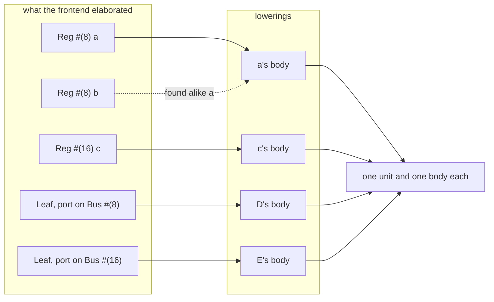
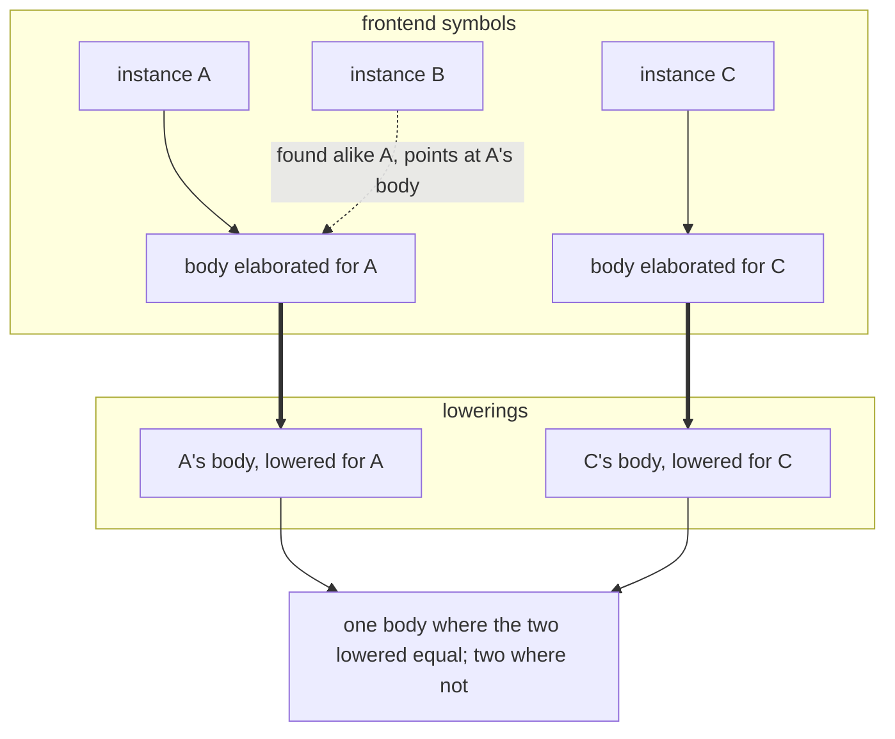

# Specialization Model

## Purpose

**A specialization is a definition applied to arguments.** `Reg #(8)` is the definition `Reg` with
`W` fixed to 8; `Leaf` connected to a `Bus #(16)` is the definition `Leaf` with its port fixed to
that interface. This doc says what counts as an argument, which applications the compiler lowers
apart, and what is shared across the instances of one: a unit where what they publish reads alike,
and a body where their code comes out equal.

Sharing is the compile-time **optimization**: the correctness baseline is concrete elaboration --
every instance lowered from the body elaborated for it -- and a shared artifact is admitted only
where distinct concrete forms are shown alike. Where they cannot be shown alike, concrete artifacts
are retained, which is a correct outcome (an optimization miss, not a failure).

Four words carry the model, each for one thing:

| Word     | What it is                                                                                         | Named by                                                          |
| -------- | -------------------------------------------------------------------------------------------------- | ----------------------------------------------------------------- |
| Instance | an occurrence of a definition in the hierarchy (LRM 23.3)                                          | its hierarchical path (LRM 23.6)                                  |
| Lowering | one body the frontend elaborated and did not share, lowered for the instance it was elaborated for | that instance's hierarchical path                                 |
| Unit     | the lowerings whose published structure reads alike                                                | the definition, with the digest of what it publishes where needed |
| Body     | the lowerings of one unit whose code comes out equal                                               | the unit's name, with an ordinal after the first                  |

## The two questions

Everything here is one of these, and they are not the same question.

**Which instances run one code?** Two the frontend found alike -- the same definition, the same
arguments, nothing reaching either from outside -- are served by one lowering; every other instance
is lowered on its own, and lowerings whose code comes out equal are one body. The number of
instances that agree never enters into it -- ten thousand `Reg #(8)` the frontend found alike are
one lowering, and the compiler's work does not grow with them.

**How do two separately compiled units agree on which unit they mean?** They cannot look each other
up: a unit compiles from its own contents and the signatures it consumes, with no table between
them. So a unit has a _name_, a function of what its lowerings publish and of nothing a body
produces, worked out once before any body is lowered; the parent's reference to a child and the
child's own artifact both carry it, and that name is the only identity that survives crossing a
boundary two units share nothing across.

The second question is what makes the first one strict. If identity were only ever compared inside
one compiler run, an ordinary object comparison would do. Because a parent naming a child's unit and
the child's artifact must mean one thing, the unit's name has to be a pure function of what is
published, renderable as a name both can write down, and settled before either compiles further.



Five instances, four lowerings, four units. `a` and `b` collapse because the frontend found them
alike, their arguments agreeing. `D` and `E` do not, even though neither writes a parameter -- which
is the point of the next section.

## What counts as an argument

Everything the parent fixes at the instantiation site is an argument of the specialization. Which of
them make the lowering another unit is not decided from the arguments: it is whatever makes what the
lowering publishes differ, which is found by comparing. An argument is **not** only "what was
written as a parameter", and the difference is not a corner case:

```systemverilog
interface Bus #(parameter int W = 8);
  logic [W-1:0] data;
endinterface

module Leaf (Bus b);          // no parameters at all
  initial b.data = 3;
endmodule

module Top;
  Bus #(8)  narrow ();
  Bus #(16) wide ();
  Leaf on_narrow (.b(narrow));   // b.data is 8 bits
  Leaf on_wide   (.b(wide));     // b.data is 16 bits
endmodule
```

`Leaf` declares no parameter, and SystemVerilog gives no way to declare one for this: a port list
names the interface _definition_, and `Bus #(8) b` there is rejected. So `Leaf` is generic over its
interface, and the connection is where the argument is deduced rather than written. Two `Leaf`
instances bound to different interfaces reach different types at different member positions, so they
are two units -- exactly as two bindings of a parameter the declarations use would be.

Read as templates, with the argument deduced rather than written:

```
interface Bus #(int W);   ~   template <int W> struct Bus { ... };
module Leaf (Bus b);      ~   template <class B> struct Leaf { B* b; };
Leaf on_narrow (.b(narrow));  ~   Leaf<Bus<8>> on_narrow{&narrow};
```

`Bus` is not a base class and `Bus #(8)` is not derived from it: two specializations of one
interface share a name and a source text and nothing else, and neither is substitutable for the
other.

## What the frontend supplies

The frontend elaborates the design into symbols, and three of them correspond to concepts here:

| This model                                      | Frontend symbol                                                                                           |
| ----------------------------------------------- | --------------------------------------------------------------------------------------------------------- |
| An instance                                     | an instance                                                                                               |
| The elaborated body an instance is read through | that instance's body, or the body of the earlier instance it was found alike and points at                |
| A lowering                                      | an elaborated body the frontend left no instance pointing at from elsewhere, lowered for its own instance |

The frontend elaborates a body for every instance, and where it finds one alike an earlier one --
the same definition, the same parameter values, each interface port bound to an instance alike, no
hierarchical name leaving upward, nothing written elsewhere reaching it or anything below it -- it
leaves the later instance pointing at the earlier one's body and does not visit its own. That record
is read as given. An instance pointing at a body is read through that body; one standing below such
an instance is read through the member at the same site under the body pointed at; and a share the
frontend got wrong is its defect, corrected there and never second-guessed here. Every elaborated
body nothing points at from elsewhere is lowered on its own, for the instance it was elaborated for,
and whether it shares code with another is found afterwards by comparing what the two lowered to.



The dotted arrow is the frontend's answer to which elaborations are alike, and the only one: B is
served by A's lowering. Whether A's and C's lowerings are one body is this model's answer, and it is
a comparison of what they came out as, never a prediction from what the design fixed for them.

## Owns

- What counts as an argument of a specialization.
- The correspondence between this model and the frontend's symbol graph, including that its record
  of which elaborations are alike is read as given.
- The rule that lowerings publishing alike are one unit, and those whose code comes out alike one
  body, shared by every instance they serve.
- How a unit, a body and a lowering are named.
- The rule for which parameter reads are fields of the object and which constants.

## Does Not Own

- The internal shape of a compilation unit (see `compilation_unit_model.md`).
- Identity kinds inside a unit (see `identity_and_ownership.md`).
- Cache keys for incremental reuse (see `incremental_build.md`). Unit and body names feed into that
  cache, but this doc does not define the cache's contract.

## Core Invariants

1. **Concrete elaboration is the correctness baseline; sharing is the optimization.** Every accepted
   program has a correct concrete lowering in which each instance is lowered from the body
   elaborated for it. Sharing one artifact across distinct lowerings is admitted only where what
   they state is shown equal; absent that, the concrete artifacts are retained. Correctness never
   depends on proving sharing.
2. **Artifacts are driven by what is published and what is compiled, not by instance count.** A new
   unit is created only where what two lowerings publish differs, and a new body only where their
   code does. The number of instances a lowering serves does not affect how many artifacts exist.
3. **Nothing classifies a parameter in advance.** A body is elaborated under every argument; which
   arguments change the unit is what comparing what lowerings publish finds, and which change the
   code is what comparing their code finds. Neither is a precondition for lowering a program
   correctly.
4. **A parameter the code reads as a value is a field of the object.** Where the language requires a
   constant -- a width, a type, a generate condition -- the front end has settled it in each
   elaboration, and what is left of a parameter is a read the object answers from what it was built
   with. So a value that only steers what the code computes -- an initial value, a count, a flag --
   forks neither the unit nor the code.
5. **A lowering is one elaborated body the frontend did not share, lowered once for the instance it
   was elaborated for under that instance's environment.** Nothing is worked out before lowering to
   say that two instances may share one lowering: which bodies exist is the frontend's answer, and
   which of them come out as one code is the comparison of what they lowered to. A construction
   table is stated per lowering, by its instance's hierarchical path.
6. **One unit compiles once per distinct body.** A unit is the lowerings whose declarations publish
   alike, and each distinct code they come out as is a body of it, found by comparing what they
   state and compiled once, shared by every lowering and instance it serves. Two instances served by
   one body are indistinguishable at compile time; two of one unit and different bodies are objects
   of one published class that a referrer cannot tell apart.
7. **A unit's name is a function of its definition and what it publishes.** It depends on no
   traversal order and no instance enumeration: the definition alone where the definition has one
   unit in the design, else the definition and the digest of what the unit publishes. A body is
   named for the first lowering, in the design's order, that came out as it -- the unit's name for
   the first body, the unit's name and the body's ordinal after -- so a body's name alone follows
   that order. A lowering is named by its instance's hierarchical path, inside one run.
8. **A lowering is read from the body elaborated for it, and from nothing else.** What the design
   fixed for an instance -- what its parent wrote, what was written elsewhere that reaches it or an
   instance below it (LRM 23.10.1, 23.11, 33.4), where each hierarchical name written in it or below
   it lands once it leaves (LRM 23.8) -- is what the frontend elaborated its body under, and is what
   makes it share no body with an instance it differs from in any of them. Instances handed
   different constructor inputs may build different blocks, since those inputs decide which
   alternative of a conditional generate stands, and an alternative not selected is not elaborated
   (LRM 27.5); each is lowered from what it built, and which blocks stand where is the
   construction's. How many blocks a loop counts out is nobody's argument: the constructor runs the
   loop.
9. **A unit's name is settled before any body is lowered, and every party carries it alike.** A unit
   is a function of what every lowering publishes, all of which exists before any unit's later
   stages run, so the parent naming a child's unit and the child's own artifact carry one name with
   no table between them -- which is what lets units compile in any order and in isolation after
   that point. The comparison of what is published is what decides whether two lowerings are one
   unit, and a name that no longer tells two units apart is a defect in the naming, not a second
   definition of the unit.

## Boundary to Adjacent Layers

- `compilation_unit_model.md` defines the compilation unit. This doc defines which lowerings are one
  unit and which one body.
- `incremental_build.md` uses unit and body names as cache keys. The rules in this doc are upstream
  of incremental reuse.
- HIR is per lowering, and every layer after it per body, never per instance. See the individual IR
  docs for how each manifests in HIR, MIR, and LIR.

## Forbidden Shapes

- A unit keyed on a parameter's value where the value changes nothing the unit publishes.
- In the optimized steady state, leaving every lowering as its own unit without comparing what the
  lowerings publish. The concrete baseline of invariant 1 does exactly this and is correct; the
  sharing optimization must not stop there.
- A unit name derived from instance path, instance ordinal, or instance enumeration. A body's name
  and a lowering's follow the design's order and the instance's path (invariant 7).
- A second answer, beside the frontend's record, to which elaborations are alike: a key worked out
  before lowering that says two instances may share one lowering, or a lowering of an instance the
  frontend left pointing at another's body through its own body, to check the frontend. Such a key
  was kept right one field at a time, and each miss had an instance run another's code with no
  error.
- Compiling, for one lowering, a body elaborated for an instance outside it.
- An identity stored as the name it renders to, so that two applications are told apart by comparing
  renderings. A name drops whatever the target it is written for recovers by other means; an
  identity may drop nothing. Where the two are one value, the day they disagree is silent.
- A shared table, registry, or ordinal that both a unit and its instantiator consult to agree on
  which unit is meant. Agreement comes from computing the same function, never from reading the same
  table.
- Forking a unit or a body per instance, or allowing instance count to drive the number of
  artifacts.
- Rejecting a program because two lowerings cannot be shown alike. The correct fallback is concrete
  artifacts, never rejection.

## Notes / Examples

`parameter int W = 8` used as `logic [W-1:0] data`: W changes the packed width of what the unit
publishes. Instances with different W values belong to different units.

`parameter int INIT = 0` used only as the initial value of a register: INIT changes neither what is
published nor the code. Instances with different INIT values are two lowerings of one unit that come
out as one body, each object handed its own value.

`parameter int N` controlling a `generate for` that instantiates N children: the compiled
constructor loops N times, producing N child objects. Neither what the unit publishes nor its code
depends on N, so the unit compiles once for any N that builds blocks of the same kinds.

`parameter type T = int` substituting a type parameter: T changes emitted types and operations.
Distinct types produce distinct units. "Distinct" follows the language: a built-in type, or one
built out of others, is told apart by its form, and a type the source declares -- a class, an
enumeration, a structure or a union, packed or not -- by its declaration (LRM 6.22.1, 8.3), so two
declared alike are two. Which instance of a design element a declaration was elaborated for is no
part of it: the children every instance of a module hands a type the module declares are one unit
and, where their code comes out alike, one body, whether or not the frontend found them alike.
