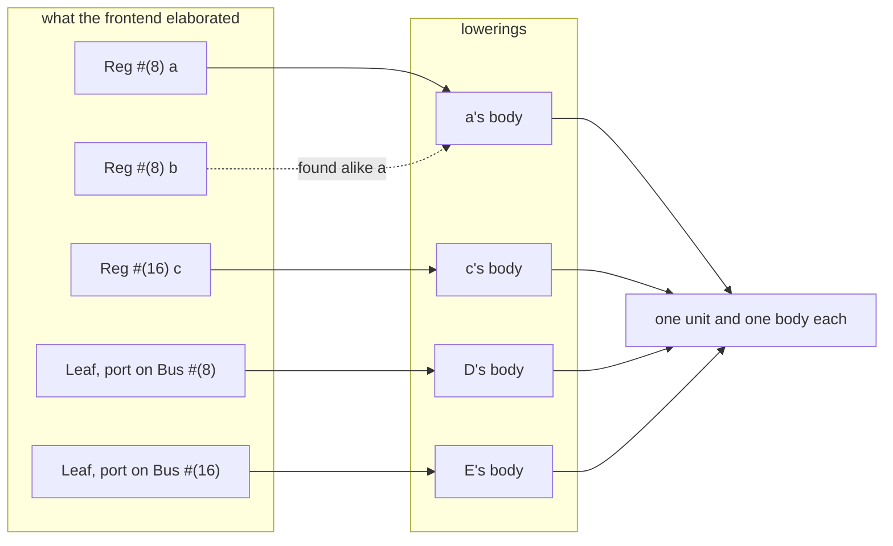
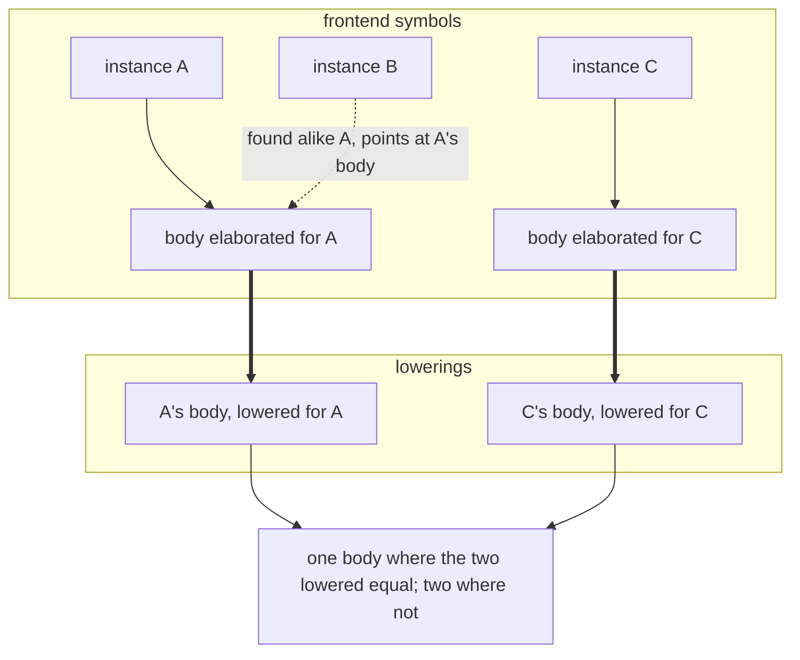

# Specialization Model

The compiler does not yet realize two of the rules below. A lowering on a cycle of units, each of
whose published structure names another on the cycle, is a unit of its own written by its instance's
hierarchical path rather than by what it publishes (invariants 7 and 9). And a parameter that a
design element declared inside the unit reads is compiled in as the value its elaboration settled
rather than held by the object (invariant 4), so lowerings differing only in it are two bodies. Both
lose a share and never an answer, and the rules bind regardless.

## Purpose

**A specialization is a definition applied to arguments.** `Reg #(8)` is the definition `Reg` with
`W` fixed to 8; `Leaf` connected to a `Bus #(16)` is the definition `Leaf` with its port fixed to
that interface. This doc says what counts as an argument, which applications the compiler lowers
apart, and what is shared across the instances of one: a unit where what they publish reads alike,
and a body where their code comes out equal.

Sharing is the compile-time **optimization**: the correctness baseline is concrete elaboration --
every instance lowered from the body elaborated for it -- and a shared artifact is admitted only
where distinct concrete forms are shown alike. Where they cannot be shown alike, concrete artifacts
are retained, which is a correct outcome (an optimization miss, not a failure).

Four words carry the model, each for one thing:

| Word     | What it is                                                                                         | Named by                                                          |
| -------- | -------------------------------------------------------------------------------------------------- | ----------------------------------------------------------------- |
| Instance | an occurrence of a definition in the hierarchy (LRM 23.3)                                          | its hierarchical path (LRM 23.6)                                  |
| Lowering | one body the frontend elaborated and did not share, lowered for the instance it was elaborated for | that instance's hierarchical path                                 |
| Unit     | the lowerings whose published structure reads alike                                                | the definition, with the digest of what it publishes where needed |
| Body     | the lowerings of one unit whose code comes out equal                                               | the unit's name, with an ordinal after the first                  |

## The two questions

Everything here is one of these, and they are not the same question.

**Which instances run one code?** Two the frontend found alike -- the same definition, the same
arguments, nothing reaching either from outside -- are served by one lowering; every other instance
is lowered on its own, and lowerings whose code comes out equal are one body. The number of
instances that agree never enters into it -- ten thousand `Reg #(8)` the frontend found alike are
one lowering, and the compiler's work does not grow with them.

**How do two separately compiled units agree on which unit they mean?** They cannot look each other
up: a unit compiles from its own contents and the signatures it consumes, with no table between
them. So a unit has a _name_, a function of what its lowerings publish and of nothing a body
produces, worked out once before any body is lowered; the parent's reference to a child and the
child's own artifact both carry it, and that name is the only identity that survives crossing a
boundary two units share nothing across.

The second question is what makes the first one strict. If identity were only ever compared inside
one compiler run, an ordinary object comparison would do. Because a parent naming a child's unit and
the child's artifact must mean one thing, the unit's name has to be a pure function of what is
published, renderable as a name both can write down, and settled before either compiles further.



Five instances, four lowerings, four units. `a` and `b` collapse because the frontend found them
alike, their arguments agreeing. `D` and `E` do not, even though neither writes a parameter -- which
is the point of the next section.

## What counts as an argument

Everything the design fixes for an instance is an argument of the specialization: every value or
type its instantiation may assign (LRM 23.10), the interface each of its interface ports is bound to
(LRM 25.3), where each name written in it or below it lands once it leaves (LRM 23.8), and what a
`defparam`, a `bind` or a configuration fixes for it or below it (LRM 23.10.1, 23.11, 33.4). Which
of them make the lowering another unit is not decided from the arguments: it is whatever makes what
the lowering publishes differ, which is found by comparing. An argument is **not** only "what was
written as a parameter", and the difference is not a corner case:

```systemverilog
interface Bus #(parameter int W = 8);
  logic [W-1:0] data;
endinterface

module Leaf (Bus b);          // no parameters at all
  initial b.data = 3;
endmodule

module Top;
  Bus #(8)  narrow ();
  Bus #(16) wide ();
  Leaf on_narrow (.b(narrow));   // b.data is 8 bits
  Leaf on_wide   (.b(wide));     // b.data is 16 bits
endmodule
```

`Leaf` declares no parameter, and SystemVerilog gives no way to declare one for this: a port list
names the interface _definition_, and `Bus #(8) b` there is rejected. So `Leaf` is generic over its
interface, and the connection is where the argument is deduced rather than written. Two `Leaf`
instances bound to different interfaces reach different types at different member positions, so they
are two units -- exactly as two bindings of a parameter the declarations use would be. The argument
is the interface's own unit, never its parameter bindings, so a module bound to an interface
inherits whatever sharing that interface's units already have.

Read as templates, with the argument deduced rather than written:

```
interface Bus #(int W);   ~   template <int W> struct Bus { ... };
module Leaf (Bus b);      ~   template <class B> struct Leaf { B* b; };
Leaf on_narrow (.b(narrow));  ~   Leaf<Bus<8>> on_narrow{&narrow};
```

`Bus` is not a base class and `Bus #(8)` is not derived from it: two specializations of one
interface share a name and a source text and nothing else, and neither is substitutable for the
other.

## What the frontend supplies

The frontend elaborates the design into symbols, and three of them correspond to concepts here:

| This model                                      | Frontend symbol                                                                                           |
| ----------------------------------------------- | --------------------------------------------------------------------------------------------------------- |
| An instance                                     | an instance                                                                                               |
| The elaborated body an instance is read through | that instance's body, or the body of the earlier instance it was found alike and points at                |
| A lowering                                      | an elaborated body the frontend left no instance pointing at from elsewhere, lowered for its own instance |

The frontend elaborates a body for every instance, and where it finds one alike an earlier one --
the same definition, the same parameter values, each interface port bound to an instance alike, no
hierarchical name leaving upward, nothing written elsewhere reaching it or anything below it -- it
leaves the later instance pointing at the earlier one's body and does not visit its own. That record
is read as given. An instance pointing at a body is read through that body; one standing below such
an instance is read through the member at the same site under the body pointed at; and a share the
frontend got wrong is its defect, corrected there and never second-guessed here. Every elaborated
body nothing points at from elsewhere is lowered on its own, for the instance it was elaborated for,
and whether it shares code with another is found afterwards by comparing what the two lowered to.



The dotted arrow is the frontend's answer to which elaborations are alike, and the only one: B is
served by A's lowering. Whether A's and C's lowerings are one body is this model's answer, and it is
a comparison of what they came out as, never a prediction from what the design fixed for them.

**An instance is its body and its environment, and a lowering reads it through nothing else.** The
environment is everything the body's text reaches outside itself: where each name it writes lands
once it leaves the instance, where it reaches each class another instance declares, the constant a
parameter of another instance it reads settled to, what the parent bound to each interface port, and
which of its own parameters it is handed. It is worked out once per instance, and a fact the
lowering asks for and does not find there is this compiler's defect rather than a reason to ask the
frontend again. Of the body itself, the lowering reads only what the text states: the expressions as
written, where the standard requires a constant as much as anywhere else, the type a declaration
states, and a type the frontend read as a fact (invariant 12). What has no range of its own -- an
operator, a conversion, a concatenation, an unbased unsized literal (LRM 11.6.1, 5.7.1) -- is typed
by its width, signedness and element count, and what a node reads and writes is the longest static
prefix the source wrote (LRM 9.2.2.2.1, 11.5.3). The frontend also folds answers it was not asked
for -- a select's result range, a dead branch, a flow analysis's bit runs -- which differ between
instances whose code is the same, so reading them would make equal code compare unequal.

## Owns

- What counts as an argument of a specialization.
- The correspondence between this model and the frontend's symbol graph, including that its record
  of which elaborations are alike is read as given.
- What a lowering reads of an instance: its body and its environment.
- The rule that lowerings publishing alike are one unit, and those whose code comes out alike one
  body, shared by every instance they serve.
- How a unit, a body and a lowering are named, and how a definition, a value and a type are spelled
  in a name.
- The rule for which parameter reads are fields of the object and which constants.

## Does Not Own

- The internal shape of a compilation unit and what it publishes (see
  [`compilation_unit_model.md`](compilation_unit_model.md)).
- Identity kinds inside a unit (see [`identity_and_ownership.md`](identity_and_ownership.md)).
- Cache keys for incremental reuse (see [`incremental_build.md`](incremental_build.md)). Unit and
  body names feed into that cache, but this doc does not define the cache's contract.
- The whole scheme from source to artifacts and how it lines up with other compilers (see
  [`compiling_a_design.md`](compiling_a_design.md)).

## Core Invariants

1. **Concrete elaboration is the correctness baseline; sharing is the optimization.** Every accepted
   program has a correct concrete lowering in which each instance is lowered from the body
   elaborated for it. Sharing one artifact across distinct lowerings is admitted only where what
   they state is shown equal; absent that, the concrete artifacts are retained. Correctness never
   depends on proving sharing.
2. **Artifacts are driven by what is published and what is compiled, not by instance count.** A new
   unit is created only where what two lowerings publish differs, and a new body only where their
   code does. The number of instances a lowering serves does not affect how many artifacts exist.
3. **Nothing classifies a parameter in advance.** A body is elaborated under every argument; which
   arguments change the unit is what comparing what lowerings publish finds, and which change the
   code is what comparing their code finds. Neither is a precondition for lowering a program
   correctly.
4. **A parameter the code reads as a value is a field of the object; one it never reads holds
   nothing at run time.** Where a value decides the class -- a width a type holds, a type -- the
   front end has settled it in each elaboration, and what is left of a parameter is a read the
   object answers from what it was built with (invariant 12). So a value that only steers what the
   code computes -- an initial value, a count, a flag, which generate blocks a construction builds
   -- forks neither the unit nor the code. A parameter an instance is handed is a declaration of its
   unit: the construction hands, in the order the unit declares them, whether the instantiation
   assigned it and the value it assigned, and where it assigned none the unit evaluates the default
   its declaration states in its own scope (LRM 23.10.2.2, 6.20.1). A local parameter written from
   such a value is worked out when the object is built.
5. **A lowering is one elaborated body the frontend did not share, lowered once for the instance it
   was elaborated for under that instance's environment.** Nothing is worked out before lowering to
   say that two instances may share one lowering: which bodies exist is the frontend's answer, and
   which of them come out as one code is the comparison of what they lowered to. A construction
   table is stated per lowering, by its instance's hierarchical path.
6. **One unit compiles once per distinct body.** A unit is the lowerings whose declarations publish
   alike, and each distinct code they come out as is a body of it, found by comparing their HIR
   whole, a digest only narrowing which are compared, and compiled once, shared by every lowering
   and instance it serves. Two instances served by one body are indistinguishable at compile time;
   two of one unit and different bodies are objects of one published class that a referrer cannot
   tell apart. What a body's code states of anything outside itself is what that thing published and
   where the source wrote it, never which body it compiled to: a reach leaving the reader's own
   scope, into a block or up to an enclosing scope, goes through the class that scope published, a
   subroutine of another scope is called through the slot its published class introduces, and which
   body each child and block is belongs to the object's construction table. So two bodies that do
   the same thing state the same code. A class a structural scope declares is stated alike by every
   body of its unit, from the declaration alone; its code is the code of the scope body that
   compiled it, so two lowerings differing only there are two bodies
   ([`object_model.md`](object_model.md) invariant 15).
7. **A unit's name is a function of its definition and what it publishes.** It depends on no
   traversal order and no instance enumeration: the definition alone where the definition has one
   unit in the design, else the definition and the digest of what the unit publishes. A body is
   named for the first lowering, in the design's order, that came out as it -- the unit's name for
   the first body, the unit's name and the body's ordinal after -- so a body's name alone follows
   that order, and a new distinct body coming out earlier renames later ones, which
   [`identity_and_ownership.md`](identity_and_ownership.md) invariant 7 counts as a shortfall. A
   lowering is named by its instance's hierarchical path, inside one run.
8. **A lowering is read from the body elaborated for it, and from nothing else.** What the design
   fixed for an instance -- what its parent wrote, what was written elsewhere that reaches it or an
   instance below it (LRM 23.10.1, 23.11, 33.4), where each hierarchical name written in it or below
   it lands once it leaves (LRM 23.8) -- is what the frontend elaborated its body under, and is what
   makes it share no body with an instance it differs from in any of them. Instances handed
   different constructor inputs may build different blocks, since those inputs decide which
   alternative of a conditional generate stands, and an alternative not selected is not elaborated
   (LRM 27.5); each is lowered from what it built, and which blocks stand where is the
   construction's. How many blocks a loop counts out is nobody's argument: the constructor runs the
   loop.
9. **A unit's name is settled before any body is lowered, and every party carries it alike.** A unit
   is a function of what every lowering publishes, all of which exists before any unit's later
   stages run, so the parent naming a child's unit and the child's own artifact carry one name with
   no table between them -- which is what lets units compile in any order and in isolation after
   that point. The comparison of what is published is what decides whether two lowerings are one
   unit, and a name that no longer tells two units apart is a defect in the naming, not a second
   definition of the unit.
10. **What is published is compared with every reference to another instance written by what it
    reaches.** An instance the lowering holds is written by what that one publishes, so units are
    found bottom-up; an instance outside it that its environment reaches is written by its place
    among those its environment reaches, so two lowerings reaching different instances of one class
    read alike, and the class of each such instance is added to the name once it is known, since an
    ancestor's class depends on this one's; any other instance is written by its unit. A generate
    block's class is found the same way inside its unit, a path inside the block written from the
    block and one reaching a block around it by how far out that block stands, so blocks of a loop
    that declare alike are one class whatever their index. A unit is of one definition, so two cells
    of one name in two libraries (LRM 33.2.1) are two whatever they publish, and two different
    writings reaching one digest are reported, never taken for one unit.
11. **A definition, a value and a type are spelled by what is stable about each, and a name is
    folded from that spelling once.** A definition is its cell as a person writes one -- `cell` in
    the default library, `library.cell` in any other -- and a design element declared inside another
    is named in the one declaring it, `Outer::Inner` (LRM 33.2.1, 23.4). A value is spelled so that
    its end can be seen: a real by its bits in fixed-length hexadecimal, a string by its length and
    its text, an aggregate by its elements between brackets, an integral by its width, signedness
    and every bit, unknowns included. A type is spelled by its declaration where the source declares
    it -- a class, an enumeration, a structure or a union, packed or not (LRM 8.3, 6.22.1) -- and by
    its form where it is built in or built of other types; which instance elaborated the declaration
    is no part of it. The spelling is this compiler's own, so the frontend's hash or rendering of a
    type, which folds addresses and numbers types in the order it made them, never enters a name.
12. **What a body states is lowered as the expression the source wrote, never as the answer the
    front end settled, whether or not the standard requires a constant there.** A clause requiring a
    constant expression says the value is known before the program runs, a fact about the source,
    not that the artifact has to hold it; and a value read at lowering is compiled in, so two
    elaborations that settled it differently become two bodies. Whether a value belongs to the class
    is one question: would a different value be a different class, or the same class holding a
    different value? A value deciding which members, types or instantiated units exist is the
    class's; one that ends up as a number a field holds, a count a loop runs to or an index a query
    names is supplied at construction. Which it is follows from what the artifact does with the
    value, read from whoever owns its representation -- a declared width sits in a type, so
    [`lir.md`](lir.md) answers for it -- never from how important the value sounds. The rule reaches
    what a body states and not the declaration surface: a unit's header and a type declaration are
    elaborated once per parameterization, which is already an artifact of its own, so reading their
    settled value costs no second one. Evaluating an expression the source wrote is an optimization,
    which belongs after the shape is fixed.

## Boundary to Adjacent Layers

- [`compilation_unit_model.md`](compilation_unit_model.md) defines the compilation unit. This doc
  defines which lowerings are one unit and which one body.
- [`incremental_build.md`](incremental_build.md) uses unit and body names as cache keys. The rules
  in this doc are upstream of incremental reuse.
- HIR is per lowering, and every layer after it per body, never per instance. See the individual IR
  docs for how each manifests in HIR, MIR, and LIR.

## Forbidden Shapes

The test each answers to: does it make artifacts follow instances ([`north_star.md`](north_star.md)
invariant 2), make correctness rest on sharing (its invariant 3), or make two units agree through
something other than computing the same function (its invariant 5)?

- A unit keyed on a parameter's value where the value changes nothing the unit publishes. It fails
  [`north_star.md`](north_star.md) invariant 2: a value that follows the instance -- a loop handing
  each child its index -- makes units follow instances.
- In the optimized steady state, leaving every lowering as its own unit without comparing what the
  lowerings publish. It fails [`north_star.md`](north_star.md) invariant 2; the concrete baseline of
  invariant 1 does exactly this and is correct, and the sharing optimization must not stop there.
- A unit name derived from instance path, instance ordinal, or instance enumeration. It fails
  invariant 9: the child's artifact and every parent must compute one name without a table. A body's
  name and a lowering's follow the design's order and the instance's path (invariant 7).
- A second answer, beside the frontend's record, to which elaborations are alike: a key worked out
  before lowering that says two instances may share one lowering, or a lowering of an instance the
  frontend left pointing at another's body through its own body, to check the frontend. It fails
  [`north_star.md`](north_star.md)'s Forbidden Shapes, which read that record as given; such a key
  was kept right one field at a time, and each miss had an instance run another's code with no
  error.
- Predicting before lowering which parameters a declaration or a body relies on. It fails invariant
  3: the prediction is a list of how SystemVerilog lets a value reach a class, which has no end, and
  each miss is a wrong program rather than a lost share.
- Compiling, for one lowering, a body elaborated for an instance outside it. It fails invariant 8:
  that body states different types at the same positions.
- A lowering reading an answer the frontend folded in what a body states. It fails invariants 6 and
  12: equal code would compare unequal between instances that fold differently.
- Reading a settled value wherever the standard requires a constant, citing the clause. It fails
  [`north_star.md`](north_star.md) invariant 2: a position the standard fixes can still differ
  between elaborations, and the clause says the value is known, not where it belongs.
- An identity stored as the name it renders to, so that two applications are told apart by comparing
  renderings. It fails invariant 11: a name drops whatever the target it is written for recovers by
  other means, while an identity may drop nothing, and where the two are one value the day they
  disagree is silent.
- A shared table, registry, or ordinal that both a unit and its instantiator consult to agree on
  which unit is meant. It fails [`north_star.md`](north_star.md) invariant 5: agreement comes from
  computing the same function, never from reading the same table.
- Two bodies taken as one on a digest alone. It fails [`north_star.md`](north_star.md) invariant 3:
  bodies that differ become one wherever the digest misses a field or collides.
- Forking a unit or a body per instance, or allowing instance count to drive the number of
  artifacts. It fails [`north_star.md`](north_star.md) invariant 2.
- Rejecting a program because two lowerings cannot be shown alike. It fails
  [`north_star.md`](north_star.md) invariant 3: the correct fallback is concrete artifacts.

## Notes / Examples

`parameter int W = 8` used as `logic [W-1:0] data`: W changes the packed width of what the unit
publishes. Instances with different W values belong to different units.

`parameter int INIT = 0` used only as the initial value of a register: INIT changes neither what is
published nor the code. Instances with different INIT values are two lowerings of one unit that come
out as one body, each object handed its own value.

`parameter int N` controlling a `generate for` that instantiates N children: the compiled
constructor loops N times, producing N child objects. Neither what the unit publishes nor its code
depends on N, so the unit compiles once for any N that builds blocks of the same kinds.

`Leaf #(.K(i)) u` inside `for (genvar i = 0; i < 256; i++)`, where `K` is read only as a value: the
256 children are one unit and one body, each object handed its own `K`, and the loop's blocks are
one class and one body. Where `K` instead sizes a port, each value publishes differently and is a
unit of its own.

`parameter type T = int` substituting a type parameter: T changes emitted types and operations.
Distinct types produce distinct units. "Distinct" follows the language: a built-in type, or one
built out of others, is told apart by its form, and a type the source declares -- a class, an
enumeration, a structure or a union, packed or not -- by its declaration (LRM 6.22.1, 8.3), so two
declared alike are two. Which instance of a design element a declaration was elaborated for is no
part of it: the children every instance of a module hands a type the module declares are one unit
and, where their code comes out alike, one body, whether or not the frontend found them alike.
